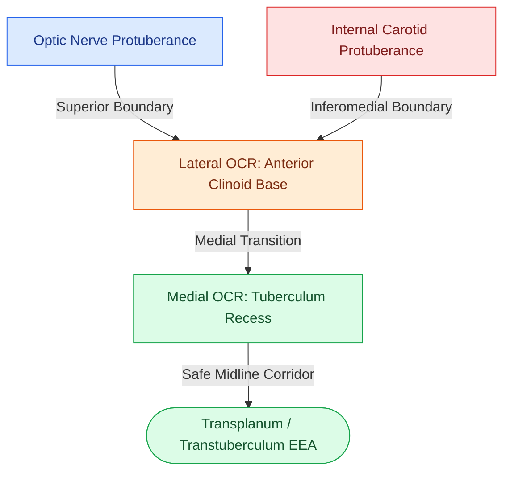

# The lateral and medial opticocarotid recesses define critical anatomical corridors in endoscopic skull base surgery

## Active Recall

> [!question]- What anatomic boundaries define the lateral opticocarotid recess (OCR), and what intracranial structure corresponds directly to this landmark on its external endocranial surface?
> *Answer / Clinical Rationale*: The **lateral opticocarotid recess (OCR)** is the bony indentation located between the **optic nerve protuberance superiorly** and the **internal carotid artery (ICA) parasellar/paraclival protuberance inferomedially**. The lateral OCR corresponds directly to the pneumatized base of the **anterior clinoid process (ACP)**. The oculomotor nerve (CN III) enters the upper superior orbital fissure immediately inferolateral to this landmark.

> [!question]- What is the clinical and surgical significance of the medial opticocarotid recess during transsphenoidal and suprasellar approaches?
> *Answer / Clinical Rationale*: The **medial OCR** represents the junction between the planum sphenoidale, tuberculum sellae, and the medial wall of the optic canal. It defines the **absolute lateral limit of safe bony drill-out** above the sella turcica during expanded endonasal approaches (EEA) for tuberculum sellae meningiomas and craniopharyngiomas; drilling lateral to the medial OCR directly risks lacerating the cavernous/ophthalmic ICA or severing the optic nerve.

## Core Clinical & Mechanistic Principles
During expanded endonasal endoscopic skull base surgery (EEA), the posterior sphenoid wall displays critical neurovascular protuberances that must be systematically mapped before bony removal. The **opticocarotid recesses (OCRs)** serve as key navigational waypoints dividing safe midline dural corridors from catastrophic neurovascular danger zones.

### Anatomic Distinctions Between Lateral and Medial OCR
1. **Lateral Opticocarotid Recess (Lateral OCR)**:
   - **Formed By**: Confluence of the optic canal superiorly and the carotid canal inferomedially.
   - **Internal Correlation**: Corresponds to the **optic strut** and pneumatic expansion of the **anterior clinoid process**.
   - **Cavernous Sinus Apex**: The cone-shaped apex of the cavernous sinus sits directly at the inferior aspect of the lateral OCR.
   - **Surgical Mandate**: Standard bilateral sellar exposure in skull base surgery requires skeletonization of the sphenoid wall laterally until the lateral OCR is clearly visualized bilaterally.
2. **Medial Opticocarotid Recess (Medial OCR)**:
   - **Formed By**: Bony triangular depression at the lateral extent of the tuberculum sellae where the medial optic canal merges with the subchiasmal sulcus.
   - **Surgical Relevance**: Serves as the lateral boundary for osteotomies during [[Transplanum and transtuberculum EEA corridors expose suprasellar craniopharyngiomas|transtuberculum and transplanum approaches]], protecting the intracranial subarachnoid carotid and prechiasmatic optic nerves.
3. **Onodi Cell Distortion**:
   - In patients with a pneumatized [[Onodi cells place the optic nerve and carotid artery at risk during posterior ethmoidectomy|sphenoethmoidal (Onodi) cell]] (7%–25% incidence), the optic nerve and lateral OCR may be situated within the posterior ethmoid rather than the true sphenoid sinus, increasing the risk of inadvertent blindness during posterior ethmoidectomy.

## Connected Concepts & Graph Traversal
- **Critical Vascular Neighbor**: [[Intraoperative ICA injury requires two-surgeon suction and crushed muscle patch hemostasis|ICA Injury Hemostasis Protocol]]
- **Anatomical Variant**: [[Onodi cells place the optic nerve and carotid artery at risk during posterior ethmoidectomy|Onodi Cell Optic Nerve Danger]]
- **Endoscopic Corridor**: [[Transplanum and transtuberculum EEA corridors expose suprasellar craniopharyngiomas|Transtuberculum Suprasellar EEA]]
- **Midline Sellar Access**: [[Transsellar EEA provides direct access to pituitary adenomas and Rathke cleft cysts|Transsellar Approach Protocol]]
- **Carotid Navigation**: [[Transpterygoid EEA exposes juvenile nasopharyngeal angiofibromas and lateral sphenoid defects|Vidian-to-Carotid Navigational Rule]]
