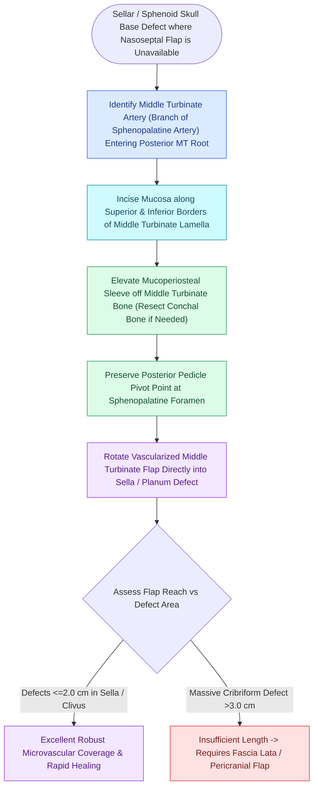

# The middle turbinate vascularized flap provides an alternative rescue flap for skull base repair

## Active Recall

> [!question]- What is the axial blood supply of the middle turbinate vascularized flap?
> *Answer / Clinical Rationale*: The **middle turbinate artery**, a major branch of the **posterior lateral nasal artery** arising from the sphenopalatine artery.

> [!question]- What skull base defects are ideally reconstructed with a middle turbinate flap?
> *Answer / Clinical Rationale*: Unilateral defects of the **fovea ethmoidalis, cribriform plate, planum sphenoidale, and sella turcica**.

## Core Clinical & Mechanistic Principles
When the primary [[Temporoparietal fascia free and pedicled flaps provide vascularized tissue when nasoseptal flaps fail|Hadad-Bassagasteguy]] nasoseptal flap is unavailable (due to prior septectomy, septal tumor involvement, or previous surgical harvest), the **Middle Turbinate Vascularized Flap (MT Flap)** serves as a robust local pedicled alternative for reconstructing defects of the **cribriform plate, fovea ethmoidalis, planum sphenoidale, and sella**.

### Reconstructive Reach & Limitations
- **Optimal Reach**: Anterior skull base (fovea ethmoidalis and cribriform plate) and anterior sella.
- **Limitation**: Smaller surface area than the nasoseptal flap; cannot cover large clival or transodontoid defects.

## Connected Concepts & Graph Traversal
- **Nasoseptal Flap Primary**: [[The Hadad-Bassagasteguy nasoseptal flap is pedicled on the posterior septal artery|Hadad-Bassagasteguy Flap]]
- **Inferior Turbinate Flap**: [[The inferior turbinate flap pedicled on the inferior turbinate artery repairs anterior floor defects|Inferior Turbinate Flap]]
- **Pericranial Reconstruction**: [[The endoscopic pericranial flap transposed through the nasion repairs large anterior skull base defects|Endoscopic Pericranial Flap]]
- **Basal Lamella Anchor**: [[The basal lamella of the middle turbinate divides anterior from posterior ethmoid cells|Basal Lamella of Middle Turbinate]]
- **Sphenopalatine Artery Landmark**: [[The crista ethmoidalis guides endoscopic sphenopalatine artery ligation|Crista Ethmoidalis & SPA]]
- **Flap Design**: [[The frontal sinus rescue procedure utilizes a medially based middle turbinate mucosal flap to resurface denuded bone and prevent Draf IIb ostial restenosis|Frontal Sinus Rescue Flap]]
