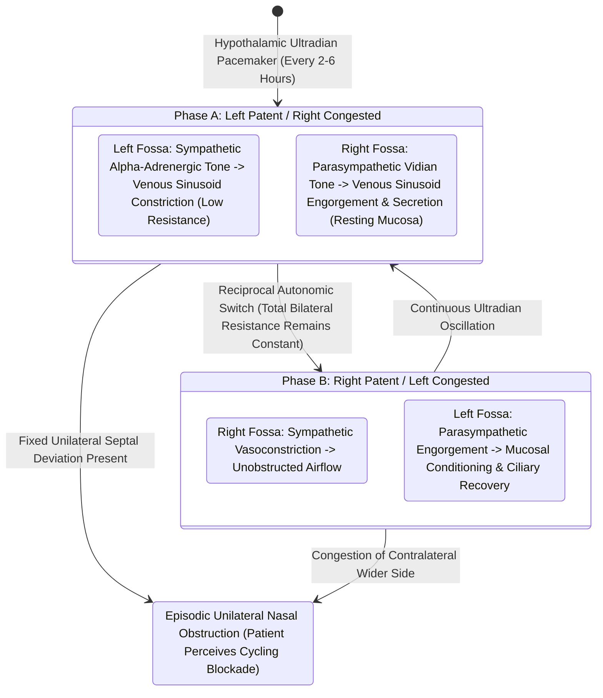

# The nasal cycle provides alternating autonomic mucosal congestion and decongestion

## Active Recall

> [!question]- Why do healthy individuals not perceive the significant airflow fluctuations caused by the nasal cycle?
> *Answer / Clinical Rationale*: Because total nasal airway resistance remains **constant**, as decongestion in one nasal fossa exactly compensates for congestion in the contralateral fossa.

> [!question]- What autonomic division mediates mucosal engorgement during the congested phase of the nasal cycle?
> *Answer / Clinical Rationale*: **Parasympathetic stimulation**, which causes dilation of large venous sinusoids (capacitance vessels) in the turbinate submucosa.

## Core Clinical & Mechanistic Principles
The **nasal cycle** is a normal, involuntary physiological rhythm characterized by **reciprocal, alternating congestion and decongestion of the venous sinusoids** in the inferior turbinates and nasal septum, regulated centrally by the anterior hypothalamus via the [[The Vidian nerve carries parasympathetic secretomotor and sympathetic vasomotor fibers|autonomic nervous system]].

It occurs in approximately **$80\%$ of healthy individuals**, with a cycle periodicity ranging from **$2\text{ to }6\text{ hours}$**:
- **Autonomic Mechanism**:
  1. **Congestion Phase (Parasympathetic Dominance)**: Postganglionic parasympathetic secretomotor fibers originating from the [[The sphenopalatine ganglion serves as the primary parasympathetic relay for the sinonasal cavity|sphenopalatine ganglion]] trigger acetylcholine and VIP release, dilating the large thin-walled venous sinusoids (capacitance vessels) in the turbinate submucosa, producing mucosal swelling and glandular secretion.
  2. **Decongestion Phase (Sympathetic Dominance)**: Superior cervical ganglion sympathetic fibers release norepinephrine and neuropeptide Y onto $\alpha_1$ and $\alpha_2$ adrenergic receptors, causing profound arteriolar and sinusoidal vasoconstriction, shrinking the turbinates and expanding the cross-sectional airway area.

### Total Resistance Invariance & Clinical Relevance
- **Constant Total Airway Resistance**: Although unilateral airflow fluctuates reciprocally between the two nostrils, the **total combined bilateral nasal airway resistance remains virtually constant**, rendering the cycle imperceptible to healthy individuals.
- **Symptomatic Unmasking by Structural Deviation**: When a patient possesses a fixed mechanical obstruction (such as a severe septal deflection or spur), the physiological cycle becomes highly symptomatic; when the open, non-deviated nostril enters its normal congested phase, total bilateral airway resistance spikes, producing severe episodic nasal obstruction.

## Connected Concepts & Graph Traversal
- **Autonomic Nerve Corridor**: [[The Vidian nerve carries parasympathetic secretomotor and sympathetic vasomotor fibers|Vidian Nerve Autonomic Transmission]]
- **Parasympathetic Ganglion Relay**: [[The sphenopalatine ganglion serves as the primary parasympathetic relay for the sinonasal cavity|Sphenopalatine Ganglion]]
- **Vasomotor Dysregulation**: [[Rhinitis subtypes are differentiated into allergic, vasomotor, gustatory, and rhinitis medicamentosa|Vasomotor Rhinitis & Neurogenic Tone]]
- **Surgical Neurectomy Counterpart**: [[Transnasal endoscopic vidian neurectomy treats refractory non-allergic cholinergic rhinitis|Transnasal Vidian Neurectomy]]
- **🔗 Turbinate Reduction Target (Pediatrics)**: [[Radiofrequency ablation of the inferior turbinates and soft palate stiffens tissue through submucosal fibrosis|Inferior Turbinate Volume Reduction]]
- **Physiological Basis**: [[Inferior turbinate submucosal resection with outfracture provides durable volume reduction while preserving ciliated mucosal function|Submucosal IT Resection]]
