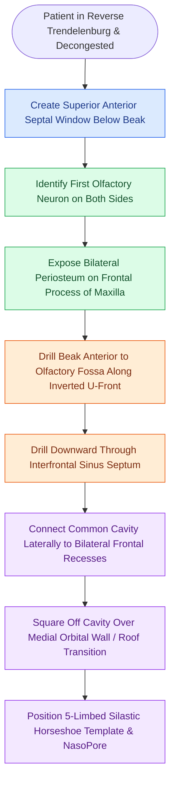

# The outside-in Draf III modified endoscopic Lothrop procedure establishes anterior septal and olfactory boundaries before drilling the nasofrontal beak

## Active Recall

> [!question]- Why does the outside-in modified endoscopic Lothrop procedure (MELP) offer greater surgical safety in revision cases than the traditional inside-out technique?
> *Answer / Clinical Rationale*: In revision cases, the frontal recess is frequently scarred, filled with neo-osteogenic bone, or anatomically distorted. The outside-in approach avoids initial dissection within this scarred recess; instead, it establishes fixed, reliable landmarks outside the diseased area (anterior septal window, olfactory neuron, and frontal process of maxilla) and drills the beak from anterior-to-posterior.

> [!question]- What anatomical structure marks the strict posterior limit of drilling during the outside-in common frontal sinusotomy?
> *Answer / Clinical Rationale*: The first olfactory neuron (olfactory filum) on each side, which marks the forward projection of the olfactory fossa and cribriform plate. Drilling posterior to this landmark causes dural violation, olfactory nerve avulsion, and cerebrospinal fluid rhinorrhea.

> [!question]- What template design and dressing are placed at the completion of a Draf III procedure to prevent circumferential stenosis?
> *Answer / Clinical Rationale*: A customized $0.5\text{ mm}$ thick Silastic sheet cut into a five-limbed template (resembling an inverted U or "horseshoe") is placed across the neo-ostium, supported inferiorly by resorbable NasoPore packing, to separate the raw bony edges and middle turbinate remnants during early re-epithelialization.

## Core Clinical & Mechanistic Principles
The common frontal sinusotomy, or [[Draf III modified Lothrop unites both frontal sinuses into a common cavity]], transforms narrow, diseased bilateral frontal outflow tracts into a single spacious, horseshoe-shaped opening. Developed by Harvey and Sacks, the **outside-in MELP** addresses the principal hazard of traditional Lothrop surgery: navigating heavily scarred frontal recesses with neo-osteogenesis.

By defining boundaries in virgin anatomical planes and utilizing [[First olfactory filum marks the posterior limit of frontal drill-out to avoid CSF leak]], the surgeon drills the thick bone of the nasofrontal beak before ever opening the scarred frontal recess. High-speed burs (such as a $15^\circ$ angled Medtronic Straightshot M5 diamond drill with integrated distal suction-irrigation) prevent bone heating, adhering to principles in [[Curved diamond and cutting burrs with continuous irrigation prevent frontal beak thermal osteonecrosis]].

### Operative Steps of the Outside-In Approach
1. **Patient Preparation and Septal Window**:
   - The surgical table is placed in $15^\circ\text{ to }20^\circ$ reverse Trendelenburg with the neck extended over a shoulder roll.
   - Under $0^\circ$ endoscopy, create an anterior-superior septal window: needle-tip electrocautery scores mucosa $1\text{ cm}$ below the skull base anterior to the middle turbinate. A $2\text{ mm}$ Kerrison rongeur removes perpendicular plate cartilage and bone, creating a wide through-and-through communication.
2. **Establishing Fixed Boundaries**:
   - *Posterior Limit*: Identify the first olfactory neuron emerging into the olfactory cleft. Bipolar electrocautery seals mucosal margins anterior to this filum.
   - *Lateral Limits*: Expose the periosteum over the frontal process of the maxilla bilaterally, which marks the anterior projection of the medial orbital wall.
   - *Anterior Limit*: The periosteum overlying the glabellar skin on the anterior table.
3. **Beak Drill-Out Along Inverted U-Front**:
   - A high-speed $15^\circ$ rough diamond drill ($4.5\text{ mm}$ head, $30,000\text{ rpm}$) drills the nasofrontal beak along an inverted U-shaped front between the exposed maxilla boundaries, well anterior to the olfactory fossa.
   - Drilling continues superiorly until entering both frontal sinuses from below.
4. **Interfrontal Septectomy and Lateral Extension**:
   - Drill the interfrontal septum completely flush with the anterior and posterior tables.
   - Drill laterally over the transition of the medial orbital wall to the orbital roof to "square off" the cavity and maximize neo-ostium dimensions.
   - Finally, connect the common neo-ostium back to the bilateral frontal recesses, creating an expansive, unified cavity.
5. **Silastic Horseshoe Stenting**:
   - A customized $0.5\text{ mm}$ Silastic sheet with distinct limbs corresponding to the right/left frontal sinus, right/left ethmoid cavity, and septal window is placed and supported with NasoPore, remaining for $2\text{ to }3\text{ weeks}$.

## Connected Concepts & Graph Traversal
- **Unilateral Extended Drill-Out**: [[Draf IIb versus Draf III modified Lothrop procedures differentiate unilateral middle turbinate resection from bilateral interfrontal septectomy and sinus floor drill-out|Draf IIb vs Draf III Comparison]]
- **Restenosis Resurfacing Protocol**: [[Nasal beak drill-out and mucosal grafting prevent neo-ostium restenosis in Draf III|Nasal Beak Drill-Out Grafting]]
- **Open Surgical Obliteration**: [[Osteoplastic flap with frontal sinus obliteration manages lateral frontal disease and osteomyelitis|Osteoplastic Flap Obliteration]]
- **Percutaneous Surgical Port**: [[Frontal sinus trephination provides combined endoscopic and percutaneous visualization and irrigation|Frontal Sinus Trephination]]
- **Olfactory Function Protection**: [[Preserving the superior septal mucosal strip prevents post-NSF anosmia|Superior Septal Olfactory Preservation]]
