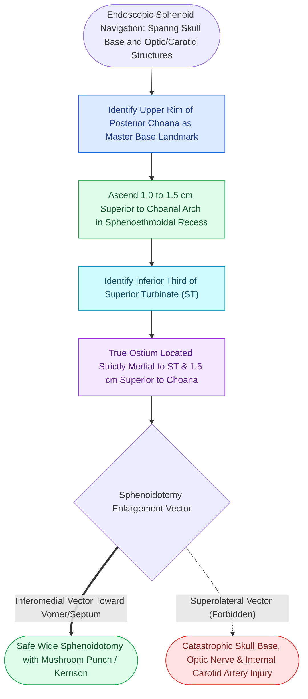

# The sphenoid sinus ostium lies medial to the superior turbinate above the choana

## Active Recall

> [!question]- What is the standard anatomical distance from the anterior nasal sill to the natural sphenoid sinus ostium?
> *Answer / Clinical Rationale*: Approximately **$7.0\text{ cm}$** from the anterior nasal spine at an angle of roughly $30^\circ$ to the nasal floor.

> [!question]- Why must sphenoidotomy enlargement be directed inferomedially rather than superolaterally?
> *Answer / Clinical Rationale*: The superolateral wall of the sphenoid sinus contains the **internal carotid artery** and the **optic nerve** (which may be dehiscent). Inferomedial enlargement toward the vomer/septum avoids these catastrophic neurovascular structures.

## Core Clinical & Mechanistic Principles
**Sphenoidotomy** (Step 6 of FESS) provides wide drainage of the sphenoid sinus and serves as the primary gateway to the sella, clivus, and expanded skull base. Identifying the **natural sphenoid sinus ostium** relies on constant anatomical measurements and its invariable relationship to the **superior turbinate** and **posterior choana**.

### Step-by-Step Sphenoidotomy Protocol
1. **Transnasal / Sphenoethmoidal Recess Approach**:
   - Advance a $0^\circ$ endoscope along the nasal septum into the **sphenoethmoidal recess**.
   - Locate the superior turbinate. The natural sphenoid ostium is located **medial to the inferior 1/3 of the superior turbinate**, approximately **$1.5\text{ cm}$ superior to the choanal arch**.
2. **Partial Superior Turbinate Resection**:
   - Resect the lower 1/3 of the superior turbinate with endoscopic scissors or [[Powered microdebrider blade selection and suction irrigation maintain clean surgical optics|microdebrider]] to achieve wide, unobstructed visualization of the anterior sphenoid face.
3. **Ostial Enlargement**:
   - Enlarge the ostium **inferiorly and medially** toward the nasal septum using a mushroom punch, Kerrison rongeur, or diamond burr.
   - **CRITICAL LANDMARK SAFETY RULE**: Never enlarge the sphenoid ostium superolaterally, where the **internal carotid artery** and **optic nerve** lie immediately behind the bone.

## Connected Concepts & Graph Traversal
- **Preceding Step**: [[Posterior ethmoidectomy requires dissecting along the skull base from posterior to anterior|Posterior Ethmoidectomy]]
- **Pneumatization Hazards**: [[Sphenoid sinus pneumatization patterns dictate carotid and optic canal exposure|Sphenoid Pneumatization]]
- **Onodi Hazard**: [[Onodi cells place the optic nerve and carotid artery at risk during posterior ethmoidectomy|Onodi Cell Danger]]
- **Carotid Crisis**: [[Intraoperative ICA injury requires two-surgeon suction and crushed muscle patch hemostasis|ICA Management]]
- **Anatomical Foundation**: [[Sphenoidotomy utilizes superior turbinate resection or the Bolger box parallelogram to identify the natural ostium while preventing Onodi cell injury|Bolger Box Sphenoidotomy]]
