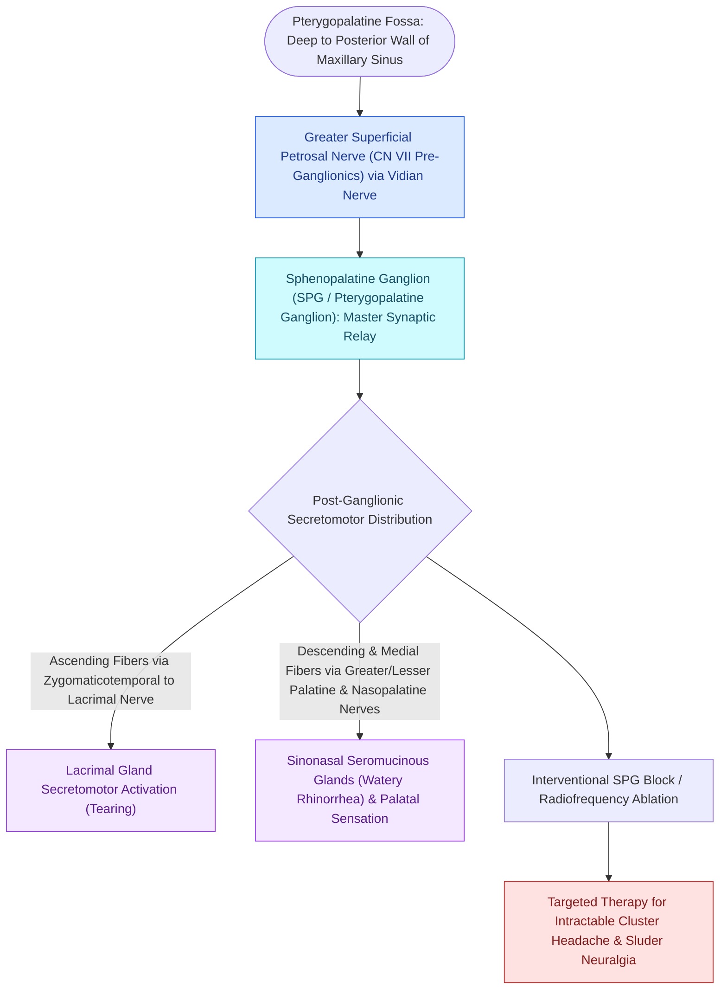

# The sphenopalatine ganglion serves as the primary parasympathetic relay for the sinonasal cavity

## Active Recall

> [!question]- Which neural fibers synapse within the sphenopalatine ganglion, and which pass through without synapsing?
> *Answer / Clinical Rationale*: **Parasympathetic preganglionic fibers (from Greater Petrosal Nerve / CN VII)** synapse in the SPG. **Sympathetic fibers (Deep Petrosal Nerve)** and **sensory fibers (CN V2)** pass directly through without synapsing.

> [!question]- What secretomotor effect results from postganglionic parasympathetic stimulation from the SPG?
> *Answer / Clinical Rationale*: Profuse **seromucinous nasal glandular secretion (watery rhinorrhea)** and capacitance vessel vasodilation causing mucosal swelling.

## Core Clinical & Mechanistic Principles
The **Sphenopalatine Ganglion (SPG / Pterygopalatine Ganglion)** is the largest parasympathetic peripheral ganglion of the head, located in the **pterygopalatine fossa (PPF)** immediately posterior to the middle turbinate attachment and deep to the sphenopalatine foramen.

### Clinical & Procedural Applications
- **SPG Block for Rhinitis & Cluster Headaches**: Transnasal endoscopic or transoral greater palatine injection of local anesthetic blocks parasympathetic hyperactivity in [[Transnasal endoscopic vidian neurectomy treats refractory non-allergic cholinergic rhinitis|vasomotor rhinitis]] and terminates acute cluster headaches.
- **Surgical Corridor**: Accessed during transpterygoid expanded skull base approaches (see [[Transpterygoid EEA exposes juvenile nasopharyngeal angiofibromas and lateral sphenoid defects|Transpterygoid EEA]]).

## Connected Concepts & Graph Traversal
- **Vasomotor Rhinitis Autonomics**: [[Rhinitis subtypes are differentiated into allergic, vasomotor, gustatory, and rhinitis medicamentosa|Vasomotor Rhinitis]]
- **Vascular Sphenopalatine Branch**: [[The crista ethmoidalis guides endoscopic sphenopalatine artery ligation|Crista Ethmoidalis & SPA]]
- **Mucosal Contact Point Pain**: [[Rhinogenic contact point headache arises from mucosal contact between the nasal septum and turbinates|Rhinogenic Contact Point Headache]]
- **Nasoseptal Pedicle Supply**: [[The Hadad-Bassagasteguy nasoseptal flap is pedicled on the posterior septal artery|Posterior Septal Neurovascular Pedicle]]
- **Allergy Sensitization Driver**: [[Intradermal dilutional testing IDT and modified quantitative testing MQT quantify allergic sensitization to guide safe immunotherapy escalation|Allergic Autonomic Reflexes]]
