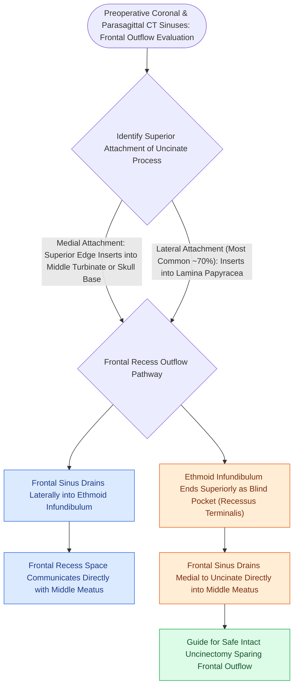

# The uncinate process superior attachment dictates the frontal sinus drainage pathway

## Active Recall

> [!question]- If coronal CT demonstrates the uncinate process inserting onto the lamina papyracea, where does the frontal sinus drain relative to the uncinate?
> *Answer / Clinical Rationale*: The frontal sinus drains **medial to the uncinate process directly into the middle meatus**, because the lateral attachment creates a blind-ending recessus terminalis within the infundibulum.

> [!question]- Why does an uncinate process attaching to the anterior skull base increase the risk of [[Iatrogenic skull base cribriform leaks require immediate intraoperative multi-layer graft repair|iatrogenic CSF leak]] during uncinectomy?
> *Answer / Clinical Rationale*: Forceful twisting or tearing of the superior uncinate remnant can fracture the paper-thin ethmoid roof at its insertion, creating a dural tear and CSF fistula.

## Core Clinical & Mechanistic Principles
The **uncinate process** is a sickle-shaped, paper-thin bone of the ethmoid labyrinth that forms the medial wall of the ethmoid infundibulum. While its anterior attachment is consistently to the posterior border of the lacrimal bone and its inferior attachment is to the ethmoidal process of the inferior turbinate, its **superior attachment** exhibits three major anatomical variations that directly govern the drainage pathway of the frontal sinus.

### The Three Superior Attachment Variations

1. **Attachment to Lamina Papyracea ($\sim 80\%$, Most Common)**:

   - The superior uncinate curves laterally to insert directly onto the **[[Draf IIb frontal sinusotomy extends from lamina papyracea to the nasal septum|lamina papyracea]]**.
   - The ethmoid infundibulum ends superiorly as a blind-ending pocket called the **recessus terminalis**.
   - **Frontal Drainage Pathway**: The frontal sinus drains **medial to the uncinate process**, emptying directly into the **middle meatus**.
2. **Attachment to Anterior Skull Base ($\sim 15\%$)**:
   - The superior uncinate extends vertically to insert onto the ethmoid roof (cribriform / fovea ethmoidalis).
   - The ethmoid infundibulum is open superiorly.
   - **Frontal Drainage Pathway**: The frontal sinus drains **directly into the ethmoid infundibulum** (lateral to the uncinate).
3. **Attachment to Middle Turbinate ($\sim 5\%$)**:
   - The superior uncinate reflects medially to fuse with the junction of the vertical and horizontal lamellae of the middle turbinate.
   - **Frontal Drainage Pathway**: The frontal sinus drains **directly into the ethmoid infundibulum**.

## Surgical Significance in FESS
- **Uncinectomy Execution**: During uncinectomy, failing to identify the superior attachment leads to incomplete clearance of the uncinate root, leaving a residual superior uncinate flake that obstructs the frontal recess (a leading cause of revision frontal surgery).
- **Protecting the Skull Base**: In patients with uncinate attachment to the skull base (15%), traction on the uncinate during removal can transmit shearing forces directly to the cribriform plate, causing an iatrogenic skull base fracture and CSF leak.

## Connected Concepts & Graph Traversal
- **Surgical Step**: [[Incisive uncinectomy exposes the ethmoid infundibulum while protecting the nasolacrimal duct|Incisive Uncinectomy Technique]]
- **Outflow Space**: [[The frontal recess is bounded by the agger nasi, middle turbinate, and skull base|Frontal Recess 3D Boundaries]]
- **Radiological Checklist**: [[The CLOSE checklist systematically evaluates critical radiological danger zones|CLOSE Checklist (Cribriform & Lamina)]]
- **Infundibulum Anatomy**: [[The hiatus semilunaris and infundibulum form the primary drainage channel of the ostiomeatal complex|Hiatus Semilunaris & Infundibulum]]
- **Surgical Technique**: [[Endoscopic dacryocystorhinostomy bypasses nasolacrimal duct obstruction via lacrimal sac marsupialization into the middle meatus|Endoscopic DCR Technique]]
