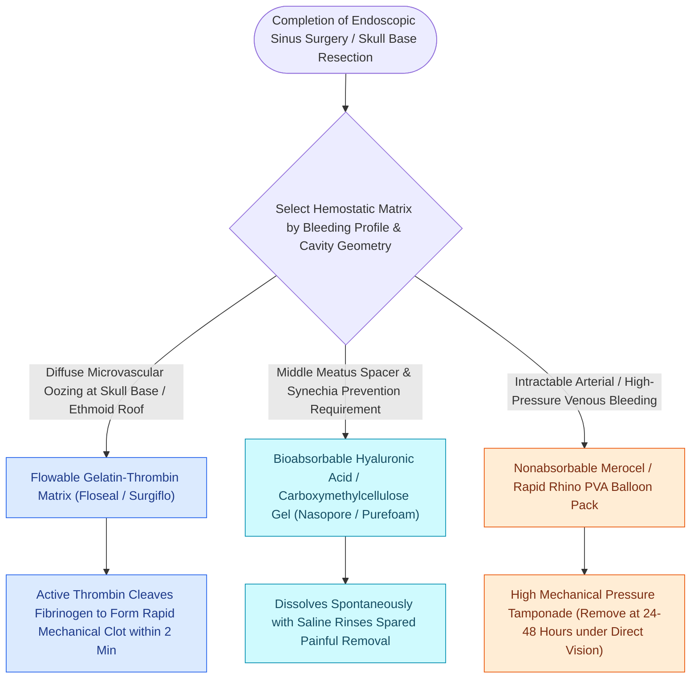

# Topical hemostatic matrix agents and nasal packing mitigate postoperative epistaxis and synechiae

## Active Recall

> [!question]- How does Floseal achieve rapid hemostasis in mucosal sinus bleeding?
> *Answer / Clinical Rationale*: It delivers concentrated **cross-linked gelatin granules combined with human thrombin**, which swells to provide mechanical tamponade while thrombin directly triggers local fibrin clot formation.

> [!question]- Why has dissolvable carboxymethylcellulose packing largely replaced non-absorbable packs in modern FESS?
> *Answer / Clinical Rationale*: Dissolvable packing eliminates the pain, mucosal trauma, and secondary bleeding associated with pack removal, while stenting the middle meatus and supporting mucociliary regeneration.

## Core Clinical & Mechanistic Principles
Postoperative management in FESS balances effective **hemostasis** against the prevention of **synechiae (adhesions)** and the promotion of normal **ciliary re-epithelialization**.

### Middle Meatal Stenting
- Placing a dissolvable spacer in the middle meatus medializes the middle turbinate during the initial 7–10 days of healing, preventing **[[Middle turbinate lateralization causes secondary ostiomeatal obstruction and frontal sinus stenosis|middle turbinate lateralization]]** and secondary frontal/maxillary ostial stenosis.

## Connected Concepts & Graph Traversal
- **Turbinate Position**: [[Middle turbinate lateralization causes secondary ostiomeatal obstruction and frontal sinus stenosis|Middle Turbinate Lateralization]]
- **Debridement**: [[Postoperative FESS debridement timing and technique prevent crusting and synechiae formation|Postoperative Debridement]]
- **Steroid Stent**: [[Steroid-eluting sinus implants deliver localized anti-inflammatory therapy to prevent restenosis|Steroid-Eluting Implants]]
- **Surgical Craft**: [[TIVA and greater palatine canal blocks optimize surgical field visibility in FESS|FESS Hemostasis Optimization]]
- **Structural / Flap Alternative**: [[Temporoparietal fascia free and pedicled flaps provide vascularized tissue when nasoseptal flaps fail|Temporoparietal Fascia Flap (TPFF)]]
- **Critical Safety / Complication**: [[Esthesioneuroblastoma Kadish and Hyams staging determines craniofacial resection and adjuvant therapy|Esthesioneuroblastoma (ENB)]]
