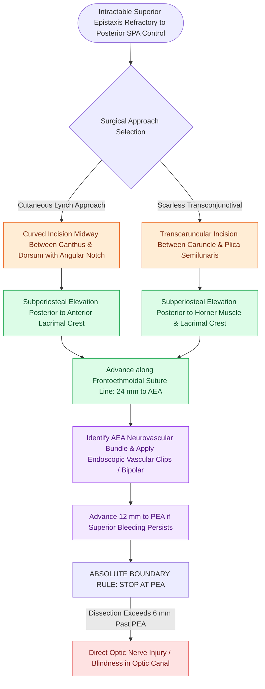

# Transcaruncular and Lynch external approaches provide direct access to the frontoethmoidal suture line for anterior ethmoidal artery ligation in refractory epistaxis

## Active Recall

> [!question]- What is the key aesthetic and structural advantage of the transcaruncular approach compared to the traditional Lynch frontoethmoidal incision?
> *Answer / Clinical Rationale*: The transcaruncular approach traverses the conjunctival plane between the caruncle and plica semilunaris to reach the subperiosteal medial orbital wall without an external cutaneous facial scar or the risk of medial canthal web contracture associated with a Lynch incision.

> [!question]- How does the frontoethmoidal suture line guide dissection, and what is the absolute posterior safety boundary along the medial orbital wall?
> *Answer / Clinical Rationale*: The frontoethmoidal suture marks the exact cranial level of the ethmoid roof (fovea ethmoidalis) and contains the anterior and posterior ethmoidal foramina. Dissection must never advance more than 6 mm posterior to the posterior ethmoidal artery, as the optic canal lies precisely 6 mm posterior to the PEA.

## Core Clinical & Mechanistic Principles
When severe anterior or superior epistaxis fails to respond to sphenopalatine artery ligation and anterior packing, the bleeding almost always originates from the anterior ethmoidal artery (an internal carotid branch). In traumatic epistaxis, craniofacial fractures, or acute emergencies where extensive sinus surgery and skull base exposure are undesirable, external access provides rapid, definitive vascular control.

External orbitotomy relies upon the constant landmarks of the medial orbital wall governed by [[The 24-12-6 rule governs anterior and posterior ethmoidal artery surgical localization|the 24-12-6 metric rule]]. Dissection proceeds in the subperiosteal plane along the **frontoethmoidal suture line**, which delineates the roof of the ethmoid labyrinth and the floor of the anterior cranial fossa. Furthermore, understanding medial canthal and lid anatomy is vital to avoid post-orbitotomy lid retraction, as treated in [[Lateral canthopexy and lateral tarsal strip suspension prevent post-blepharoplasty ectropion|canthal suspension principles]].

### Surgical Approaches: Lynch Incision vs Transcaruncular Corridor
1. **Lynch Frontoethmoidal Incision**:
   - A curvilinear incision is made midway between the medial canthus and the nasal dorsum.
   - *The Anti-Webbing Notch*: A critical angular notch is incorporated at the level of the medial canthus. Straight vertical incisions across the concavity of the medial canthus contract under tension, producing a visible, disfiguring epicanthal web.
   - Dissection is carried sharply through orbicularis oculi directly to periosteum, preserving the angular vessels.
2. **Transcaruncular Transconjunctival Corridor**:
   - Topical tetracaine and 1% lidocaine with epinephrine are injected into the caruncular bed.
   - An incision is placed between the caruncle and the plica semilunaris. Dissection proceeds bluntly posterior to Horner's muscle to incise the periorbita immediately posterior to the posterior lacrimal crest.
   - This approach eliminates all external facial incisions and completely avoids epicanthal webbing.
3. **Subperiosteal Dissection & 24-12-6 Metric Traversal**:
   - Using a Freer elevator, the periorbita is elevated off the lamina papyracea directly along the frontoethmoidal suture line.
   - Soft tissues of the orbit are gently retracted laterally using a malleable retractor. The superior oblique muscle remains shielded within the superior orbital fascial envelope above the plane of dissection.
   - **24 mm**: The anterior ethmoidal artery and nerve emerge from the anterior ethmoidal foramen 24 mm posterior to the anterior lacrimal crest.
   - **12 mm**: The posterior ethmoidal artery emerges 12 mm posterior to the AEA.
   - **6 mm**: The optic canal lies only 6 mm posterior to the PEA. Subperiosteal dissection must **never extend beyond the PEA** without continuous magnified direct visualization.
4. **Vascular Occlusion and Complication Avoidance**:
   - Two titanium endoscopic vascular clips are applied to the vessel, or bipolar electrocautery is performed using fine insulated forceps. Excessive thermal energy must be avoided to prevent thermal injury to the adjacent optic nerve.
   - Postoperative care mandates hourly visual acuity and pupillary light reflex assessments for 6 hours to detect early orbital hematoma.

## Connected Concepts & Graph Traversal
- **Endoscopic Endonasal Counterpart**: [[Endoscopic endonasal anterior ethmoidal artery ligation requires skull base skeletonization to prevent orbital fat prolapse and vessel retraction]]
- **Orbital Compartment Syndrome**: [[Retrobulbar hematoma requires emergent bedside lateral canthotomy and cantholysis]]
- **Pneumatization Variants**: [[Supraorbital ethmoid cells suspend the anterior ethmoidal artery below the skull base]]
- **Radiologic Danger Checkpoints**: [[The CLOSE checklist systematically evaluates critical radiological danger zones]]
- **🔗 Canthal Tendon Complex (FPRS)**: [[Naso-orbito-ethmoid NOE fractures staged by Markowitz and Manson require medial canthal tendon fixation]]
