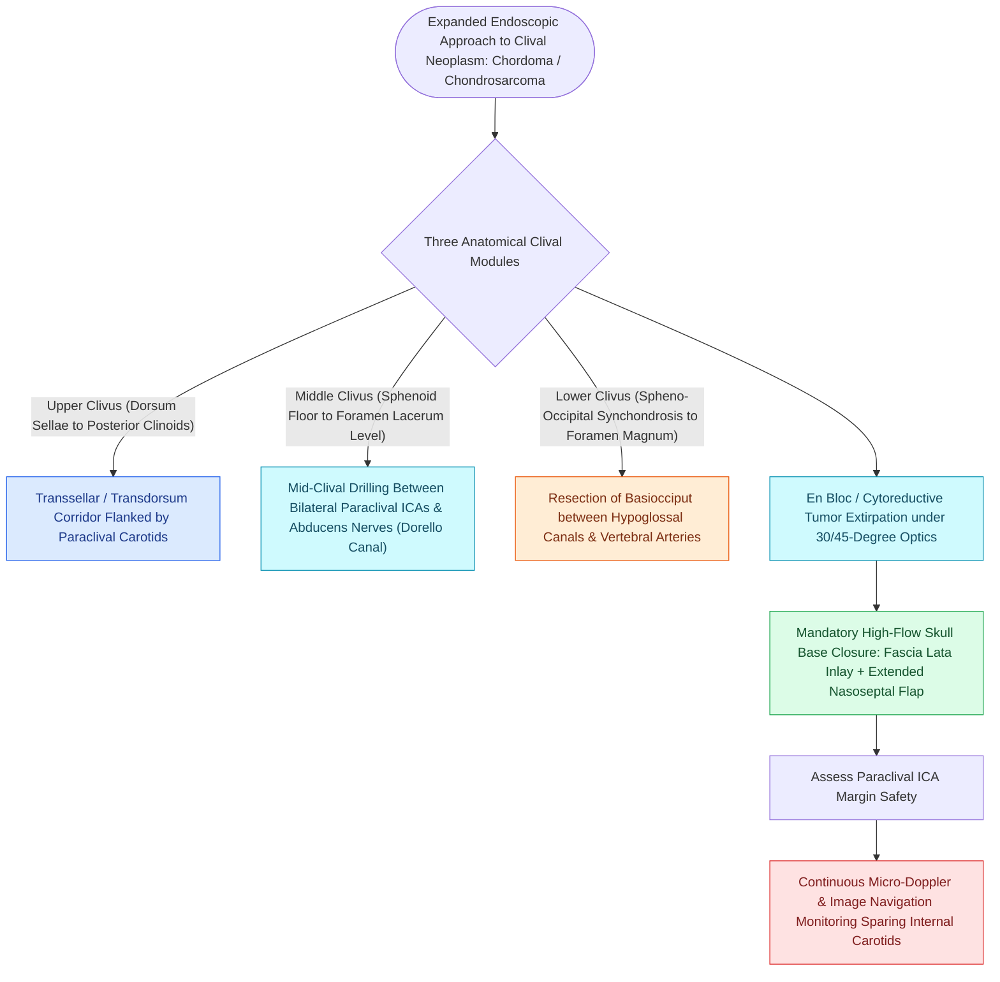

# Transclival EEA provides midline access to clival chordomas and chondrosarcomas

## Active Recall

> [!question]- What structures form the lateral boundaries of the surgical working corridor in a transclival approach?
> *Answer / Clinical Rationale*: The **paraclival internal carotid arteries (ICAs)** bilaterally.

> [!question]- From what embryonic structure do clival chordomas originate, and what is their classic histological hallmark?
> *Answer / Clinical Rationale*: They originate from persistent **notochord remnants**, and their histological hallmark is the presence of **physaliferous cells** (large, vacuolated, mucin-filled cells).

## Core Clinical & Mechanistic Principles
The **Transclival Expanded [[Diagnostic rigid nasal endoscopy utilizes a standardized three-pass examination sequence|Endoscopic]] Approach** exposes the central **skull base clivus**, posterior cranial fossa dura, basilar artery, and ventral brainstem (pons and medulla) from the dorsum sellae superiorly to the foramen magnum and odontoid peg inferiorly.

### Lateral Boundaries & Neurovascular Landmarks
- **Lateral Vascular Boundaries**: The **bilateral paraclival internal carotid arteries**. The inter-carotid distance at the mid-clivus is typically **$1.5\text{–}2.0\text{ cm}$**. Dissection requires continuous micro-Doppler ultrasound tracking.
- **Abducens Nerve (CN VI) in Dorello's Canal**: Crosses from the posterior fossa into the cavernous sinus at the junction of the petrous apex and upper clivus; extreme risk of injury during lateral clival bone resection.
- **Primary Pathology Targets**:
  - **Chordoma**: Malignant bone tumor arising from embryonic **notochord remnants** in the clivus; characteristic physaliferous cells on histology; high recurrence without complete resection.
  - **Chondrosarcoma**: Arises from petroclival synchondroses; cartilaginous matrix.

## Connected Concepts & Graph Traversal
- **Carotid Protection**: [[Intraoperative ICA injury requires two-surgeon suction and crushed muscle patch hemostasis|Carotid Artery Crisis Protocol]]
- **Multi-Layer Reconstruction**: [[Multi-layer skull base reconstruction combines underlay, inlay, and overlay barriers|Multi-Layer Skull Base Repair]]
- **Flap Closure**: [[The Hadad-Bassagasteguy nasoseptal flap is pedicled on the posterior septal artery|Nasoseptal Flap]]
- **Diagnostic Evaluation**: [[Transcribriform EEA provides access to olfactory groove meningiomas and esthesioneuroblastomas|Transcribriform EEA Corridor]]
- **Anatomical Foundation**: [[Transplanum and transtuberculum EEA corridors expose suprasellar craniopharyngiomas|Transplanum EEA Corridor]]
- **Surgical Craft**: [[Transpterygoid EEA exposes juvenile nasopharyngeal angiofibromas and lateral sphenoid defects|Transpterygoid EEA Corridor]]
- **Surgical Corridor**: [[Transclival endoscopic corridors expose posterior fossa neoplasms between the paraclival carotids and basilar artery boundaries|Transclival Corridor]]
