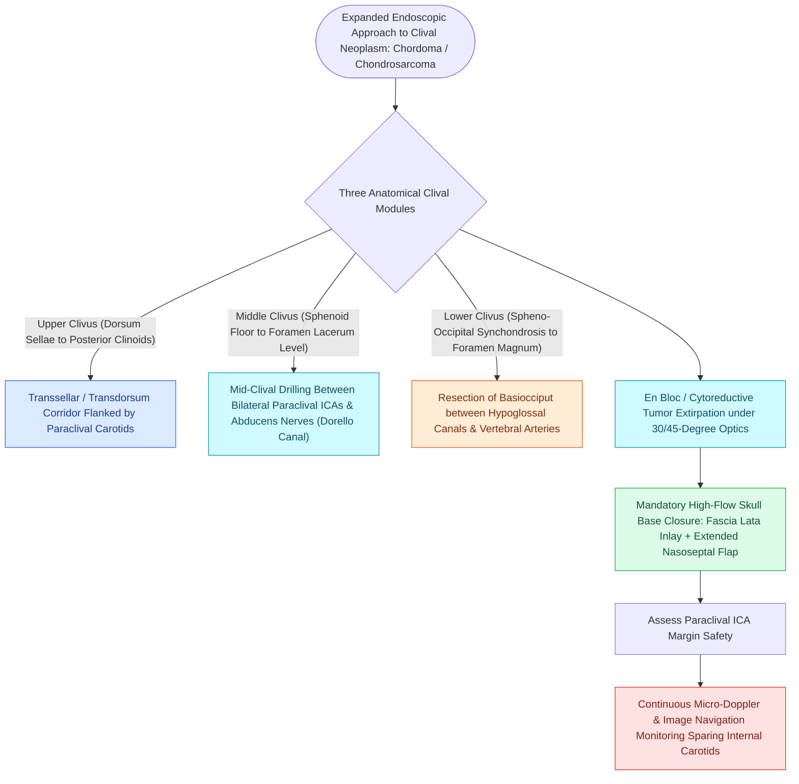

# Transclival EEA provides midline access to clival chordomas and chondrosarcomas

## Active Recall

> [!question]- What structures form the lateral boundaries of the surgical working corridor in a transclival approach?
> *Answer / Clinical Rationale*: The **paraclival internal carotid arteries (ICAs)** bilaterally.

> [!question]- From what embryonic structure do clival chordomas originate, and what immunohistochemical profile distinguishes them from petroclival chondrosarcomas?
> *Answer / Clinical Rationale*: **Chordomas** arise from midline **notochord remnants**, contain vacuolated mucin-filled **physaliferous cells**, and stain strongly positive for **brachyury, cytokeratin, and EMA**. Conversely, **chondrosarcomas** arise off-midline from petroclival synchondroses, show hyaline cartilage matrix with ring-and-arc calcification, and stain **S100-positive but negative for brachyury and cytokeratin**.

> [!question]- What arterial structures lie immediately posterior to the clival dura in the middle and lower transclival corridors?
> *Answer / Clinical Rationale*: The **basilar artery trunk** in the prepontine cistern, its branching **anterior inferior cerebellar arteries (AICA)** (closely associated with CN VI, VII, and VIII) and **superior cerebellar arteries (SCA)**, and the **vertebrobasilar junction** formed by the bilateral vertebral arteries.

## Core Clinical & Mechanistic Principles
The **Transclival Expanded [[Diagnostic rigid nasal endoscopy utilizes a standardized three-pass examination sequence|Endoscopic]] Approach** exposes the central **skull base clivus**, posterior cranial fossa dura, basilar artery, and ventral brainstem (pons and medulla) from the dorsum sellae superiorly to the foramen magnum and odontoid peg inferiorly.

### Modular Clival Zones, Neurovascular Boundaries & Intradural Reconstruction
Initial lateral orientation identifies the [[The Vidian nerve carries parasympathetic secretomotor and sympathetic vasomotor fibers|vidian nerve]] while safeguarding the paraclival [[Intersphenoid sinus septations frequently insert directly onto the internal carotid canal|carotid canal]] using CTA-fused navigation and micro-Doppler ultrasound:
- **Upper Clivus**: Dorsum sellae/posterior clinoids down to the sellar floor; flanked by cavernous ICA siphons and CN III/IV.
- **Middle Clivus**: Sellar floor to foramen lacerum/sphenoid floor; bounded laterally by the **bilateral paraclival ICAs** (inter-carotid distance **$1.5\text{–}2.0\text{ cm}$**) and the **abducens nerve (CN VI)** entering **Dorello's canal** beneath Gruber's (petrosphenoidal) ligament.
- **Lower Clivus**: Spheno-occipital synchondrosis to foramen magnum; bounded laterally by hypoglossal canals (CN XII), occipital condyles, and jugular tubercles.
- **Intradural Vascular Architecture & Drilling**: Directly deep to middle/lower clival dura lie the **basilar artery trunk**, **vertebrobasilar junction**, **AICA** (junction of middle/lower basilar thirds near CN VI/VII/VIII), and **SCA/PCA** at the interpeduncular cistern. Bone removal uses **$3\text{–}4\text{ mm}$ diamond burrs** with continuous high-volume saline irrigation to prevent thermal vessel injury.
- **Primary Pathology Targets**: **Chordoma** (midline notochord, physaliferous cells, brachyury+/CK+/EMA+) vs **Chondrosarcoma** (off-midline petroclival synchondrosis, S100+, brachyury-).
- **High-Flow Closure**: Dependent posterior fossa CSF defects require a **fascia lata inlay/underlay**, extended Hadad-Bassagasteguy nasoseptal flap overlay, sealant, and a **48–72 hour lumbar drain**.

## Connected Concepts & Graph Traversal
- **Carotid Protection**: [[Intraoperative ICA injury requires two-surgeon suction and crushed muscle patch hemostasis|Carotid Artery Crisis Protocol]]
- **Multi-Layer Reconstruction**: [[Multi-layer skull base reconstruction combines underlay, inlay, and overlay barriers|Multi-Layer Skull Base Repair]]
- **Flap Closure**: [[The Hadad-Bassagasteguy nasoseptal flap is pedicled on the posterior septal artery|Nasoseptal Flap]]
- **Intracranial Pressure Diversion**: [[Lumbar drain placement and ICP management lower the risk of postoperative CSF fistula recurrence|Lumbar Drain Management]]
- **Radiological Danger Zones**: [[Opticocarotid recesses on coronal CT demarcate the paraclinoid ICA and optic strut|Opticocarotid Recesses on CT]]
- **Adjacent Ventral Corridor**: [[Transodontoid EEA provides direct anterior access for basilar invagination and pannus decompression|Transodontoid EEA Corridor]]
- **Lateral Skull Base Corridor**: [[Transpterygoid EEA exposes juvenile nasopharyngeal angiofibromas and lateral sphenoid defects|Transpterygoid EEA Corridor]]
