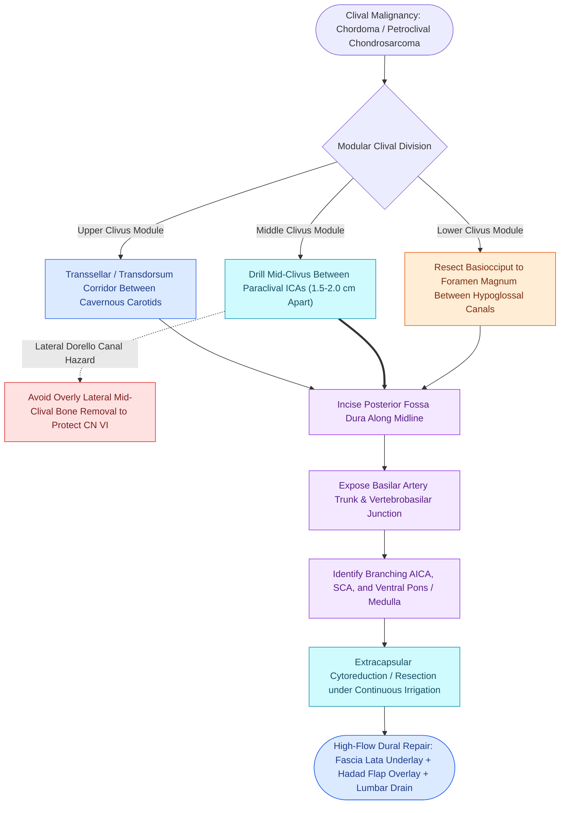

# Transclival endoscopic corridors expose posterior fossa neoplasms between the paraclival carotids and basilar artery boundaries

## Active Recall

> [!question]- What histopathological and immunohistochemical findings definitively distinguish clival chordomas from petroclival chondrosarcomas?
> *Answer / Clinical Rationale*: **Chordomas** arise from midline notochord remnants, contain vacuolated **physaliferous cells**, and stain strongly positive for **brachyury, cytokeratin, and EMA**; **chondrosarcomas** arise from off-midline petroclival synchondroses, exhibit hyaline cartilage matrix with ring-and-arc calcification, and stain positive for **S100** but are negative for brachyury and cytokeratin.

> [!question]- What are the anatomical boundaries and key neurovascular structures of the middle clivus corridor?
> *Answer / Clinical Rationale*: The middle clivus extends from the floor of the sella to the level of the foramen lacerum; it is bounded laterally by the **paraclival internal carotid arteries** (inter-carotid distance 1.5 to 2.0 cm) and the **abducens nerve (CN VI) within Dorello's canal**.

> [!question]- What arterial structures lie immediately posterior to the clival dura in the middle and lower transclival corridors?
> *Answer / Clinical Rationale*: The **basilar artery trunk**, its branching anterior inferior cerebellar arteries (AICA), superior cerebellar arteries (SCA), and the **vertebrobasilar junction** formed by the convergence of the bilateral vertebral arteries.

## Core Clinical & Mechanistic Principles
The central and lower clivus, posterior cranial fossa, and ventral brainstem present major surgical challenges. Traditional lateral or transoral routes carry high rates of collateral morbidity, including lower cranial nerve dysfunction, velopharyngeal insufficiency, and cosmetic disruption. The **transclival expanded endoscopic approach (EEA)** provides direct ventral midline access, avoiding brainstem and cerebral retraction while enabling early visualization of posterior fossa neurovascular landmarks. Initial lateral orientation relies on identifying the [[The Vidian nerve carries parasympathetic secretomotor and sympathetic vasomotor fibers|vidian nerve]], while avoiding injury to the paraclival [[Intersphenoid sinus septations frequently insert directly onto the internal carotid canal|carotid canal]].

### Modular Topographical Zones of the Clivus
1. **Upper Clivus**: Extends from the dorsum sellae and posterior clinoids to the floor of the sella. Flanked laterally by the cavernous internal carotid artery (ICA) siphons and CN III/IV.
2. **Middle Clivus**: Spans the sellar floor to the level of the foramen lacerum and sphenoid sinus floor. Bounded laterally by the bilateral paraclival ICAs (inter-carotid distance $1.5\text{–}2.0\text{ cm}$) and the **abducens nerve (CN VI)** entering **Dorello's canal** under Petrosphenoidal (Gruber's) ligament.
3. **Lower Clivus**: Extends from the spheno-occipital synchondrosis to the anterior margin of the foramen magnum. Bounded laterally by the hypoglossal canals (CN XII), occipital condyles, and jugular tubercles.

### Intradural Vascular Architecture
- **Basilar Artery Trunk**: Courses vertically in the prepontine cistern along the ventral aspect of the pons directly behind the middle clival dura.
- **Vertebrobasilar Junction**: Located near the lower-to-middle clivus transition, where the bilateral vertebral arteries join to form the basilar artery.
- **Perforators & Branches**: The anterior inferior cerebellar artery (AICA) originates at the junction of the middle and lower thirds of the basilar trunk, intimately associated with CN VI, VII, and VIII. The superior cerebellar artery (SCA) and posterior cerebral artery (PCA) bifurcate from the basilar apex in the interpeduncular cistern.

### Surgical Nuances & Complication Avoidance
- **Carotid Doppler & Continuous Navigation**: Continuous image guidance fused with intraoperative CT-angiography and micro-Doppler ultrasound tracking must verify the paraclival ICA trajectory prior to bone drilling.
- **Drill Safety**: Diamond burrs (3–4 mm) with continuous high-volume saline irrigation are mandatory when drilling the clival trabecular bone to prevent thermal injury to the underlying basilar artery and paraclival carotids.
- **High-Flow Reconstruction**: Posterior fossa dural defects produce high-pressure dependent CSF leaks. Closure requires a fascia lata underlay, extended Hadad-Bassagasteguy nasoseptal flap overlay, biological sealant, and a 48- to 72-hour lumbar drain.

## Connected Concepts & Graph Traversal
- **Transclival Foundation**: [[Transclival EEA provides midline access to clival chordomas and chondrosarcomas|Transclival EEA Overview]]
- **Vascular Emergency**: [[Intraoperative ICA injury requires two-surgeon suction and crushed muscle patch hemostasis|Internal Carotid Injury Protocol]]
- **Radiological Danger Zones**: [[Opticocarotid recesses on coronal CT demarcate the paraclinoid ICA and optic strut|Opticocarotid Recesses on CT]]
- **Reconstruction Hierarchy**: [[Multi-layer skull base reconstruction combines underlay, inlay, and overlay barriers|Multi-Layer Skull Base Repair]]
- **Vascularized Flap**: [[The Hadad-Bassagasteguy nasoseptal flap is pedicled on the posterior septal artery|Hadad-Bassagasteguy Flap]]
- **Intracranial Pressure Diversion**: [[Lumbar drain placement and ICP management lower the risk of postoperative CSF fistula recurrence|Lumbar Drain Management]]
