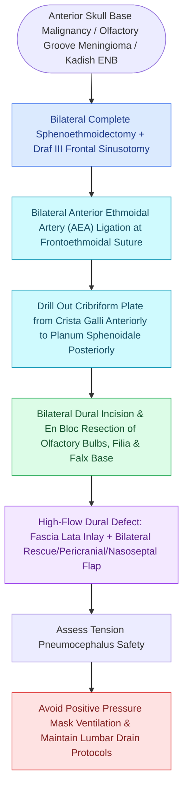

# Transcribriform EEA provides access to olfactory groove meningiomas and esthesioneuroblastomas

## Active Recall

> [!question]- What major vascular structures are ligated as the initial step in the transcribriform approach to devascularize an olfactory groove meningioma?
> *Answer / Clinical Rationale*: The **bilateral anterior and posterior ethmoidal arteries (AEAs and PEAs)**, which provide the primary blood supply to the anterior skull base dura and tumor base.

> [!question]- What cell of origin gives rise to an esthesioneuroblastoma?
> *Answer / Clinical Rationale*: **Basal neural crest stem cells of the olfactory neuroepithelium** within the cribriform plate, superior septum, and superior turbinate.

## Core Clinical & Mechanistic Principles
The **Transcribriform Expanded Endoscopic Approach (EEA)** provides complete midline access to the **anterior cranial fossa** from the posterior wall of the frontal sinus back to the planum sphenoidale, and from the [[Lamina papyracea dehiscence predisposes to orbital fat herniation and medial rectus injury|lamina papyracea]] of one orbit to the contralateral lamina.

### Key Anatomical Resection Elements & Vascular Control
1. **Bilateral Anterior/Posterior Ethmoidal Artery Ligation**: The AEAs and PEAs are clipped/bipolar cauterized bilaterally along the ethmoid roof to devascularize the tumor early.
2. **Bone Removal**: Resection of the **crista galli**, horizontal **cribriform plates**, and **planum sphenoidale**.
3. **Dural Resection**: Complete excision of the olfactory dura and bilateral olfactory bulbs (Kadish/Hyams staging for [[Esthesioneuroblastoma Kadish and Hyams staging determines craniofacial resection and adjuvant therapy|esthesioneuroblastoma]]).
4. **Primary Pathology Targets**:
   - **Esthesioneuroblastoma (Olfactory Neuroblastoma)**: Arises from basal stem cells of the [[Olfactory neuroepithelium contains bipolar sensory neurons and basal stem cells|olfactory neuroepithelium]].
   - **Olfactory Groove Meningioma**: Originates along the cribriform groove; devascularized from below via transcribriform EEA without frontal lobe retraction.
   - **Sinonasal Undifferentiated Carcinoma (SNUC)**: Aggressive neuroendocrine malignancy managed with multimodal therapy ([[Sinonasal undifferentiated carcinoma exhibits aggressive neuroendocrine features requiring multimodal therapy|SNUC Management]]).

## Reconstruction Mandate
- Creates a massive high-flow dural defect communicating directly with the subarachnoid space and frontal lobes.
- Mandatory **multi-layer vascularized reconstruction** utilizing an intradural fascia lata underlay + bilateral [[The Hadad-Bassagasteguy nasoseptal flap is pedicled on the posterior septal artery|Hadad-Bassagasteguy Nasoseptal Flap (NSF)]] or pericranial flap.

## Connected Concepts & Graph Traversal
- **Reconstruction**: [[The Hadad-Bassagasteguy nasoseptal flap is pedicled on the posterior septal artery|Nasoseptal Flap]]
- **Multi-Layering**: [[Multi-layer skull base reconstruction combines underlay, inlay, and overlay barriers|Multi-Layer Reconstruction]]
- **Anatomy**: [[The Keros classification stages olfactory fossa depth and lateral lamella vulnerability|Keros Classification]]
- **Anatomical Foundation**: [[Transplanum and transtuberculum EEA corridors expose suprasellar craniopharyngiomas|Transplanum EEA Corridor]]
- **Diagnostic Evaluation**: [[Transpterygoid EEA exposes juvenile nasopharyngeal angiofibromas and lateral sphenoid defects|Transpterygoid EEA Corridor]]
- **Surgical Craft**: [[Transodontoid EEA provides direct anterior access for basilar invagination and pannus decompression|Transodontoid EEA Corridor]]
- **Surgical Approach**: [[Endoscopic craniofacial olfactory cleft resection achieves clear margins for anterior skull base malignancies while avoiding open craniotomy morbidity|Craniofacial Olfactory Cleft Resection]]
