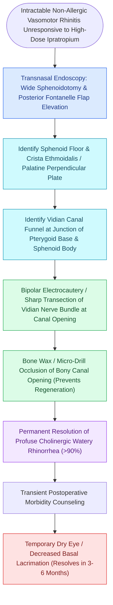

# Transnasal endoscopic vidian neurectomy treats refractory non-allergic cholinergic rhinitis

## Active Recall

> [!question]- Why does a classic Vidian neurectomy cause postoperative dry eye (alacrimia), whereas posterior nasal nerve (PNN) ablation does not?
> *Answer / Clinical Rationale*: The Vidian nerve carries preganglionic fibers destined for both the nasal mucosa and the **lacrimal gland (via the zygomaticotemporal nerve)**; transecting the proximal Vidian nerve halts lacrimal secretion, while distal PNN ablation spares the lacrimal pathways.

> [!question]- What anatomical bony landmark guides the surgeon directly to the Vidian canal?
> *Answer / Clinical Rationale*: The base of the **pterygoid process along the floor of the sphenoid sinus**, located inferomedial to the foramen rotundum and leading posteriorly to the petrous carotid artery.

## Core Clinical & Mechanistic Principles
**Transnasal [[Diagnostic rigid nasal endoscopy utilizes a standardized three-pass examination sequence|Endoscopic]] Vidian Neurectomy** and **Posterior Nasal Nerve (PNN) Cryoablation / Radiofrequency Neurolysis** target the parasympathetic secretomotor drive to the nasal mucosa to treat severe, medical-refractory **non-allergic vasomotor (cholinergic) rhinitis** presenting with profuse watery rhinorrhea.

### Surgical Technique of Vidian Neurectomy
- Dissect the posterior wall of the maxillary sinus and anterior sphenoid face.
- Identify the **Vidian canal** at the junction of the pterygoid process and sphenoid body (inferomedial to the foramen rotundum).
- Cauterize and transect the nerve bundle within the canal aperture with bipolar cautery.

## Connected Concepts & Graph Traversal
- **Autonomic Foundations**: [[The Vidian nerve carries parasympathetic secretomotor and sympathetic vasomotor fibers|Vidian Nerve Neuroanatomy]]
- **Relay Center**: [[The sphenopalatine ganglion serves as the primary parasympathetic relay for the sinonasal cavity|Sphenopalatine Ganglion]]
- **Skull Base Landmark**: [[Transpterygoid EEA exposes juvenile nasopharyngeal angiofibromas and lateral sphenoid defects|Vidian-to-Carotid Landmark]]
- **Surgical Technique**: [[Vidian canal identification at the junction of the sphenoid floor and pterygoid base differentiates the Vidian nerve from the inferomedial palatovaginal canal|Vidian Canal Identification]]
- **Anatomical Foundation**: [[Rhinitis subtypes are differentiated into allergic, vasomotor, gustatory, and rhinitis medicamentosa|Rhinitis Subtypes]]
