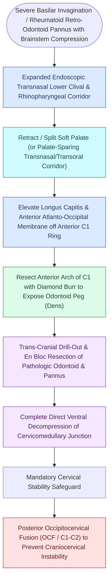

# Transodontoid EEA provides direct anterior access for basilar invagination and pannus decompression

## Active Recall

> [!question]- What major advantage does endoscopic transnasal odontoidectomy offer over the traditional transoral approach?
> *Answer / Clinical Rationale*: It avoids oral incisions, tongue retraction, and palate splitting, drastically reducing postoperative airway compromise, tracheostomy requirements, and velopharyngeal insufficiency.

> [!question]- Why is posterior cervical fusion frequently required following a transodontoid approach?
> *Answer / Clinical Rationale*: Resection of the anterior C1 arch, apical/alar ligaments, and dens destabilizes the **atlantoaxial joint**, requiring posterior stabilization to prevent spinal cord compression.

## Core Clinical & Mechanistic Principles
The **Transodontoid Expanded [[Diagnostic rigid nasal endoscopy utilizes a standardized three-pass examination sequence|Endoscopic]] Approach (Endoscopic Odontoidectomy)** provides direct, minimally invasive midline access to the **craniovertebral junction (CVJ)**, lower clivus, anterior arch of C1 (atlas), and the **dens / odontoid process of C2 (axis)**.

It replaces traditional transoral surgery, eliminating tongue swelling, prolonged intubation, and palate splitting.

### Operative Key Steps
1. **Nasopharyngeal Mucosal Flap**: Elevate an inferiorly based nasopharyngeal mucosal flap (or U-shaped flap).
2. **C1 Anterior Arch Resection**: Drill the central $1.0\text{–}1.5\text{ cm}$ of the C1 anterior arch with a diamond burr.
3. **Odontoidectomy**: Shell out the core of the dens and drill the cortical shell away from the **transverse atlantal ligament** and tectorial membrane, decompressing the brainstem.
4. **Postoperative Posterior Fusion**: Occipitocervical (C1-C2) posterior instrumented fusion is routinely required to stabilize the spine.

## Connected Concepts & Graph Traversal
- **Superior Neighbor**: [[Transclival EEA provides midline access to clival chordomas and chondrosarcomas|Transclival EEA]]
- **Vascular Safety**: [[Intraoperative ICA injury requires two-surgeon suction and crushed muscle patch hemostasis|ICA Safety Protocol]]
- **Flap Closure**: [[The Hadad-Bassagasteguy nasoseptal flap is pedicled on the posterior septal artery|Nasoseptal Flap]]
- **Diagnostic Evaluation**: [[Transcribriform EEA provides access to olfactory groove meningiomas and esthesioneuroblastomas|Transcribriform EEA Corridor]]
- **Anatomical Foundation**: [[Transplanum and transtuberculum EEA corridors expose suprasellar craniopharyngiomas|Transplanum EEA Corridor]]
- **Surgical Craft**: [[Transpterygoid EEA exposes juvenile nasopharyngeal angiofibromas and lateral sphenoid defects|Transpterygoid EEA Corridor]]
