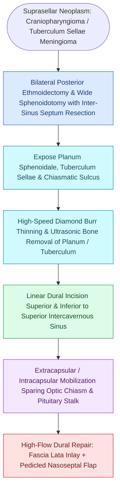

# Transplanum and transtuberculum EEA corridors expose suprasellar craniopharyngiomas

## Active Recall

> [!question]- What anatomical structure is mobilized and preserved in the suprasellar cistern during resection of a craniopharyngioma?
> *Answer / Clinical Rationale*: The **pituitary stalk (infundibulum)**, preservation of which is essential to avoid permanent [[Postoperative diabetes insipidus and SIADH require strict fluid balance and desmopressin titration|diabetes insipidus]] and [[Pituitary apoplexy causes acute chiasmatic compression and life-threatening panhypopituitarism|panhypopituitarism]].

> [!question]- Why is bilateral optic canal unroofing performed during a transplanum/transtuberculum approach?
> *Answer / Clinical Rationale*: It decompresses the **optic nerves (CN II)**, relieves visual compromise caused by tumor compression, and provides lateral mobilization room for tumor delivery.

## Core Clinical & Mechanistic Principles
The **Transplanum / Transtuberculum EEA corridor** exposes the **suprasellar cistern**, optic chiasm, pituitary stalk (infundibulum), and circle of Willis (anterior communicating artery complex). It extends the standard [[Transsellar EEA provides direct access to pituitary adenomas and Rathke cleft cysts|transsellar corridor]] superiorly to manage lesions with suprasellar, prechiasmatic, and third ventricular extension.

### Operative Key Steps & Optic Canal Unroofing
1. **Bone Resection**:
   - Drill the **planum sphenoidale**, **chiasmatic sulcus**, and **tuberculum sellae** down to eggshell thickness using a diamond burr with copious cold irrigation.
   - Perform **$180^\circ$ bilateral optic canal unroofing (decompression)** to release optic nerve tethering and improve chiasmatic mobilization.
2. **Dural Opening & Chiasm Inspection**:
   - Open the superior intercavernous sinus and incise the planum dura.
   - Directly visualize the optic chiasm, pituitary stalk, subchiasmatic space, and anterior cerebral / anterior communicating artery ($\text{ACom}$) branches.
3. **Primary Pathology Targets**:
   - **Craniopharyngiomas (Adamantinomatous / Papillary)**: Arise from Rathke’s pouch epithelial rests along the pituitary stalk.
   - **Tuberculum Sellae & Planum Meningiomas**.

## Connected Concepts & Graph Traversal
- **Inferior Neighbor**: [[Transsellar EEA provides direct access to pituitary adenomas and Rathke cleft cysts|Transsellar EEA]]
- **Anterior Neighbor**: [[Transcribriform EEA provides access to olfactory groove meningiomas and esthesioneuroblastomas|Transcribriform EEA]]
- **Reconstruction**: [[The Hadad-Bassagasteguy nasoseptal flap is pedicled on the posterior septal artery|Nasoseptal Flap]]
- **Diagnostic Evaluation**: [[Transpterygoid EEA exposes juvenile nasopharyngeal angiofibromas and lateral sphenoid defects|Transpterygoid EEA Corridor]]
- **Anatomical Foundation**: [[Transodontoid EEA provides direct anterior access for basilar invagination and pannus decompression|Transodontoid EEA Corridor]]
- **Surgical Corridor**: [[Endoscopic transplanum and transtuberculum approaches expose suprasellar lesions by decompressing the optic chiasm and preserving the superior hypophyseal arteries|Transplanum-Transtuberculum Technique]]
