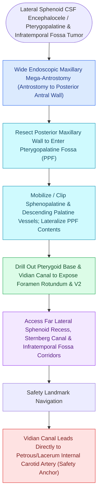

# Transpterygoid EEA exposes juvenile nasopharyngeal angiofibromas and lateral sphenoid defects

## Active Recall

> [!question]- Why is the Vidian canal considered the indispensable guide to the internal carotid artery in transpterygoid surgery?
> *Answer / Clinical Rationale*: The Vidian canal points directly to the **anterior genu of the petrous/paraclival internal carotid artery**, allowing safe identification and Doppler verification of the artery before lateral tumor dissection.

> [!question]- In what demographic and anatomical location does a [[Sinonasal juvenile angiofibroma staging by Radkowski and Fisch guides surgical approach|Juvenile Nasopharyngeal Angiofibroma (JNA)]] typically originate?
> *Answer / Clinical Rationale*: In **adolescent males**, originating at the **sphenopalatine foramen / posterolateral margin of the middle turbinate**.

## Core Clinical & Mechanistic Principles
The **Transpterygoid Expanded Endoscopic Approach** opens the **pterygopalatine fossa (PPF)**, **infratemporal fossa (ITF)**, and **lateral pterygoid recess of the sphenoid sinus**. It extends the corridor lateral to the paraclival internal carotid artery.

### The Vidian-to-Carotid Navigational Rule
- The **Vidian canal** runs directly through the base of the pterygoid process.
- Drilling the bone of the Vidian canal from anterior to posterior leads directly to the **anterior genu of the petrous/paraclival internal carotid artery**. It is the single most reliable surgical landmark for identifying the carotid in expanded lateral approaches.

### Primary Pathology Targets
1. **Juvenile Nasopharyngeal Angiofibroma (JNA)**:
   - Benign, highly vascular, non-encapsulated tumor in adolescent males originating at the sphenopalatine foramen.
   - Expands into PPF, ITF, sphenoid sinus, and middle cranial fossa.
   - Managed with preoperative embolization of internal maxillary feeding vessels followed by transpterygoid EEA resection.
2. **Sternberg’s Canal Lateral Sphenoid Encephaloceles**:
   - Lateral sphenoid recess defect resulting from persistent [[Sternberg's canal in the lateral sphenoid recess acts as a conduit for spontaneous CSF leaks|lateral craniopharyngeal canal]].
3. **Trigeminal Schwannomas (V2 / V3)**.

## Connected Concepts & Graph Traversal
- **Autonomic Nerve**: [[The Vidian nerve carries parasympathetic secretomotor and sympathetic vasomotor fibers|Vidian Nerve Neuroanatomy]]
- **Sphenoid Lateral Recess**: [[Sphenoid sinus pneumatization patterns dictate carotid and optic canal exposure|Sphenoid Pneumatization]]
- **Diagnostic Evaluation**: [[Transcribriform EEA provides access to olfactory groove meningiomas and esthesioneuroblastomas|Transcribriform EEA Corridor]]
- **Anatomical Foundation**: [[Transplanum and transtuberculum EEA corridors expose suprasellar craniopharyngiomas|Transplanum EEA Corridor]]
- **Surgical Craft**: [[Transodontoid EEA provides direct anterior access for basilar invagination and pannus decompression|Transodontoid EEA Corridor]]
- **Surgical Corridor**: [[Endoscopic transpterygoid repair of lateral sphenoid recess encephaloceles accesses Sternberg's canal by drilling the pterygoid base lateral to the vidian nerve|Transpterygoid Encephalocele Repair]]
- **Diagnostic Assessment**: [[Pterygopalatine fossa dissection requires internal maxillary artery ligation and posterior antral wall resection to access the lateral sphenoid recess|Pterygopalatine Fossa Dissection]]
