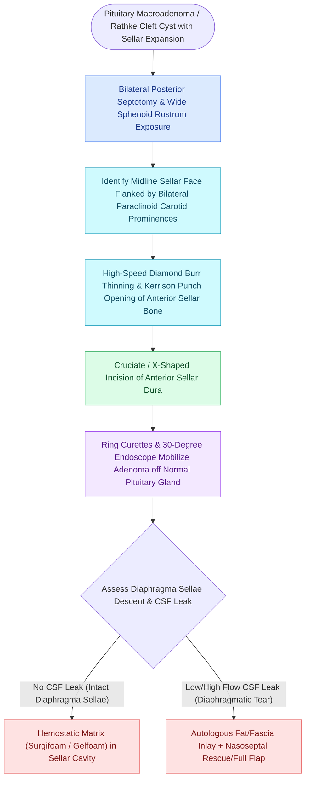

# Transsellar EEA provides direct access to pituitary adenomas and Rathke cleft cysts

## Active Recall

> [!question]- What anatomical landmark forms the lateral boundary of bone removal during a transsellar approach?
> *Answer / Clinical Rationale*: The **parasellar internal carotid arteries** and the medial walls of the **cavernous sinuses**.

> [!question]- What is the emergency presentation and surgical indication for pituitary apoplexy?
> *Answer / Clinical Rationale*: Acute infarction/hemorrhage of a pituitary adenoma presenting with sudden thunderclap headache, ophthalmoplegia, acute visual loss (chiasm compression), and hemodynamic collapse from ACTH crisis, requiring emergent transsellar decompression.

## Core Clinical & Mechanistic Principles
The **Transsellar Endoscopic Approach** is the workhorse corridor of endoscopic skull base surgery, providing direct, minimally invasive access to the **sella turcica**, **pituitary gland**, and **cavernous sinus medial walls**.

### Operative Protocol & Dural Opening
1. **Wide Sphenoidotomy & Posterior Septectomy**:
   - Perform wide bilateral sphenoidotomies and resect the posterior $1.5\text{–}2.0\text{ cm}$ of the vomer/septum to create a single large binasal working space.
2. **Sellar Floor Removal**:
   - Identify the sellar bulge, opticocarotid recesses ([[Opticocarotid recesses on coronal CT demarcate the paraclinoid ICA and optic strut|OCR]]), and clival recess.
   - Drill the anterior sellar face with a diamond burr and remove bone with Kerrison rongeurs from **carotid-to-carotid**.
3. **Cruciate Dural Incision**:
   - Perform a cruciate incision through the outer periosteal and inner meningeal dura, avoiding the **superior and inferior intercavernous sinuses**.
4. **Primary Pathology Targets**:
   - **Pituitary Adenomas**: Functioning (Prolactinoma refractory to dopamine agonists, Cushing's ACTH-secreting, Acromegaly GH-secreting) vs Non-Functioning (macroadenomas with chiasm compression).
   - **Rathke Cleft Cysts**: Lined by cuboidal/columnar epithelium; treated with wide marsupialization.
   - **Pituitary Apoplexy**: Acute hemorrhagic infarction causing sudden severe headache, visual field loss, and panhypopituitarism.

## Connected Concepts & Graph Traversal
- **Superior Expansion**: [[Transplanum and transtuberculum EEA corridors expose suprasellar craniopharyngiomas|Transplanum EEA]]
- **Inferior Expansion**: [[Transclival EEA provides midline access to clival chordomas and chondrosarcomas|Transclival EEA]]
- **Vascular Risk**: [[Intraoperative ICA injury requires two-surgeon suction and crushed muscle patch hemostasis|Carotid Artery Injury Protocol]]
- **Diagnostic Evaluation**: [[Transcribriform EEA provides access to olfactory groove meningiomas and esthesioneuroblastomas|Transcribriform EEA Corridor]]
- **Anatomical Foundation**: [[Transpterygoid EEA exposes juvenile nasopharyngeal angiofibromas and lateral sphenoid defects|Transpterygoid EEA Corridor]]
