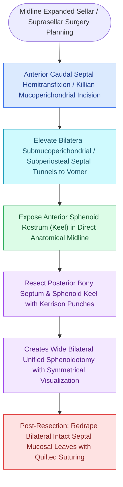

# Transseptal sphenoidotomy provides wide bilateral midline access to the sphenoid rostrum

## Active Recall

> [!question]- How much posterior nasal septum is typically resected during a binasal transseptal sphenoidotomy?
> *Answer / Clinical Rationale*: Approximately **$1.5\text{ to }2.0\text{ cm}$** of the posterior vomer and perpendicular plate, creating a wide binasal corridor.

> [!question]- Why must a nasoseptal flap be harvested before executing a posterior septectomy?
> *Answer / Clinical Rationale*: Posterior septectomy strips the mucosa from both sides of the posterior septum; harvesting the NSF first preserves the vascular pedicle and mucosal paddle on the harvest side.

## Core Clinical & Mechanistic Principles
When wide, four-handed bilateral access to the sphenoid sinuses and sella turcica is required (such as in transsellar pituitary surgery or expanded skull base corridors), a **Transseptal / Posterior Septectomy Sphenoidotomy** provides a single unified working cavity.

### Nasoseptal Flap Pedicle Consideration
- If a [[The Hadad-Bassagasteguy nasoseptal flap is pedicled on the posterior septal artery|Hadad-Bassagasteguy]] nasoseptal flap is planned, the flap must be harvested on at least one side **prior to performing the posterior septectomy**, as the septectomy will destroy the contralateral septal mucosa.

## Connected Concepts & Graph Traversal
- **Transsellar Corridor**: [[Transsellar EEA provides direct access to pituitary adenomas and Rathke cleft cysts|Transsellar EEA]]
- **Flap Harvest**: [[The Hadad-Bassagasteguy nasoseptal flap is pedicled on the posterior septal artery|Nasoseptal Flap Craft]]
- **Standard Sphenoidotomy**: [[The sphenoid sinus ostium lies medial to the superior turbinate above the choana|Standard Sphenoidotomy]]
- **Surgical Technique**: [[Extended sphenoid antrostomy and drill-out resects the rostrum and intersinus septum with mini-nasoseptal flap lining to prevent osteitic restenosis|Extended Sphenoid Antrostomy]]
- **Anatomical Foundation**: [[Endoscopic transpterygoid repair of lateral sphenoid recess encephaloceles accesses Sternberg's canal by drilling the pterygoid base lateral to the vidian nerve|Sternberg's Canal Lateral Sphenoid Recess Encephaloceles]]
