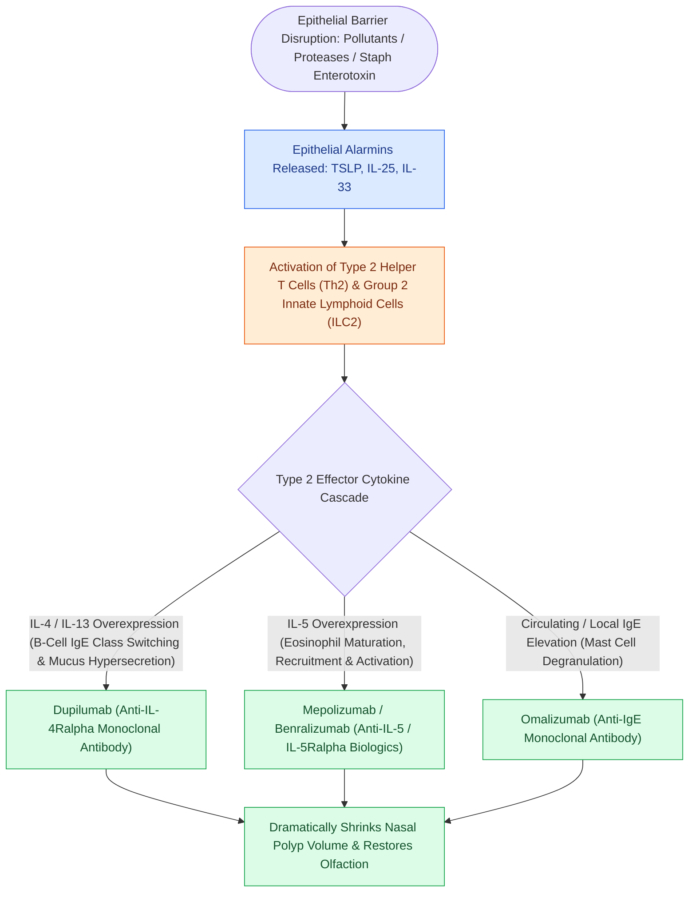

# Type 2 CRS exhibits eosinophilic inflammation responsive to targeted biologics

## Active Recall

> [!question]- What is the molecular mechanism of action of Dupilumab in treating severe CRSwNP?
> *Answer / Clinical Rationale*: Dupilumab binds to the **IL-4R$\alpha$ subunit**, blocking downstream receptor signaling for both **IL-4 and IL-13**, thereby halting IgE synthesis, eosinophil tissue migration, and epithelial barrier breakdown.

> [!question]- What histologic finding in sinonasal mucin confirms intense eosinophil degranulation?
> *Answer / Clinical Rationale*: **Charcot-Leyden crystals** (composed of galectin-10) and high concentrations of Major Basic Protein (MBP).

## Core Clinical & Mechanistic Principles
Chronic Rhinosinusitis (CRS) is now pathologically classified by underlying [[Non-Type 2 CRS features neutrophilic inflammation associated with cystic fibrosis and ciliopathies|molecular endotype]] rather than purely phenotypic presence of polyps. **Type 2 (T2) High Inflammation** drives $>85\%$ of chronic rhinosinusitis with nasal polyps (CRSwNP) in Western populations.

### Clinical Definition & Histopathological Hallmarks (EPOS Guidelines)
- **EPOS / Clinical Diagnostic Criteria for CRS**:
  - Requires **$\ge 12\text{ consecutive weeks}$** of mucosal inflammation of the nose and paranasal sinuses characterized by **at least two cardinal symptoms**, one of which MUST be **nasal blockage/congestion** OR **nasal discharge** (anterior or posterior drip), $\pm$ facial pain/pressure, $\pm$ reduction or loss of smell (hyposmia/anosmia), PLUS objective endoscopic evidence (polyps, mucopurulent discharge, middle meatal edema) or sinus CT mucosal opacification.
- **Histopathological Triad of Allergic/Type 2 Polyps**:
  - Nasal polyps in CRSwNP characteristically display a distinctive microscopic triad:
    1. **Epithelial goblet cell hyperplasia** with basement membrane thickening.
    2. **Marked stromal edema (myxoid stroma)** with pseudo-cystic degeneration and sparse vascularity.
    3. **Dense eosinophilic leukocyte infiltration** (often $>10–20$ eosinophils per high-power field, releasing toxic major basic protein and eosinophil cationic protein).
- **Evidence-Based Medical Recommendations (EPOS / ICAR Consensus)**:
  - Intranasal corticosteroids (high-volume steroid irrigations) and oral steroid bursts form the bedrock of medical therapy.
  - *Recommendation Against Antifungals*: Systematic reviews demonstrate that **topical or systemic antifungal therapy is NOT effective and is strongly recommended AGAINST in routine CRSwNP**, as non-invasive fungal colonization does not drive primary disease in non-AFRS polyposis.

### Cytokine Networks & Cellular Drivers
1. **IL-4 & IL-13**:
   - Drive B-cell class-switching to **IgE** production.
   - Stimulate goblet cell hyperplasia, mucin hypersecretion, and basement membrane remodeling.
2. **IL-5**:
   - The primary cytokine for **eosinophil differentiation, bone marrow release, recruitment, and survival**.
   - Eosinophils degranulate **Major Basic Protein (MBP)** and **Eosinophil Cationic Protein (ECP)**, inducing mucosal epithelial shedding and edema.
3. **Charcot-Leyden Crystals**: Formed from crystallized galectin-10 from degranulated eosinophils.

### Targeted Biologic Therapies (FDA-Approved in CRSwNP)
- **Dupilumab (Dupixent)**: Fully human monoclonal antibody against **IL-4 receptor alpha (IL-4R$\alpha$)**, simultaneously blocking both IL-4 and IL-13 signaling. Most potent overall reduction in polyp size and Lund-Mackay CT scores.
- **Omalizumab (Xolair)**: Anti-IgE antibody that binds free circulating IgE, preventing binding to Fc$\varepsilon$RI receptors on mast cells and basophils.
- **Mepolizumab (Nucala)**: Anti-IL-5 antibody that directly neutralizes circulating IL-5.
- **Benralizumab (Fasenra)**: Anti-IL-5 receptor alpha (IL-5R$\alpha$) antibody that induces direct antibody-dependent cell-mediated cytotoxicity (ADCC) of eosinophils.

## Connected Concepts & Graph Traversal
- **AERD Subtype**: [[AERD manifests with asthma, nasal polyps, and severe aspirin-induced respiratory reactions|AERD Clinical Triad]]
- **AFRS Subtype**: [[Allergic fungal rhinosinusitis presents with eosinophilic mucin and Charcot-Leyden crystals|AFRS Eosinophilic Mucin]]
- **Non-T2 Endotype**: [[Non-Type 2 CRS features neutrophilic inflammation associated with cystic fibrosis and ciliopathies|Non-Type 2 CRS]]
- **Surgical Platform**: [[Draf III modified Lothrop unites both frontal sinuses into a common cavity|Draf III for Severe T2 Polyposis]]
- **Innate Mucosal Immunity**: [[Nitric oxide produced in the paranasal sinuses provides host defense and ciliary stimulation|Sinonasal Nitric Oxide (nNO)]]
- **Disease Mechanism**: [[Complement activation cascades, MHC antigen presentation, and leukocyte adhesion molecules orchestrate mucosal innate and adaptive immunity|Eosinophil VLA-4/VCAM-1 Recruitment]]
