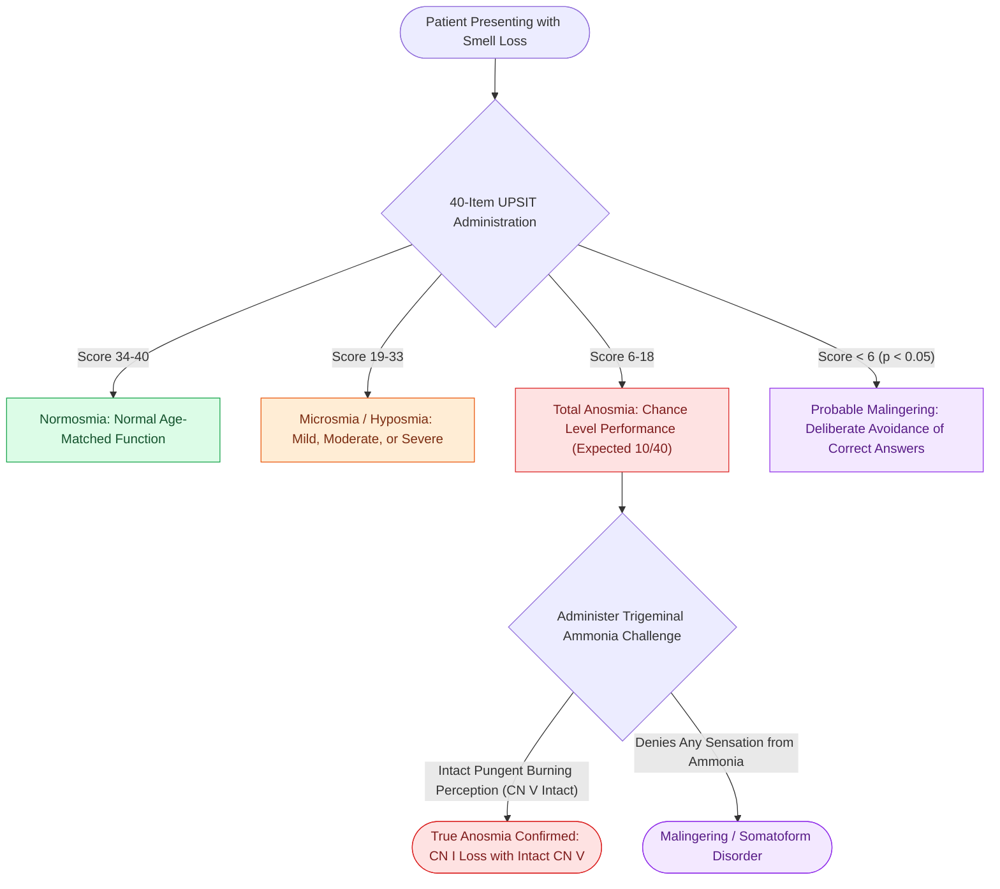

# UPSIT and CCCRC tests quantify olfactory thresholds and odor identification in chemosensory disorders

## Active Recall

> [!question]- What score ranges define normosmia, microsmia, anosmia, and probable malingering on the 40-item University of Pennsylvania Smell Identification Test (UPSIT)?
> *Answer / Clinical Rationale*: - **Normosmia**: $34\text{–}40$ in women, $33\text{–}40$ in men (age-dependent normograms). - **Mild Microsmia (Hyposmia)**: $30\text{–}33$. - **Moderate Microsmia**: $26\text{–}29$. - **Severe Microsmia**: $19\text{–}25$. - **Total Anosmia**: $6\text{–}18$ (consistent with random guessing on a 4-choice test where pure chance yields a score of 10 out of 40). - **Probable Malingering / Factitious Anosmia**: **$<6\text{ out of }40$** ($p<0.05$). Because pure chance produces an expected score of 10, scores below 6 indicate deliberate avoidance of correct answers.

> [!question]- What two distinct diagnostic components comprise the Connecticut Chemosensory Clinical Research Center (CCCRC) test?
> *Answer / Clinical Rationale*: (1) **Threshold Detection Testing**: Serial 1:3 dilutions of **n-butanol** in water (Bottles 0 to 9) presented in a forced-choice ascending staircase design against a water blank; (2) **Suprathreshold Odor Identification Testing**: 10 common microencapsulated or jar odorants (7 pure olfactory stimuli like peanut butter/cinnamon/chocolate, and 1 pure trigeminal stimulus like menthol/ammonia) scored from 0 to 10. The combined average score ($0-7$) categorizes patients from normosmic to anosmic.

> [!question]- Which chemical odorants stimulate the trigeminal nerve ($CN\ V$) rather than the olfactory nerve ($CN\ I$), and how are they used to detect true anosmia vs malingering?
> *Answer / Clinical Rationale*: Pure **trigeminal stimulants** (e.g., **ammonia, acetic acid / vinegar, menthol, formaldehyde**) stimulate nasal somatosensory and pain receptors ($V_1$ and $V_2$) rather than olfactory receptor neurons. A patient with true complete anosmia ($CN\ I$ loss) will still detect the burning, pungent sensation of ammonia. Inability or refusal to perceive concentrated ammonia confirms malingering or psychogenic unresponsiveness.

## Core Clinical & Mechanistic Principles

Chemosensory testing objectively quantifies olfactory dysfunction into **conductive (transport)** deficits (mechanical obstruction of the olfactory cleft from nasal polyps in [[Type 2 CRS exhibits eosinophilic inflammation responsive to targeted biologics|Type 2 CRS]], severe septal deflection, or mucosal edema) versus **sensorineural** deficits (loss of [[Olfactory neuroepithelium contains bipolar sensory neurons and basal stem cells|bipolar olfactory sensory neurons]], post-viral olfactory neuropathy, post-traumatic shearing of olfactory filia at the [[The Keros classification stages olfactory fossa depth and lateral lamella vulnerability|cribriform plate]], or neurodegenerative $\alpha$-synucleinopathies):

### Chemosensory Testing Battery Metrics & Qualitative Disorders
- **Qualitative vs Quantitative Olfactory Disorders**:
  - **Anosmia / Hyposmia**: Quantitative reduction in olfactory sensitivity.
  - **Parosmia (Troposmia)**: Distorted qualitative perception of an actual odorant (often foul, rotten, or chemical), commonly seen during aberrant axonal regeneration after post-viral olfactory loss.
  - **Phantosmia**: Perception of an odor in the absence of any ambient olfactory stimulus (olfactory hallucination), requiring differentiation from temporal lobe epilepsy or psychiatric etiologies.
  - **Presbyosmia**: Age-related decline in olfactory receptor density and globose basal cell neurogenesis starting in the 6th decade.

## Connected Concepts & Graph Traversal
- **Olfactory Neuroepithelium**: [[Olfactory neuroepithelium contains bipolar sensory neurons and basal stem cells|Olfactory Neuroepithelium Architecture]]
- **Esthesioneuroblastoma Staging**: [[Esthesioneuroblastoma Kadish and Hyams staging determines craniofacial resection and adjuvant therapy|Esthesioneuroblastoma Kadish & Hyams]]
- **Transcribriform Approaches**: [[Transcribriform EEA provides access to olfactory groove meningiomas and esthesioneuroblastomas|Transcribriform Skull Base Approaches]]
- **Type 2 CRS & Polyposis**: [[Type 2 CRS exhibits eosinophilic inflammation responsive to targeted biologics|Type 2 CRS & Anosmia]]
- **Keros Classification**: [[The Keros classification stages olfactory fossa depth and lateral lamella vulnerability|Keros Classification & Olfactory Fossa Depth]]
- **Nasal Cycle Mechanics**: [[The nasal cycle provides alternating autonomic mucosal congestion and decongestion|Nasal Cycle Dynamics]]
- **Forced-Choice Malingering Detection**: [[Quantitative olfactory testing with the UPSIT differentiates conductive from sensorineural dysosmia and detects deliberate malingering through below-chance forced-choice scoring|UPSIT Malingering Detection]]
