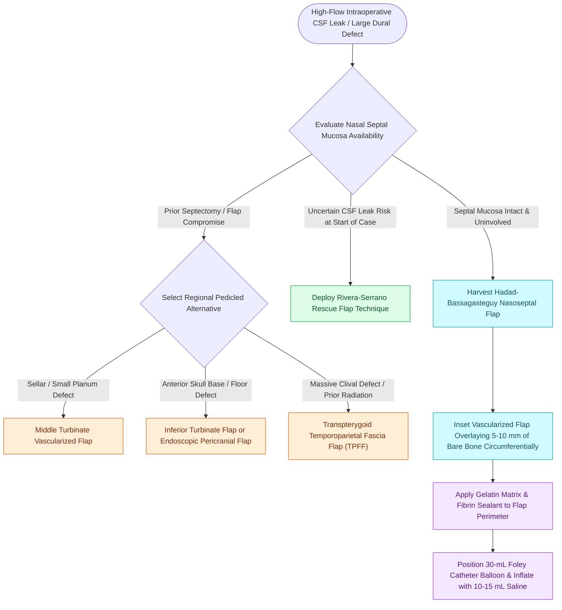

# Vascularized nasoseptal and regional pedicled flaps provide robust skull base reconstruction for high-flow CSF leaks and large dural defects

## Active Recall

> [!question]- What is the Rivera-Serrano 'rescue flap' technique, and how does it optimize nasoseptal flap preservation during expanded skull base access?
> *Answer / Clinical Rationale*: The rescue flap involves making the posterior mucosal cuts of the nasoseptal flap along the sphenoid face and reflecting the vascular pedicle inferiorly; this permits wide sphenoidotomies and posterior septectomy while keeping the anterior septal mucosa untouched, leaving the option to convert to a full flap only if a high-flow CSF leak occurs.

> [!question]- What anatomical boundary must be respected along the superior septum during nasoseptal flap elevation, and what is the consequence of violating it?
> *Answer / Clinical Rationale*: The superior incision must remain **1.0 to 1.5 cm below the cribriform plate** (superior septal roof) to preserve the olfactory sensory neuroepithelium; violating this border causes permanent postoperative anosmia.

> [!question]- How is a Foley catheter balloon bolster deployed and calibrated to support a nasoseptal flap without causing ischemic necrosis?
> *Answer / Clinical Rationale*: A 30-mL Foley catheter balloon is positioned below the flap and inflated with **10 to 15 mL of sterile saline**; this provides gentle, uniform non-shearing counterpressure against the skull base for 3 to 5 days without exceeding mucosal capillary perfusion pressure.

## Core Clinical & Mechanistic Principles
The development of vascularized pedicled flaps—epitomized by the **Hadad-Bassagasteguy nasoseptal flap (NSF)**—revolutionized expanded endonasal skull base surgery, reducing postoperative high-flow CSF leak rates from over 20%–30% to less than 5%. In extensive anterior, central, or posterior cranial fossa dural defects, vascularized tissue provides immediate arterial perfusion, rapid fibrovascular incorporation, and resilience against adjuvant radiotherapy, providing the essential overlay tier in [[Multi-layer skull base reconstruction combines underlay, inlay, and overlay barriers|multi-layer skull base reconstruction]] over a bed prepared with [[CSF leak defect preparation requires circumferential bone de-mucosalization|circumferential bone de-mucosalization]].

### Reconstructive Flap Hierarchy & Indications
1. **Hadad-Bassagasteguy Nasoseptal Flap (First-Line Gold Standard)**:
   - Axial blood supply: **posterior septal (nasopalatine) artery**, a major terminal branch of the sphenopalatine artery (SPA) coursing across the anterior sphenoid rostrum.
   - Sizing: Small (sellar defects), medium (transplanum/clival defects), or extended (transcribriform to foramen magnum, harvesting nasal floor mucosa to the inferior turbinate).
   - Storage: Tucked into the ipsilateral maxillary sinus or nasopharynx during tumor resection.
2. **Rescue Flap Modification (Rivera-Serrano Technique)**:
   - Bilateral posterior incisions are made along the sphenoid rostrum, releasing the vascular pedicle inferiorly without elevating anterior septal mucosa.
   - If no high-flow leak occurs, the mucosa is repositioned, eliminating septal donor morbidity.
3. **Alternative Regional Pedicled Flaps (When NSF is Unavailable)**:
   - *Middle Turbinate Vascularized Flap*: Pedicled on the middle turbinate branch of the SPA; ideal for small-to-moderate sellar, planum, or cribriform defects.
   - *Inferior Turbinate Vascularized Flap*: Pedicled on the inferior turbinate artery; swung superiorly for anterior fossa floor defects.
   - *Endoscopic Pericranial Flap*: Harvested via coronal/subgaleal scalp elevation and tunneled into the nasal cavity through a horizontal nasion osteotomy; covers massive transcribriform defects.
   - *Temporoparietal Fascia Flap (TPFF)*: Tunneled through the infratemporal fossa into the sphenoid cavity for clival and parasellar reconstruction.

### Flap Inset & Secondary Bolster Mechanics
- **Direct Contact on Bone**: Flap margins must extend over a minimum of 5 to 10 mm of denuded, non-mucosalized bone circumferentially. Overlapping residual mucosa creates mucous cysts or prevents vascularized take.
- **Avoid Pedicle Torsion**: The pedicle must not be twisted or compressed against the choana or sphenoid floor.
- **Foley Balloon Bolster Protocol**: A 30-mL Foley catheter balloon is introduced transnasally beneath the flap, inflated with **10 to 15 mL of sterile saline**, and maintained for 3 to 5 days. This provides consistent, non-shearing counterpressure without causing capillary ischemia.

## Connected Concepts & Graph Traversal
- **Primary Flap Craft**: [[The Hadad-Bassagasteguy nasoseptal flap is pedicled on the posterior septal artery|Hadad-Bassagasteguy Flap Principles]]
- **Olfactory Sparing**: [[Preserving the superior septal mucosal strip prevents post-NSF anosmia|Olfactory Strip Preservation]]
- **Alternative Pedicle**: [[The middle turbinate vascularized flap provides an alternative rescue flap for skull base repair|Middle Turbinate Rescue Flap]]
- **Inferior Floor Repair**: [[The inferior turbinate flap pedicled on the inferior turbinate artery repairs anterior floor defects|Inferior Turbinate Flap]]
- **Transfrontal Reconstruction**: [[The endoscopic pericranial flap transposed through the nasion repairs large anterior skull base defects|Endoscopic Pericranial Flap]]
- **Infratemporal Tunneling**: [[Temporoparietal fascia free and pedicled flaps provide vascularized tissue when nasoseptal flaps fail|Temporoparietal Fascia Flap]]
