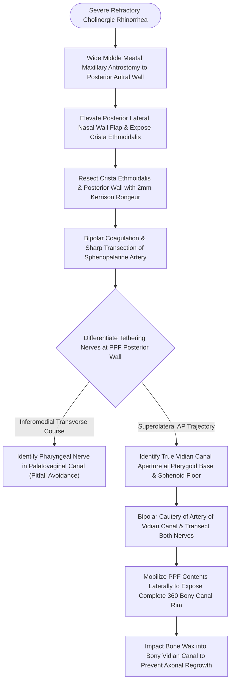

# Vidian canal identification at the junction of the sphenoid floor and pterygoid base differentiates the Vidian nerve from the inferomedial palatovaginal canal

## Active Recall

> [!question]- What is the most frequent surgical error leading to procedural failure during endoscopic Vidian neurectomy?
> *Answer / Clinical Rationale*: Misidentifying the **palatovaginal (pharyngeal) canal** as the Vidian canal. The palatovaginal canal lies **inferomedial** to the Vidian canal and transmits the pharyngeal branch of the pterygopalatine ganglion and pharyngeal artery traveling in a transverse medial-to-lateral vector. Transecting this pharyngeal nerve leaves the secretomotor Vidian nerve intact, resulting in complete failure to resolve cholinergic rhinorrhea.

> [!question]- Why must bone wax be firmly impacted into the bony aperture of the Vidian canal following sharp nerve transection?
> *Answer / Clinical Rationale*: The Vidian nerve contains preganglionic parasympathetic axons with high regenerative potential. Without a mechanical barrier, axonal sprouting across the surgical bed results in neural reanastomosis and clinical symptom relapse within **12 to 24 months postoperatively**.

## Core Clinical & Mechanistic Principles
Endoscopic Vidian neurectomy provides targeted interruption of the parasympathetic secretomotor drive to the sinonasal mucosa in patients suffering from severe, medical-refractory [[Transnasal endoscopic vidian neurectomy treats refractory non-allergic cholinergic rhinitis|refractory vasomotor rhinitis]] and intractable non-allergic rhinorrhea. The [[The Vidian nerve carries parasympathetic secretomotor and sympathetic vasomotor fibers|Vidian nerve]] (nerve of the pterygoid canal) is formed at the anterior lacerum foramen by the confluence of the **greater superficial petrosal nerve (GSPN)**—carrying preganglionic parasympathetic fibers from the superior salivatory nucleus via CN VII—and the **deep petrosal nerve**, carrying postganglionic sympathetic fibers from the internal carotid plexus. It traverses the pterygoid (Vidian) canal to synapse within the [[The sphenopalatine ganglion serves as the primary parasympathetic relay for the sinonasal cavity|pterygopalatine ganglion]].

### The Critical Anatomic Trap: Vidian vs Palatovaginal Canal
The anterior opening of the Vidian canal into the pterygopalatine fossa is situated at the precise junction of the **medial pterygoid plate** and the **floor of the sphenoid sinus**, positioned inferomedial to the foramen rotundum. 

A critical anatomical trap governs this dissection:
- **The Palatovaginal (Pharyngeal) Canal**: Located **inferomedial** to the true Vidian canal, bounded by the vaginal process of the sphenoid bone and the sphenoidal process of the palatine bone. It transmits the pharyngeal nerve (from the pterygopalatine ganglion) and the pharyngeal branch of the maxillary artery. Crucially, the pharyngeal nerve courses in a **transverse medial-to-lateral orientation**, sitting at roughly a 90° angle to the Vidian nerve.
- **The Vidian Canal**: Located more superiorly and laterally within the pterygoid base, directed along an anteroposterior trajectory toward the petrous carotid genu.
- **Surgical Failure Mechanism**: Surgeons dissecting the posterior nasal wall commonly encounter the transverse pharyngeal nerve first as it tethers the medial pterygopalatine contents. Transecting this nerve under the assumption that it is the Vidian nerve constitutes the single most common cause of failed Vidian neurectomy.

### Operative Protocol
1. **Exposure**: A wide uncinectomy and maxillary antrostomy are created, carrying the opening flush with the posterior antral wall.
2. **Crista Ethmoidalis Resection & Vascular Control**: A posteriorly based mucosal flap is raised off the lateral nasal wall. The [[The crista ethmoidalis guides endoscopic sphenopalatine artery ligation|crista ethmoidalis]] is identified and removed using a 2-mm upbiting Kerrison rongeur. The sphenopalatine artery and its posterior fontanelle branches are isolated within the exposed pterygopalatine fat, coagulated with bipolar forceps, and divided.
3. **Neurovascular Dissection**: Posterior dissection through the pterygopalatine fat reveals the neural tethers anchoring the pterygopalatine ganglion. The surgeon identifies the transverse pharyngeal nerve inferomedially and the longitudinally oriented Vidian nerve exiting its funnel-shaped bony canal superolaterally.
4. **Neurectomy & Hemostasis**: The artery of the Vidian canal (a branch of the maxillary artery that enters the canal) is coagulated with fine bipolar forceps. Both the Vidian nerve and adjacent pharyngeal nerve branches are divided with a sickle knife.
5. **Complete Bony Rim Skeletonization**: The pterygopalatine contents are gently mobilized laterally until the entire 360° bony circumference of the Vidian canal aperture is visualized, confirming that no aberrant nerve fascicles remain intact.
6. **Bone Wax Obliteration**: Using a Freer elevator, a small pellet of sterile bone wax is packed firmly into the proximal bony stump of the pterygoid canal. This forms a permanent physical barrier preventing axonal sprouting, synaptic reconnection, and symptomatic recurrence at 12 to 24 months.
7. **Flap Repositioning**: The lateral nasal wall mucosal flap is repositioned over the pterygopalatine fossa, and a small sheet of absorbable oxidized regenerated cellulose (Surgicel) is applied.

### Postoperative Morbidity Management
- **Lacrimal Function (Dry Eye)**: Because the Vidian nerve carries secretomotor fibers destined for the lacrimal gland via the zygomaticotemporal nerve, Vidian neurectomy inevitably decreases basal tear production. Schirmer testing remains objectively depressed permanently; however, symptomatic keratoconjunctivitis sicca is temporary, resolving within 30 days in nearly all patients due to compensatory accessory lacrimal gland secretion. Patients are routinely managed with topical artificial tears twice daily for 1 month.

## Connected Concepts & Graph Traversal
- **Extended Transpterygoid Dissection**: [[Pterygopalatine fossa dissection requires internal maxillary artery ligation and posterior antral wall resection to access the lateral sphenoid recess|Pterygopalatine Fossa Neurovascular Dissection]]
- **Surgical Corridor Navigation**: [[Transpterygoid EEA exposes juvenile nasopharyngeal angiofibromas and lateral sphenoid defects|Transpterygoid Corridor Landmarks]]
- **Sphenoid Base Anatomy**: [[Sphenoid sinus pneumatization patterns dictate carotid and optic canal exposure|Sphenoid Floor Pneumatization]]
- **Vascular Safety Margins**: [[Intraoperative ICA injury requires two-surgeon suction and crushed muscle patch hemostasis|Petrous ICA Proximity]]
- **Sphenoid Recess Pathology**: [[Sternberg's canal in the lateral sphenoid recess acts as a conduit for spontaneous CSF leaks|Lateral Sphenoid Recess Anatomy]]
