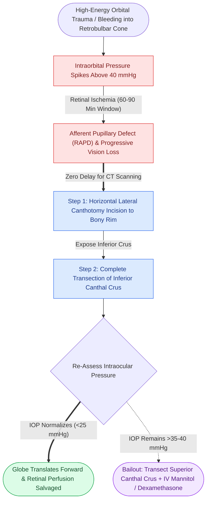

# Acute post-traumatic retrobulbar hematoma with impending vision loss requires bedside lateral canthotomy and inferior cantholysis

## Active Recall

> [!question]- What are the cardinal clinical signs of orbital compartment syndrome, and at what intraocular pressure (IOP) threshold is emergent surgical decompression indicated?
> *Answer / Clinical Rationale*: Cardinal signs include: **progressive proptosis**, intense deep orbital pain, "rock-hard" globe to palpation, **mydriasis (sluggish or non-reactive afferent pupillary defect / Marcus Gunn pupil)**, ophthalmoplegia, subconjunctival chemosis, and progressive visual loss. Decompression is indicated immediately when **IOP exceeds 40 mmHg** (normal = $10\text{--}21\text{ mmHg}$) or immediately upon clinical recognition of vision loss and a tight globe; the surgeon must **NOT delay for CT imaging**.

> [!question]- Detail the step-by-step surgical execution of a bedside lateral canthotomy and inferior cantholysis.
> *Answer / Clinical Rationale*: (1) Infiltrate lateral canthus with $1\text{--}2\text{ mL}$ lidocaine with epinephrine. (2) Apply a straight hemostat horizontally across the lateral canthal angle for 30–60 seconds to crush tissue and minimize bleeding. (3) Perform **lateral canthotomy**: cut full-thickness through the crushed lateral canthal angle laterally toward the orbital rim ($1\text{--}1.5\text{ cm}$) with straight iris scissors. (4) Retract the lower eyelid anteriorly and inferiorly to expose the lateral canthal tendon. (5) Perform **inferior cantholysis**: direct scissors inferiorly and strum the taut **inferior crus of the lateral canthal tendon**, transecting it completely. The lower lid becomes completely flaccid, allowing the globe to prolapse forward and instantly decompressing intraorbital pressure.

## Core Clinical & Mechanistic Principles

**Orbital Compartment Syndrome (OCS)** secondary to retrobulbar hemorrhage is one of the true surgical emergencies in craniomaxillofacial trauma. Frequently encountered during high-impact midface fractures or following [[Orbital floor blowout fractures with muscle entrapment or significant enophthalmos mandate reconstruction|orbital blowout trauma]], the bony orbit is a rigid, unyielding conical vault bounded anteriorly by the fibrous orbital septum and globe. Rapid arterial or venous bleeding into the retrobulbar fat space causes an exponential spike in intraorbital pressure, exceeding the retinal artery perfusion pressure ($> 40\text{ mmHg}$) and causing irreversible ischemic necrosis of retinal ganglion cells and optic neuropathy within **60 to 90 minutes**.

Clinical management rules:
1. **Never Send for CT Scanning**: If a patient with facial trauma develops progressive proptosis, decreased acuity, and an APD, performing a CT scan delays decompression beyond the window of retinal viability. Lateral canthotomy and inferior cantholysis must be performed **at the bedside within minutes**.
2. **Superior Cantholysis Bailout**: If IOP remains elevated ($> 35\text{--}40\text{ mmHg}$) after inferior cantholysis, the superior crus of the lateral canthal tendon can be transected (superior cantholysis), taking care to avoid the lacrimal gland.
3. **Medical Adjuncts**: Administer IV mannitol ($1\text{--}2\text{ g/kg}$), IV dexamethasone ($10\text{--}20\text{ mg}$), and topical beta-blocker/timolol drops to reduce intraocular humor production while proceeding with surgical evacuation.

## Connected Concepts & Graph Traversal
- **Palatal Split Transverse Reduction**: [[Sagittal palatal split fractures require transpalatal reduction prior to mandibulomaxillary fixation to prevent arch widening|Palatal Fracture Transverse Reduction]]
- **ZMC Fracture Alignment**: [[The sphenozygomatic suture along the lateral orbital wall serves as the primary key for three-dimensional ZMC reduction|Sphenozygomatic Suture Reduction]]
- **Pediatric Trapdoor Contrast**: [[Pediatric white-eyed blowout fractures cause muscle entrapment requiring emergent surgical release|Pediatric Craniofacial Trauma]]
- **Midfacial Buttress Architecture**: [[The facial skeleton absorbs impact forces through vertical and horizontal structural buttresses|Facial Buttress System Architecture]]
- **Maxillary Level I Fixation**: [[Le Fort I fractures separate the hard palate and require bilateral buttress plate fixation|Le Fort I Maxillary Buttress Fixation]]
