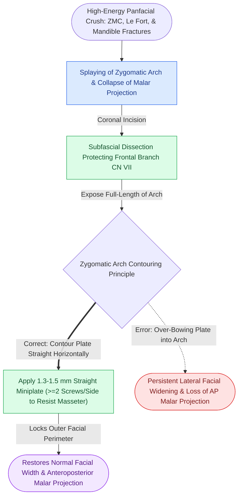

# Anatomical reduction of the zygomatic arch restores lateral facial width and anteroposterior malar projection in panfacial trauma

## Active Recall

> [!question]- Why is anatomical reduction and fixation of the zygomatic arch the key anatomical landmark for restoring lateral facial width and anteroposterior projection in panfacial trauma?
> *Answer / Clinical Rationale*: The zygomatic arch is the **primary horizontal transverse buttress** bridging the anterior midface to the posterior skull base. In high-energy panfacial fractures, the arch buckles laterally or collapses medially. Because the facial skeleton lacks intermediate transverse supports, allowing the arch to heal displaced wide produces permanent post-traumatic **facial flattening, loss of malar projection, and pathological transverse facial widening ("dish-face" deformity)**. Fixing the arch restores the correct outer perimeter of the face.

> [!question]- Detail the surgical approach and plate selection for rigid stabilization of the comminuted zygomatic arch.
> *Answer / Clinical Rationale*: Exposure requires a **coronal (bicoronal) flap**, dissecting in the deep temporal fascia plane deep to the superficial temporal fascia to safeguard the frontal (temporal) branch of CN VII. Dissection continues along the lateral orbital rim and zygomatic arch subperiosteally. Fixation is achieved with a **long low-profile 1.3 mm to 1.5 mm titanium miniplate** spanning from the articular tubercle of the temporal bone to the malar eminence, anchored with monocortical screws.

## Core Clinical & Mechanistic Principles

In complex craniomaxillofacial sequencing, the outer facial frame dictates the boundaries within which the midface and orbits reside. Stabilizing the arch is the pivotal bridge between the calvarium and midface during [[Panfacial fracture reconstruction proceeds from known stable peripheral buttresses to central occlusion|panfacial trauma reconstruction]].

Key technical principles:
1. **The Straight Arch**: An anatomical pearl is that the normal zygomatic arch is almost entirely straight in the horizontal plane, only bowing slightly at the anterior root. Surgeons frequently make the mistake of contouring plates with excessive outward curvature, recreating lateral facial widening.
2. **Sequential Landmark**: In Paul Manson's panfacial sequencing, the outer frame (cranial vault, orbital rims, zygomatic arches) provides the rigid structural box into which the tooth-bearing occlusal units are suspended.
3. **Rigid Fixation Requirements**: Because masseteric downward pull exerts repetitive distraction forces on the arch during jaw movement, plates must be rigidly secured with at least two screws on either side of each fracture line.

## Connected Concepts & Graph Traversal
- **ZMC Sphenozygomatic Alignment**: [[The sphenozygomatic suture along the lateral orbital wall serves as the primary key for three-dimensional ZMC reduction|Sphenozygomatic Suture Reduction]]
- **Midfacial Buttress Network**: [[The facial skeleton absorbs impact forces through vertical and horizontal structural buttresses|Facial Buttress System Architecture]]
- **Soft Tissue Suspension**: [[Soft tissue resuspension to facial bone plates prevents post-traumatic facial drooping and lower eyelid ectropion|Soft Tissue Resuspension]]
- **ZMC Multi-Point Plating**: [[Zygomaticomaxillary complex fractures disrupt four buttress articulations requiring multi-point reduction|ZMC Multi-Point Rigid Fixation]]
- **Locking Plate Technology**: [[Locking internal fixator plates preserve periosteal microvascular perfusion without frictional bone compression|Locking Plate Technology]]
