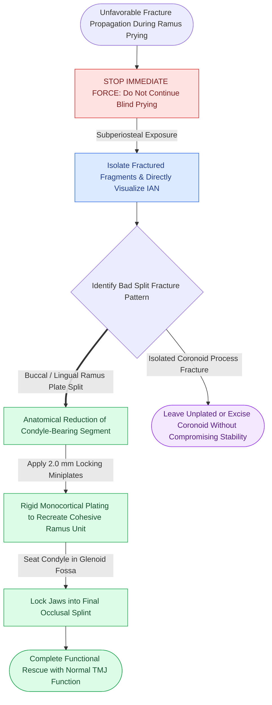

# Bad split fractures during bilateral sagittal split osteotomy require immediate fragment isolation and rigid miniplate stabilization

## Active Recall

> [!question]- What anatomical factors and technical errors trigger an unfavorable "bad split" during bilateral sagittal split osteotomy?
> *Answer / Clinical Rationale*: Bad splits occur in **1% to 3% of BSSO cases**. Predisposing factors include: (1) **Impacted or unerupted third molars** directly in the osteotomy line (weakening cortical bone and diverting fracture propagation); (2) Unfavorable thin mandibular ramus anatomy; (3) **Incomplete or shallow corticotomy cuts** (especially along the lingula or the inferior basilar border); and (4) Excessive, uncontrolled torquing or twisting of osteotomes before bone cuts are fully connected.

> [!question]- Detail the operative rescue algorithm when a bad split occurs on either the proximal (condylar) or distal (tooth-bearing) mandibular segment.
> *Answer / Clinical Rationale*: (1) Remain calm and **do NOT abort the procedure**; (2) Dissect and fully isolate the fractured bone segments to assess fracture orientation and nerve involvement; (3) Identify and **safely protect the inferior alveolar nerve**; (4) **Proximal Segment Fracture** (condylar neck/ramus fracture): Anatomically reduce the condylar segment and rigidly fix it to the proximal ramus plate using **2.0 mm low-profile miniplates or bicortical screws**; (5) **Distal Lingual Plate Fracture**: Re-approximate and secure the lingual fragment with miniplates or transosseous screws; (6) Complete the planned jaw repositioning into the occlusal splint.

## Core Clinical & Mechanistic Principles

An unfavorable fracture ("bad split") during a [[Bilateral sagittal split osteotomy achieves mandibular repositioning via sagittal corticotomies and non-compressive position screw fixation|standard BSSO sagittal osteotomy]] is one of the most stressful intraoperative emergencies in orthognathic surgery. A disciplined surgical algorithm restores stability and prevents permanent TMJ morbidity.

Key prevention and management rules:
1. **Third Molar Extraction Timing**: Elective extraction of mandibular third molars **6 to 9 months prior to BSSO** allows complete bony remodeling of the alveolar socket, drastically reducing the incidence of lingual plate fractures and bad splits.
2. **Inferior Border Cut Verification**: The buccal vertical osteotomy must be carried fully through the dense lower cortical border with a reciprocating saw or Lindemann burr. Attempting to split through an incomplete inferior border cut is the leading cause of buccal plate shatter.
3. **Coronoid Process Bad Split**: If the coronoid process fractures off the proximal segment, it can generally be left unplated or removed entirely without compromising mandibular stability or condylar function.

## Connected Concepts & Graph Traversal
- **Locking Fixator Tech**: [[Locking internal fixator plates preserve periosteal microvascular perfusion without frictional bone compression|Locking Plate Technology]]
- **IVRO Alternative**: [[Intraoral vertical ramus osteotomy corrects mandibular prognathism without internal fixation to eliminate condylar torquing|IVRO Alternative]]
- **Two-Jaw Splint Sequencing**: [[Two-jaw bimaxillary orthognathic sequencing utilizes intermediate and final occlusal splints to coordinate three-dimensional repositioning|Two-Jaw Sequencing]]
- **Comminuted Mandible Principles**: [[Mandibular angle fractures with comminution or bone defects mandate load-bearing reconstruction plates|Comminuted Mandibular Fractures]]
- **Primary Bone Healing**: [[Primary contact bone healing requires absolute stability with interfragmentary strain under two percent|Primary Bone Healing]]
