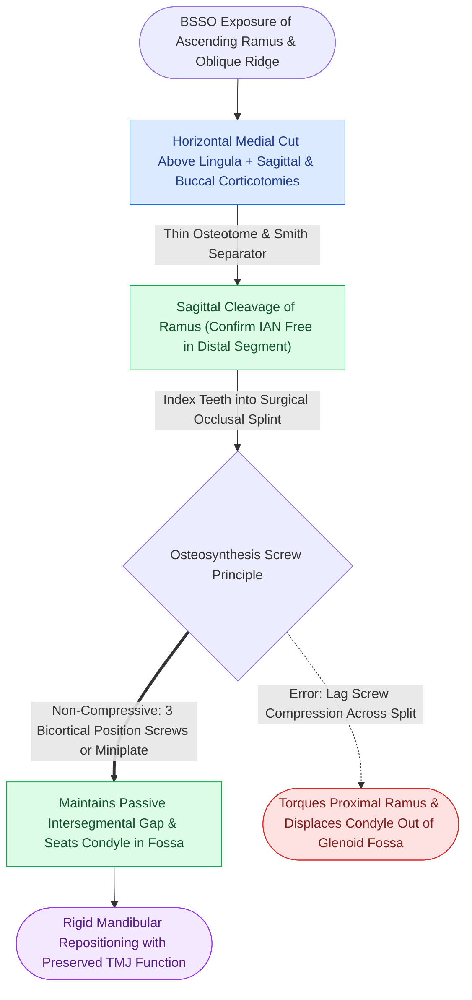

# Bilateral sagittal split osteotomy achieves mandibular repositioning via sagittal corticotomies and non-compressive position screw fixation

## Active Recall

> [!question]- What osteotomy cuts are performed in a bilateral sagittal split osteotomy (BSSO, Trauner-Obwegeser modified by Dal Pont), and how do they protect the inferior alveolar nerve (IAN)?
> *Answer / Clinical Rationale*: The classical BSSO cuts consist of: (1) A **horizontal medial lingual corticotomy** placed strictly superior and posterior to the lingula and mandibular foramen; (2) A sagittal corticotomy along the **anterior border of the ramus and external oblique ridge**; and (3) A **vertical buccal corticotomy** at the junction of the first and second molars. Dissecting subperiosteally to identify the lingula and gently cleaving the sagittal marrow plane ensures the IAN remains protected within the distal tooth-bearing segment.

> [!question]- Why must bicortical screws placed across the sagittal split be inserted as non-compressive "position screws" rather than lag screws?
> *Answer / Clinical Rationale*: If bicortical screws are placed with lag compression across the sagittal split gap, the proximal (condyle-bearing) segment is torqued medially against the distal segment. This causes **severe outward rotation or torquing of the condylar head within the glenoid fossa**, producing acute TMJ pain, disc displacement, condylar resorption, and immediate skeletal relapse. Bicortical screws must be tapped and inserted as **non-compressive position screws** (maintaining the passive anatomical position of the condyle), or low-profile monocortical miniplates should be utilized.

## Core Clinical & Mechanistic Principles

Bilateral sagittal split osteotomy (BSSO) is the premier orthognathic procedure for mandibular advancement, setback, and asymmetry correction. The biomechanical key to long-term skeletal stability is preventing [[The lag screw principle generates interfragmentary compression by engaging solely the distal cortex|lag screw compression]] across the split interface.

Key surgical pearls:
1. **Condylar Seating**: Before locking screws, the surgeon must manually verify that the condyle is seated passively in the posterosuperior aspect of the glenoid fossa without anterior displacement.
2. **Nerve Protection**: During the sagittal split propagation with Smith or Dal Pont separators, inspect the split to ensure the inferior alveolar nerve is separating cleanly from the proximal segment. If bound, free it with a micro-elevator.
3. **Hardware Configuration**: Standard bicortical fixation employs three 2.0 mm position screws placed in an inverted "L" or linear pattern along the superior border, or a single 2.0 mm miniplate with 4 monocortical screws along the external oblique ridge.

## Connected Concepts & Graph Traversal
- **Alternative Setback Osteotomy**: [[Intraoral vertical ramus osteotomy corrects mandibular prognathism without internal fixation to eliminate condylar torquing|IVRO Prognathism Correction]]
- **Bimaxillary Splint Coordination**: [[Two-jaw bimaxillary orthognathic sequencing utilizes intermediate and final occlusal splints to coordinate three-dimensional repositioning|Two-Jaw Bimaxillary Sequencing]]
- **Complication Management**: [[Bad split fractures during bilateral sagittal split osteotomy require immediate fragment isolation and rigid miniplate stabilization|Bad Split Management]]
- **Occlusal Registration**: [[Mandibulomaxillary fixation with arch bars or cortical screws establishes the central occlusal relationship|Mandibulomaxillary Fixation Occlusion]]
- **Locking Fixator Tech**: [[Locking internal fixator plates preserve periosteal microvascular perfusion without frictional bone compression|Locking Plate Technology]]
