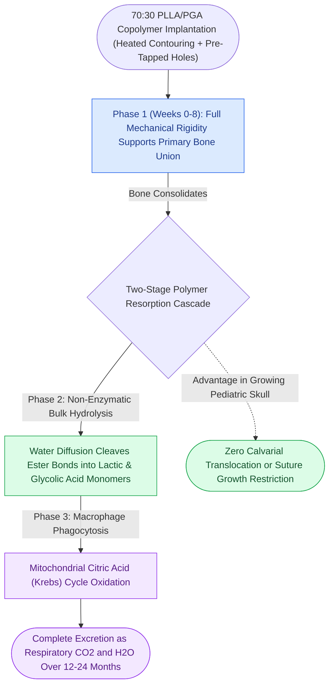
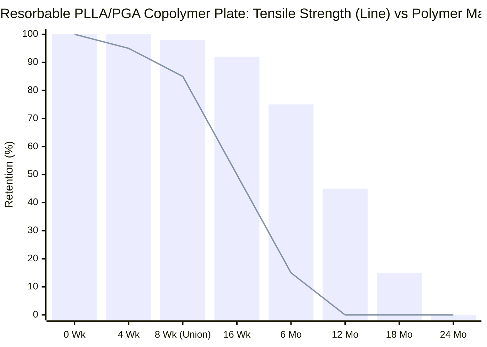

# Biodegradable copolymer osteosynthesis undergoes random hydrolytic scission eliminating hardware removal

## Active Recall

> [!question]- Describe the chemical degradation pathway of resorbable PLLA/PDLLA/PGA copolymers and explain how degradation products are eliminated by the human body.
> *Answer / Clinical Rationale*: Resorbable osteosynthesis devices are aliphatic polyesters composed of poly-L-lactic acid (PLLA), poly-D,L-lactic acid (PDLLA), polyglycolic acid (PGA), and trimethylene carbonate (TMC). In vivo, water molecules penetrate the polymer matrix, causing non-enzymatic **random hydrolytic chain scission** of ester bonds. High-molecular-weight polymers are broken down into shorter oligomers, and ultimately into soluble **monomeric lactic and glycolic acids**. Lactic acid enters the physiological **Krebs (citric acid) cycle**, where it is metabolized into carbon dioxide ($	ext{CO}_2$) and water ($	ext{H}_2	ext{O}$) and excreted via respiration and urine.

> [!question]- What are the primary clinical indications for biodegradable osteosynthesis in craniomaxillofacial trauma, and where is it contraindicated?
> *Answer / Clinical Rationale*: 
> - **Indications**: (1) **Pediatric craniofacial trauma** and cranial vault reconstruction (eliminates suture restriction and plate intracranial translocation); (2) Low-load adult midface and anterior frontal sinus wall fractures.
> - **Contraindications**: Adult mandibular fractures, comminuted load-bearing defects, infected nonunions, or high-load masticatory buttresses. Polymers have lower flexural strength than titanium and cannot withstand heavy cyclic masseteric loads.

## Core Clinical & Mechanistic Principles

The advent of **biodegradable copolymer osteosynthesis** solved one of the fundamental dilemmas in pediatric craniofacial surgery: permanent titanium plates bridge expanding cranial sutures, restrict normal skeletal growth, and can translocate intracranially through the expanding calvarial cortex. By maintaining mechanical stability while the bone heals, resorbables achieve successful [[Primary contact bone healing requires absolute stability with interfragmentary strain under two percent|primary bone osteogenesis]] without long-term foreign material retention.

Surgical craft nuances for resorbables:
1. **Thermal Shaping**: Unlike titanium which is bent cold with pliers, resorbable polymer plates require heating in a sterile warm-water bath ($65^\circ	ext{--}70^\circ	ext{C}$) or hot-air pen to become pliable. Once contoured to bone, cooling in saline locks the plate into its permanent 3D shape.
2. **Tapping Requirement**: Self-tapping titanium screws cut their own bone tracks. Polymer screws are more ductile and can shear if driven under high resistance; the pilot drill hole must be **tapped with a dedicated metal thread-cutter** before inserting polymer screws (or inserted via ultrasonic SonicWeld pin techniques).
3. **Foreign-Body Granuloma Prevention**: Early first-generation pure PGA implants degraded too rapidly, producing a localized acidic surge that caused sterile subcutaneous fluid collections. Modern amorphous copolymers (e.g., 70:30 PLLA/PDLLA) resorb at a steady, controlled rate over 12–24 months without localized inflammatory swelling.

## Connected Concepts & Graph Traversal
- **Permanent Titanium Comparison**: [[Commercially pure titanium forms a passivated titanium dioxide layer ensuring biocompatibility|Titanium Biocompatibility & Passivation]]
- **Pediatric Fracture Management**: [[Pediatric white-eyed blowout fractures cause muscle entrapment requiring emergent surgical release|Pediatric Craniofacial Trauma]]
- **Interfragmentary Strain Limits**: [[Perren strain theory dictates tissue differentiation and mechanical thresholds for osteogenesis|Perren Strain Theory]]
- **Locking Plate Design**: [[Locking internal fixator plates preserve periosteal microvascular perfusion without frictional bone compression|Locking Internal Fixator Technology]]
- **Midface Buttress Coordination**: [[The facial skeleton absorbs impact forces through vertical and horizontal structural buttresses|Facial Buttress System Architecture]]
