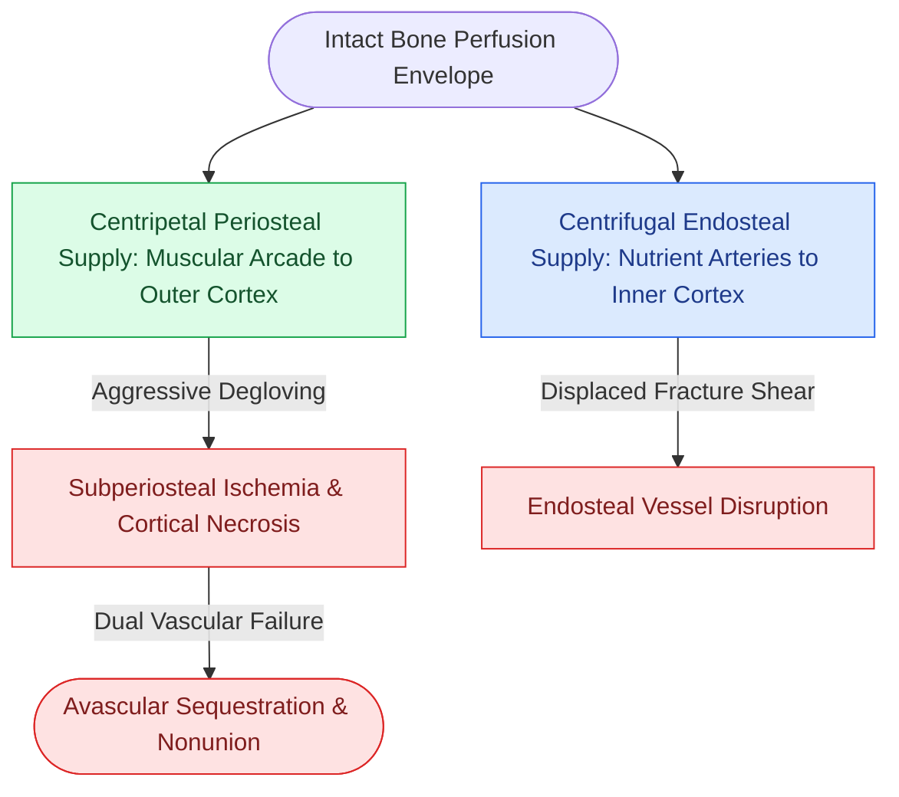

# Centripetal periosteal and centrifugal endosteal blood supplies preserve cortical bone viability

## Active Recall

> [!question]- Differentiate between centripetal and centrifugal blood supply in the facial skeleton and identify which predominates in the atrophic edentulous mandible.
> *Answer / Clinical Rationale*: **Centrifugal blood supply** flows from the interior medullary cavity outward through cortical bone via nutrient and endosteal arteries (e.g., inferior alveolar artery in the dentate mandible). **Centripetal blood supply** flows from the surrounding soft tissue and periosteal capillary network inward into the outer cortical bone layers. In the **atrophic edentulous mandible**, the inferior alveolar artery undergoes age-related atherosclerosis and thrombosis, rendering the endosteal centrifugal system non-functional; cortical survival becomes almost **100% dependent on centripetal periosteal flow** from attached musculature.

> [!question]- How does aggressive subperiosteal stripping during mandibular fracture exposure precipitate post-traumatic osteonecrosis or nonunion?
> *Answer / Clinical Rationale*: Extensive subperiosteal reflection separates the outer cortex from its overlying fascial, muscular, and periosteal microvascular arcade. Because cortical bone has limited internal collateral flow, denuding the bone over a wide footprint transforms the fracture fragments into avascular cortical sequestra. Osteocytes undergo ischemic necrosis, preventing Haversian cutting cones from remodeling the fracture and sharply increasing infection and nonunion rates.

## Core Clinical & Mechanistic Principles

The craniomaxillofacial skeleton relies on a delicate balance between **endosteal (centrifugal)** and **periosteal (centripetal)** microvascular perfusion. Understanding this dual vascular architecture is fundamental to operative design, flap harvesting, and fracture exposure. Minimizing soft-tissue degloving is paramount to maintain [[Primary contact bone healing requires absolute stability with interfragmentary strain under two percent|primary bone osteogenesis]].

Key clinical principles across anatomical regions:
1. **The Dentate Mandible**: Possesses a robust endosteal supply via the inferior alveolar artery (IAA). When a fracture occurs, the IAA may be sheared; the bone relies acutely on collateral centripetal periosteal flow from the masseter, temporalis, medial pterygoid, and digastric muscle attachments until endosteal revascularization occurs.
2. **The Atrophic Mandible**: The IAA is frequently obliterated. Stripping the lingual or labial periosteum during Luhr Class III fracture repair cuts off the sole remaining blood supply. Surgical exposure must be limited to the minimal lateral basilar footprint required for plate application.
3. **The Midface Buttresses**: The maxilla, zygoma, and nasal bones have extremely thin cortices with negligible medullary cavities; they are virtually **pure centripetal systems** sustained by overlying facial soft tissue and sinus mucosa.

## Connected Concepts & Graph Traversal
- **Atrophic Bone Pathology**: [[Severely atrophic edentulous mandible fractures classified by Luhr mandate load-bearing reconstruction plate fixation|Atrophic Mandible Reconstruction Plating]]
- **Perfusion-Preserving Hardware**: [[Locking internal fixator plates preserve periosteal microvascular perfusion without frictional bone compression|Locking Internal Fixator Technology]]
- **Direct Osteogenesis**: [[Primary contact bone healing requires absolute stability with interfragmentary strain under two percent|Primary Contact Bone Healing Threshold]]
- **Maxillary Downfracture Perfusion**: [[Le Fort I fractures separate the hard palate and require bilateral buttress plate fixation|Le Fort I Maxillary Buttress Fixation]]
- **🔗 Condylar Blood Supply (FPRS)**: [[Mandibular condyle fractures managed via open versus closed reduction depend on displacement and occlusion|Condylar Fracture Management]]
