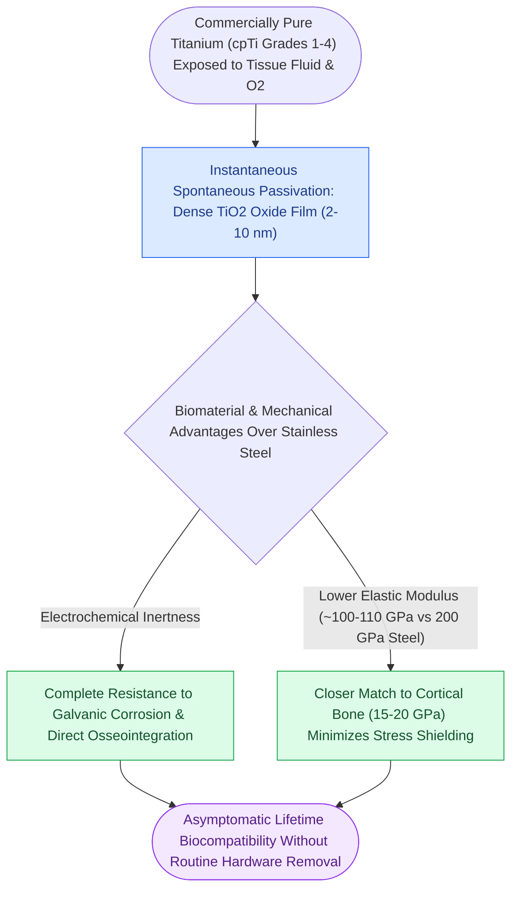

# Commercially pure titanium forms a passivated titanium dioxide layer ensuring biocompatibility

## Active Recall

> [!question]- Describe the chemical mechanism of titanium passivation and explain why it imparts superior corrosion resistance compared to stainless steel.
> *Answer / Clinical Rationale*: When titanium is exposed to oxygen, air, or biological fluids, it spontaneously forms a dense, chemically inert, ceramic-like **titanium dioxide ($	ext{TiO}_2$) passivation layer** ($2	ext{--}10	ext{ nm}$ thick) on its surface within milliseconds. If mechanically scratched, the film repassivates instantaneously in vivo. This stable oxide film acts as an impenetrable barrier that isolates underlying metal atoms from electrolytic tissue fluids, preventing electrochemical corrosion, ion leaching, and foreign-body granulomatous reactions that historically affected stainless steel.

> [!question]- How does the elastic modulus of titanium compare to cortical bone and stainless steel, and what is its clinical significance?
> *Answer / Clinical Rationale*: The elastic modulus of cortical bone is approximately **$10	ext{--}18	ext{ GPa}$**. Commercially pure titanium (cpTi) has an elastic modulus of approximately **$105	ext{--}110	ext{ GPa}$**, whereas stainless steel is **$200	ext{ GPa}$**. Titanium's lower modulus is much closer to human bone, which significantly reduces the phenomenon of **stress shielding** (osteopenia caused by hardware shielding bone from physiological functional strain).

## Core Clinical & Mechanistic Principles

**Commercially pure titanium (cpTi Grades 1–4)** and titanium alloys (e.g., Ti-6Al-7Nb) are the uncontested gold-standard biomaterials for permanent rigid internal fixation in the adult craniomaxillofacial skeleton, ensuring rigid [[Primary contact bone healing requires absolute stability with interfragmentary strain under two percent|primary bone osteosynthesis]].

Key material properties of cpTi in CMF surgery:
1. **Grades 1 to 4**: Differ primarily in trace oxygen and iron content. Grade 1 has highest ductility and lowest tensile strength (used for thin orbital meshes and microplates); Grade 4 has highest mechanical strength (used for mandibular reconstruction plates).
2. **Osseointegration**: Bone forms direct structural contact with the $	ext{TiO}_2$ surface without an intervening fibrous capsule. This anchors screws rigidly, preventing loosening.
3. **Implant Retention Doctrine**: Unlike historical stainless steel plates which mandated routine secondary surgical removal due to corrosion, cold sensation, and infection, modern titanium hardware is **biocompatible for life** and left in place unless symptomatic (pain, infection, wound dehiscence, or interference with prosthetics).

## Connected Concepts & Graph Traversal
- **Resorbable Polymer Alternative**: [[Biodegradable copolymer osteosynthesis undergoes random hydrolytic scission eliminating hardware removal|Biodegradable Copolymer Osteosynthesis]]
- **Locking Fixator Design**: [[Locking internal fixator plates preserve periosteal microvascular perfusion without frictional bone compression|Locking Internal Fixator Technology]]
- **Load-Bearing Heavy Reconstruction**: [[Load-bearing fixation supports one hundred percent of functional loads in comminuted or atrophic bone|Load-Bearing Reconstruction Plating]]
- **Atrophic Mandible Reconstruction**: [[Severely atrophic edentulous mandible fractures classified by Luhr mandate load-bearing reconstruction plate fixation|Atrophic Mandible Reconstruction Plating]]
- **Load-Sharing Miniplate Craft**: [[Load-sharing fixation relies on anatomically interlocked bone fragments to share compressive masticatory forces|Load-Sharing Osteosynthesis Principles]]
