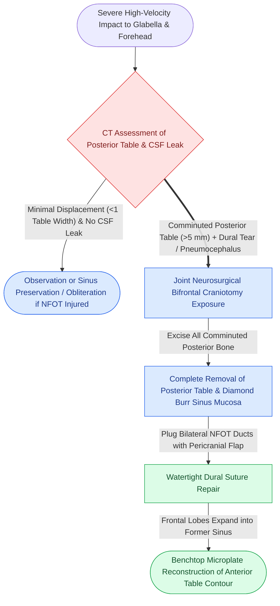

# Comminuted posterior table frontal sinus fractures with dural lacerations mandate frontal sinus cranialization

## Active Recall

> [!question]- What are the definitive indications for frontal sinus cranialization rather than sinus obliteration or conservative preservation?
> *Answer / Clinical Rationale*: Cranialization is indicated when the posterior table exhibits **comminution exceeding one table width (> 5 mm displacement)**, significant posterior displacement impinging on frontal brain parenchyma, associated **dural tears with persistent CSF leak**, or direct intracranial contusion/pneumocephalus. Comminuted posterior fragments cannot be safely stripped of mucosa or reconstructed without immense risk of intracranial mucocele, brain abscess, or meningitis.

> [!question]- Explain the surgical technique of cranialization, including management of the posterior table, anterior table, NFOT, and frontal lobes.
> *Answer / Clinical Rationale*: (1) A coronal flap and formal **bifrontal craniotomy** are performed in conjunction with neurosurgery; (2) The comminuted posterior table bone fragments are **completely excised and discarded**; (3) All mucosa is meticulously burred out from the frontal sinus floor and residual anterior table; (4) Both nasofrontal outflow ducts are permanently plugged with pericranial flaps or fascia; (5) Dural tears are repaired watertight; (6) The **frontal lobes are allowed to expand anteriorly** into the vacated sinus space; (7) The anterior table and supraorbital rims are reconstructed rigidly with microplates.

## Core Clinical & Mechanistic Principles

The posterior table of the frontal sinus serves as the dividing structural boundary between the contaminated sinonasal tract and the sterile anterior cranial fossa. High-impact fractures through this wall communicate directly with the subarachnoid space, leading to [[Traumatic cerebrospinal fluid otorrhea and rhinorrhea are managed conservatively before considering surgical skull base repair|post-traumatic CSF rhinorrhea]] and life-threatening intracranial infections.

Key operative tenets:
1. **Discarding the Posterior Table**: Unlike other facial fractures where fragment salvage is paramount, comminuted posterior table fragments are permanently removed. Reconstructing a shattered posterior table risks trapping mucosal rests between dura and bone.
2. **Dural Seal**: Meticulous watertight closure of dural lacerations is the primary life-preserving priority. Pericranial galeal flaps, fascia lata, or acellular dermal matrix are sutured in place using 4-0 or 5-0 monofilament sutures reinforced with fibrin glue.
3. **Anterior Table Repositioning**: The anterior table bone flap from the bifrontal craniotomy is meticulously reconstructed on the back table with 1.0 mm to 1.3 mm titanium mesh or microplates and secured back to the calvarium.

## Connected Concepts & Graph Traversal
- **Anterior Table Restoration**: [[Isolated anterior table frontal sinus fractures require open reduction and microplate fixation for contour restoration|Anterior Table Fracture Fixation]]
- **Sinus Obliteration Alternative**: [[Nasofrontal outflow tract injury with persistent obstruction mandates meticulous frontal sinus obliteration with autologous fat|Frontal Sinus Obliteration]]
- **Calvarial Vault Elevation**: [[Depressed cranial vault fractures exceeding full cortical bone thickness mandate surgical elevation and rigid microplate fixation|Depressed Calvarial Fractures]]
- **Biochemical CSF Testing**: [[Beta-2 transferrin and high-resolution CT localize sinonasal CSF fistulas|Biochemical CSF Fistula Localization]]
- **Buttress Foundation**: [[The facial skeleton absorbs impact forces through vertical and horizontal structural buttresses|Facial Buttress System Architecture]]
