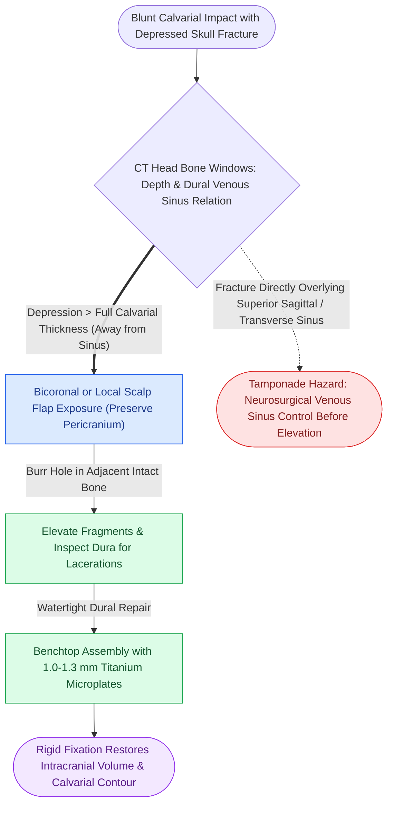

# Depressed cranial vault fractures exceeding full cortical bone thickness mandate surgical elevation and rigid microplate fixation

## Active Recall

> [!question]- What anatomical criteria define a depressed cranial vault fracture requiring operative elevation, and what are the primary surgical goals?
> *Answer / Clinical Rationale*: Operative elevation is indicated when the inner table of the fracture is **depressed by more than the full thickness of the adjacent calvarium** (typically $\ge 8\text{ to }10\text{ mm}$), or in cases of open (compound) contaminated wounds, underlying dural laceration, mass effect with neurological deficit, or severe cosmetic deformity. The primary goals are to relieve focal cortical compression, debride contaminated bone fragments, repair dural tears watertight, and restore normal calvarial vault contour.

> [!question]- How are comminuted calvarial bone fragments salvaged, contoured, and stabilized during cranioplasty?
> *Answer / Clinical Rationale*: Comminuted fragments are carefully elevated, isolated, and cleansed in antibiotic solution. On the back table, fragments are reassembled like a puzzle ("benchtop cranioplasty") and joined using **low-profile 1.0 mm to 1.3 mm titanium microplates or malleable titanium mesh**. The reconstituted calvarial unit is then replaced into the skull defect and rigidly anchored to the surrounding stable bone using monocortical micro-screws, avoiding penetration into the dura or superior sagittal sinus.

## Core Clinical & Mechanistic Principles

The calvarium is structured as a trilaminar sandwich comprising dense outer and inner cortical tables separated by vascular cancellous diploic space. High-energy localized impact drives fragments inward, while preserving the [[Centripetal periosteal and centrifugal endosteal blood supplies preserve cortical bone viability|diplöe and pericranial blood supply]].

Operative tenets:
1. **Pericranial Preservation**: Calvarial fragments devoid of dural attachment depend entirely on the overlying pericranium and scalp vascularity for revascularization and osteogenesis.
2. **Venous Sinus Caution**: Depressed fractures directly overlying the superior sagittal sinus or transverse sinus must be approached with extreme caution. Fragments may tamponade a lacerated sinus; elevating them abruptly can trigger torrential hemorrhage.
3. **Primary Bone Replacement**: In clean or non-grossly contaminated open fractures, primary replacement and rigid fixation of bone fragments is safe and avoids a secondary cranioplasty procedure.

## Connected Concepts & Graph Traversal
- **Anterior Frontal Repair**: [[Isolated anterior table frontal sinus fractures require open reduction and microplate fixation for contour restoration|Anterior Table Frontal Sinus Fractures]]
- **Posterior Table Cranialization**: [[Comminuted posterior table frontal sinus fractures with dural lacerations mandate frontal sinus cranialization|Posterior Table Cranialization]]
- **Titanium Biocompatibility**: [[Commercially pure titanium forms a passivated titanium dioxide layer ensuring biocompatibility|Titanium Microplate Biocompatibility]]
- **Facial Buttress Network**: [[The facial skeleton absorbs impact forces through vertical and horizontal structural buttresses|Facial Buttress System Architecture]]
- **Primary Bone Healing**: [[Primary contact bone healing requires absolute stability with interfragmentary strain under two percent|Primary Bone Healing]]
