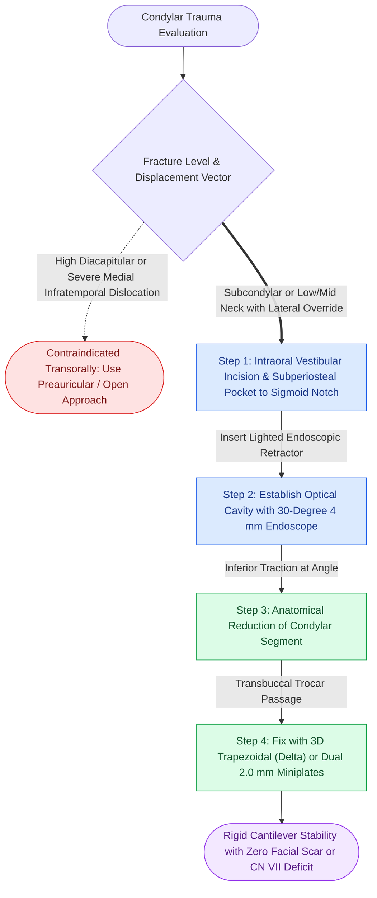

# Endoscopic-assisted transoral reduction of condylar neck fractures avoids external facial nerve dissection

## Active Recall

> [!question]- What are the primary advantages and technical limitations of endoscopic-assisted transoral reduction of condylar neck fractures?
> *Answer / Clinical Rationale*: 
> - **Advantages**: Completely avoids external skin incisions (eliminates visible facial scars) and **eliminates the risk of permanent facial nerve (CN VII) injury** because dissection remains strictly subperiosteal along the internal ramus.
> - **Limitations**: Technically demanding steep learning curve; limited 2D endoscopic depth perception; difficulty reducing medially dislocated condylar heads; and requires specialized right-angle drills, transbuccal trocars, and endoscopes (30° and 70°).

> [!question]- Describe the optical cavity creation and instrument trajectory required for transoral endoscopic subcondylar plating.
> *Answer / Clinical Rationale*: An intraoral incision is made along the anterior border of the ascending ramus (identical to a sagittal split osteotomy exposure). A subperiosteal pocket is dissected superiorly along the lateral surface of the ramus up to the sigmoid notch and condylar neck. A dedicated optical retractor with a built-in endoscope channel (30° scope) maintains the optical cavity. Reduction is achieved with bone hooks, and plating is performed using a **transbuccal trocar** (for perpendicular screw delivery) or an intraoral **90° right-angle screwdriver**.

## Core Clinical & Mechanistic Principles

Endoscopic-assisted craniomaxillofacial surgery represents the convergence of minimally invasive endoscopic techniques with rigid internal fixation. In condylar trauma, the primary hesitation for performing open reduction via [[The preauricular and retromandibular approaches provide surgical access to condylar fractures while protecting the facial nerve|traditional preauricular or retromandibular approaches]] has historically been the risk of transient (10–20%) or permanent (1–2%) facial nerve palsy.

Technical principles:
1. **Patient Selection**: Ideal for subcondylar and low-to-mid condylar neck fractures with lateral or moderate medial displacement. High diacapitular fractures or severe medial dislocations into the infratemporal fossa are excessively difficult to manipulate transorally and are better approached via preauricular incisions.
2. **Instrument Arsenal**: Requires a $30^\circ$ $4\text{ mm}$ endoscope with a sheath irrigation system, a specialized lighted elevator/retractor that holds the optical pocket open against masseteric soft tissues, and a transbuccal trocar kit for percutaneous screw placement.
3. **Fixation Stability**: Modern condylar trapezoidal plates (delta plates) or two parallel $2.0\text{ mm}$ miniplates must be utilized to resist the massive cantilever forces exerted by the lateral pterygoid muscle during opening.

## Connected Concepts & Graph Traversal
- **Champy Tension Band Comparison**: [[Mandible fractures require anatomical reduction and load-sharing miniplate fixation along Champy lines of ideal osteosynthesis|Mandibular Tension Band & Load-Sharing]]
- **Condylar ORIF Indications**: [[Mandibular condyle fractures managed via open versus closed reduction depend on displacement and occlusion|Condylar Fracture Management]]
- **Mandibular Dual-Plating**: [[Mandibular symphyseal and parasymphyseal fractures require dual-plate fixation to neutralize torsional rotational vectors|Mandibular Symphysis Dual-Plating]]
- **Locking Fixator Application**: [[Locking internal fixator plates preserve periosteal microvascular perfusion without frictional bone compression|Locking Internal Fixator Technology]]
- **Occlusal Indexing**: [[Mandibulomaxillary fixation with arch bars or cortical screws establishes the central occlusal relationship|Mandibulomaxillary Fixation Principles]]
