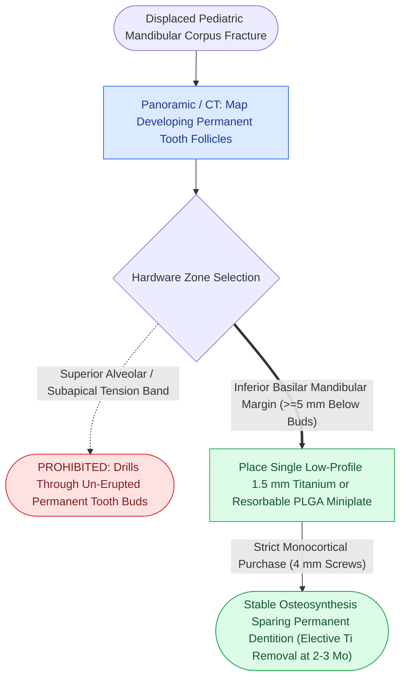

# Fixation of pediatric mandibular fractures requires monocortical plates along the inferior basilar border to preserve developing tooth buds

## Active Recall

> [!question]- Why is conventional Champy tension band plating along the alveolar margin strictly contraindicated in young children?
> *Answer / Clinical Rationale*: In pediatric patients with primary or mixed dentition (ages 2 to 11), **developing tooth buds and unerupted permanent teeth occupy almost the entire vertical height of the mandibular corpus**. Placing conventional alveolar miniplates and drilling screws near the alveolar crest drills directly through dental follicles and developing roots, causing permanent tooth loss, follicular arrest, root dysmorphology, or odontogenic cysts.

> [!question]- Where and how must internal fixation be applied to stabilize displaced pediatric mandibular fractures safely?
> *Answer / Clinical Rationale*: Fixation must be applied strictly along the **inferior basilar border of the mandible**, placing a single low-profile miniplate or resorbable plate at least $5\text{ to }8\text{ mm}$ below the developing tooth apices. Screws must be **monocortical and short ($4\text{ to }5\text{ mm}$ length)** to prevent penetration into the lingual cortex or tooth buds. In many cases, conservative management with an acrylic lingual splint (Gunning-type) secured with circummandibular wires is preferred.

## Core Clinical & Mechanistic Principles

Management of pediatric mandibular fractures requires an acute awareness of the [[Teeth in the mandibular fracture line are extracted if roots are fractured or loose but preserved if structurally intact|developing dental follicles]]. The pediatric mandible is largely a tooth-storing organ, and safe internal fixation must avoid compromising future dental development.

Surgical craft rules:
1. **Resorbable Hardware Advantage**: Resorbable poly-L/D-lactide-co-glycolide (PLGA) plates avoid the potential restriction of skeletal growth and eliminate the need for a second general anesthetic for hardware removal.
2. **Circummandibular Splints**: For minimally displaced symphyseal and body fractures in children aged 3–8, prefabricated acrylic splints wired around the lower border of the mandible provide robust stability without open periosteal dissection.
3. **Hardware Removal Rule**: If permanent titanium miniplates are placed across the inferior border, they should be electively removed 2 to 3 months post-injury to prevent plate osseointegration and growth restriction.

## Connected Concepts & Graph Traversal
- **Pediatric Elasticity**: [[Pediatric craniofacial fractures demonstrate high elasticity and greenstick patterns governed by thick osteogenic periosteum|Pediatric Craniofacial Elasticity]]
- **Condylar Remodeling**: [[Pediatric mandibular condyle fractures are managed with short-term functional mobilization to exploit biological remodeling and prevent ankylosis|Pediatric Condylar Remodeling]]
- **Resorbable Hardware**: [[Biodegradable copolymer osteosynthesis undergoes random hydrolytic scission eliminating hardware removal|Resorbable Hardware Technology]]
- **Adult Dual-Plating**: [[Mandibular symphyseal and parasymphyseal fractures require dual-plate fixation to neutralize torsional rotational vectors|Adult Mandibular Dual-Plating]]
- **Bone Healing Doctrine**: [[Primary contact bone healing requires absolute stability with interfragmentary strain under two percent|Primary Bone Healing]]
