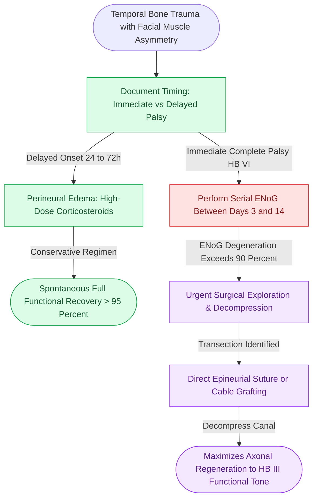

# Immediate complete facial nerve paralysis following temporal bone trauma warrants electroneuronography and surgical decompression

## Active Recall

> [!question]- How do immediate complete versus delayed incomplete post-traumatic facial paralysis differ regarding pathophysiology, prognosis, and surgical indication?
> *Answer / Clinical Rationale*: 
> - **Delayed Incomplete Paralysis** (onset 24–72 hours post-injury): Caused by secondary perineural edema, ischemia, or expanding hematoma within the fallopian canal. Has an excellent prognosis (> 95% spontaneous recovery) and is managed conservatively with high-dose intravenous corticosteroids.
> - **Immediate Complete Paralysis** (House-Brackmann VI at presentation): Indicates primary structural injury, such as **bony impingement, intraneural hematoma, or complete nerve transection**. Carries poor spontaneous recovery and warrants urgent electrodiagnostic testing and surgical exploration.

> [!question]- At what electroneuronography (ENoG) threshold and within what time window is surgical facial nerve decompression indicated?
> *Answer / Clinical Rationale*: Surgical decompression is indicated when ENoG demonstrates **greater than 90% axonal degeneration compared to the healthy contralateral side within 14 days of injury**, combined with absent voluntary motor unit action potentials on electromyography (EMG). Operating within this 14-day window before irreversible muscular motor endplate atrophy and neural fibrosis occur achieves the highest rate of facial motor recovery (recovering to House-Brackmann Grade III or better).

## Core Clinical & Mechanistic Principles

The intratemporal course of the facial nerve is constrained within a rigid bony osseous tunnel, the fallopian canal. Following a [[Temporal bone fractures classified as otic capsule violating carry high risks of sensorineural hearing loss and facial nerve transection|temporal bone fracture]], high-energy shearing forces fracture the canal walls, compressing or lacerating the nerve.

Operative pearls:
1. **Surgical Approach Selection**:
   - **Serviceable Hearing Present**: Combine a transmastoid extralabyrinthine approach (for mastoid and tympanic segments) with a middle cranial fossa (MCF) approach (for labyrinthine segment and geniculate ganglion) without violating the cochlea.
   - **Profound SNHL (Dead Ear)**: A direct **translabyrinthine approach** provides rapid, complete exposure of the entire intratemporal nerve course from the cerebellopontine angle to the stylomastoid foramen.
2. **Decompression Extent**: Decompress 180° to 270° of the bony canal circumference and slit the fibrous epineurial sheath if tense intraneural edema is observed.
3. **Primary Repair**: If nerve transection is discovered, freshen ragged nerve ends with micro-scissors and perform immediate tension-free **direct epineurial repair** using 8-0 or 9-0 monofilament sutures, or interpose a greater auricular or sural nerve cable graft.

## Connected Concepts & Graph Traversal
- **Electrodiagnostic Thresholds**: [[Electroneuronography showing greater than ninety percent degeneration within fourteen days indicates severe facial nerve axonal injury|ENoG Axonal Degeneration Thresholds]]
- **Decompression Approaches**: [[Transmastoid and middle cranial fossa facial nerve decompression relieves canalicular compression|Transmastoid and Middle Cranial Fossa Decompression]]
- **End-to-End Epineurial Repair**: [[Immediate direct epineurial end-to-end repair is the gold standard for transected facial nerve injury|Direct Epineurial Nerve Repair]]
- **House-Brackmann Grading**: [[House-Brackmann grading system stratifies facial nerve function from Grade I normal to Grade VI total paralysis|House-Brackmann Grading System]]
- **Traumatic CSF Fistula**: [[Traumatic cerebrospinal fluid otorrhea and rhinorrhea are managed conservatively before considering surgical skull base repair|Traumatic CSF Leak Management]]
