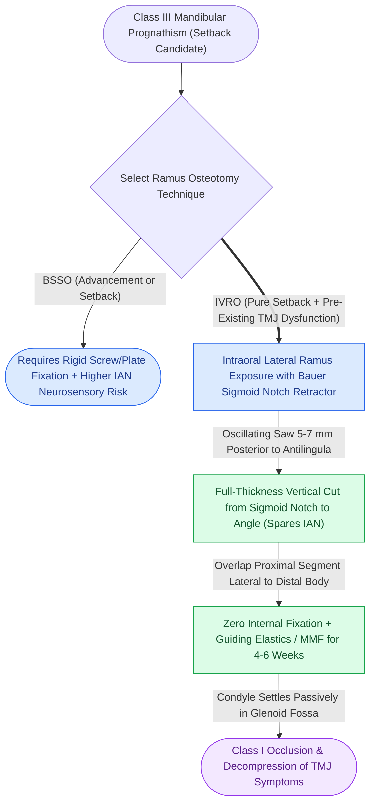

# Intraoral vertical ramus osteotomy corrects mandibular prognathism without internal fixation to eliminate condylar torquing

## Active Recall

> [!question]- What are the operative advantages and clinical indications for intraoral vertical ramus osteotomy (IVRO) over BSSO for mandibular setback?
> *Answer / Clinical Rationale*: IVRO is indicated specifically for **mandibular setback in Class III prognathism**, particularly in patients with **pre-existing TMJ internal derangement, disc displacement, or chronic joint pain**. Advantages include: (1) Virtual elimination of permanent inferior alveolar nerve injury (osteotomy cut is placed entirely posterior to the lingula); (2) Shorter operative time; (3) Complete absence of condylar torquing or compressive stress because fragments overlap passively without rigid screws; (4) Marked improvement or resolution of pre-existing TMJ pain.

> [!question]- Why is rigid internal fixation contraindicated in classic IVRO, and how is the patient managed postoperatively?
> *Answer / Clinical Rationale*: Rigid internal fixation with screws or plates is contraindicated in IVRO because securing the overlapping proximal and distal ramus fragments forces the condylar head out of its physiological alignment. Leaving the proximal segment unfixed allows the **condyle to seek its natural, passive position within the glenoid fossa** under lateral pterygoid tone. Because fragments are not rigidly fixed, the patient requires **4 to 6 weeks of mandibulomaxillary fixation (MMF)** or guiding elastics while broad cortical surfaces undergo secondary bone healing.

## Core Clinical & Mechanistic Principles

While [[Bilateral sagittal split osteotomy achieves mandibular repositioning via sagittal corticotomies and non-compressive position screw fixation|BSSO advancement]] dominates orthognathic surgery, intraoral vertical ramus osteotomy (IVRO) provides a tissue-sparing alternative for pure setbacks with excellent TMJ safety.

Technical pearls:
1. **Osteotomy Trajectory**: The cut starts at the midpoint of the sigmoid notch and extends downward to the inferior border $5\text{ mm}$ anterior to the posterior ramus margin, remaining safely behind the antilingula.
2. **Coronoidectomy Adjunct**: If significant setback is performed ($> 7\text{ mm}$), ipsilateral coronoidectomy or temporalis tendon release may be necessary to prevent impingement against the zygomatic arch.
3. **Secondary Union**: Despite the lack of rigid fixation, nonunion is exceedingly rare in IVRO due to the extensive, broad surface area of overlapping cortical bone bathed in masseteric and pterygoid vascularity.

## Connected Concepts & Graph Traversal
- **Mandibular Symphysis Craft**: [[Mandibular symphyseal and parasymphyseal fractures require dual-plate fixation to neutralize torsional rotational vectors|Mandibular Symphysis Dual-Plating]]
- **Secondary Callus Healing**: [[Secondary indirect bone healing proceeds through an enchondral cartilaginous callus under relative stability|Secondary Bone Healing Callus]]
- **Two-Jaw Coordination**: [[Two-jaw bimaxillary orthognathic sequencing utilizes intermediate and final occlusal splints to coordinate three-dimensional repositioning|Two-Jaw Splint Sequencing]]
- **Condylar Access Approaches**: [[The preauricular and retromandibular approaches provide surgical access to condylar fractures while protecting the facial nerve|Condylar Ramus Approaches]]
- **MMF System Mechanics**: [[Mandibulomaxillary fixation with arch bars or cortical screws establishes the central occlusal relationship|MMF Fixation Systems]]
