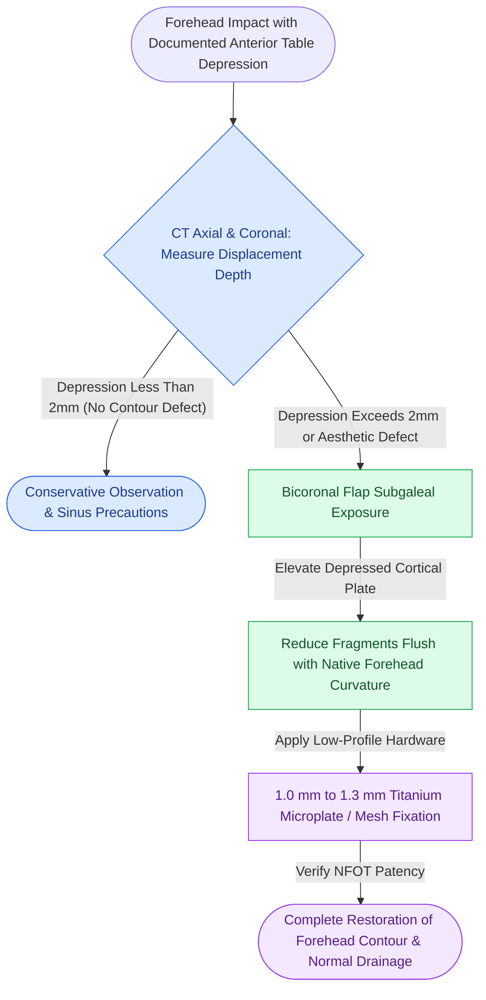

# Isolated anterior table frontal sinus fractures require open reduction and microplate fixation for contour restoration

## Active Recall

> [!question]- What are the operative indications for open reduction and internal fixation of isolated anterior table frontal sinus fractures?
> *Answer / Clinical Rationale*: Operative intervention is indicated when **aesthetic contour deformity exceeds 2 to 3 mm of posterior displacement** (or greater than the thickness of the anterior cortical table). Non-displaced or minimally displaced fractures (< 2 mm without aesthetic flattening) can be managed non-operatively with serial clinical observation. Bony impingement into the nasofrontal outflow tract (NFOT) or associated mucosal laceration also dictates open surgical exploration.

> [!question]- Which surgical approaches provide access to the anterior table of the frontal sinus, and how is contour restoration achieved?
> *Answer / Clinical Rationale*: The gold standard exposure is the **coronal (bicoronal) flap**, elevated in the subgaleal plane to protect the frontal branches of the facial nerve, followed by pericranial incision and subperiosteal exposure of the anterior table and supraorbital rims. In bald patients with forehead rhytids, an endoscopic transfrontal approach or direct forehead laceration exploration may be selected. Displaced fragments are elevated using bone hooks, reduced flush, and stabilized using **low-profile 1.0 mm to 1.3 mm titanium microplates or curved anatomical mesh**.

## Core Clinical & Mechanistic Principles

The frontal bone is among the most resilient structural units of the human calvarium, requiring impact loads of 800 to 1,600 lbs to fracture. The anterior table functions biomechanically as an aesthetic shield protecting the anterior cranial fossa while contributing to the upper [[The facial skeleton absorbs impact forces through vertical and horizontal structural buttresses|frontal bar buttress]].

Surgical craft pearls:
1. **Pericranial Flap Preservation**: When elevating a coronal incision, preserve an intact, vascularized pericranial flap based on the supraorbital and supratrochlear vessels in case local coverage or subsequent sinus obliteration is required.
2. **NFOT Assessment**: Prior to definitive plate osteosynthesis, instill saline or dilute fluorescein into the frontal sinus cavity while visualizing the middle meatus endoscopically to confirm unobstructed nasofrontal drainage.
3. **Hardware Profile**: The skin and subcutaneous tissue overlying the frontal bar and glabella are thin. Standard miniplates (> 1.5 mm) cause visible prominence, hardware palpability, and skin breakdown. Only 1.0 mm to 1.3 mm microplates or dedicated malleable frontal contour mesh should be utilized.

## Connected Concepts & Graph Traversal
- **Posterior Table Status**: [[Comminuted posterior table frontal sinus fractures with dural lacerations mandate frontal sinus cranialization|Posterior Table Cranialization]]
- **Outflow Tract Evaluation**: [[Nasofrontal outflow tract injury with persistent obstruction mandates meticulous frontal sinus obliteration with autologous fat|Frontal Sinus Obliteration Criteria]]
- **Endoscopic Frontal Drainage**: [[Draf III modified Lothrop unites both frontal sinuses into a common cavity|Draf III Frontal Sinusotomy]]
- **Calvarial Vault Repair**: [[Depressed cranial vault fractures exceeding full cortical bone thickness mandate surgical elevation and rigid microplate fixation|Depressed Calvarial Fractures]]
- **Biomaterial Profile**: [[Commercially pure titanium forms a passivated titanium dioxide layer ensuring biocompatibility|Titanium Microplate Biocompatibility]]
