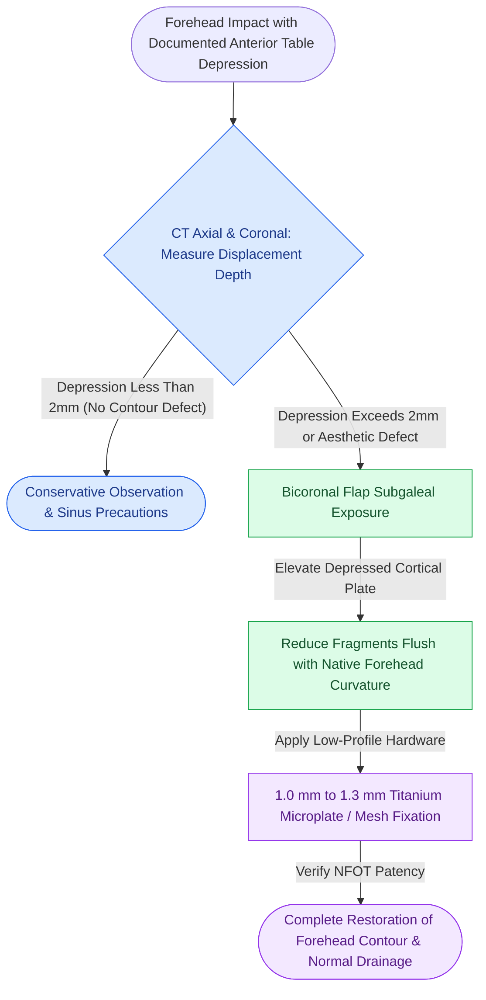

# Isolated anterior table frontal sinus fractures require open reduction and microplate fixation for contour restoration

## Active Recall

> [!question]- What are the clinical and radiological indications for surgical repair of isolated anterior table frontal sinus fractures?
> *Answer / Clinical Rationale*: Operative reduction and fixation are indicated when **displacement exceeds $1\text{–}2\text{ mm}$ to $2\text{–}3\text{ mm}$ (or greater than one cortical table width)**, producing visible forehead contour depression, aesthetic flattening, or fracture mobility on palpation, as well as bony impingement into the nasofrontal outflow tract (NFOT) or associated mucosal laceration. Non-displaced fractures ($<1\text{–}2\text{ mm}$) without contour depression are managed non-operatively with serial clinical observation.

> [!question]- Which surgical exposure corridors access the anterior table while protecting the facial nerve and supraorbital neurovascular bundles?
> *Answer / Clinical Rationale*: The gold standard is a **zig-zag coronal (bicoronal) incision** placed $3\text{–}5\text{ cm}$ behind the anterior hairline. Dissection proceeds in the **subgaleal plane** to $2\text{–}3\text{ cm}$ above the supraorbital rims, where the pericranium is incised to transition to a **subperiosteal plane**—protecting the **frontal branch of the facial nerve** within the temporoparietal fascia (TPF) and preserving the supraorbital/supratrochlear bundles. In bald patients or deep forehead rhytids, an endoscopic transfrontal approach or direct forehead laceration exploration may be used.

> [!question]- How are displaced anterior table fragments elevated and rigidly stabilized without visible hardware prominence?
> *Answer / Clinical Rationale*: A small pilot hole is drilled in the central depressed fragment for placement of a **corkscrew, Carroll-Girard screw, or bone hook** to disimpact fragments outward while preserving osteoperiosteal attachments. Fragments are reassembled like a 3D jigsaw puzzle and fixated with **low-profile $1.0\text{–}1.3\text{ mm}$ titanium microplates or pre-curved anatomical mesh** secured with **self-drilling monocortical screws ($3\text{–}4\text{ mm}$ length)**, because thicker miniplates ($>1.5\text{ mm}$) become palpable and visible through thin forehead skin.

## Core Clinical & Mechanistic Principles

The **anterior table of the frontal bone** is a thick cortical barrier ($4\text{–}12\text{ mm}$ thick) and one of the most resilient structural units of the human calvarium, requiring impact loads of $800\text{ to }1,600\text{ lbs}$ to fracture. It functions biomechanically as an aesthetic shield protecting the anterior cranial fossa while contributing to the upper [[The facial skeleton absorbs impact forces through vertical and horizontal structural buttresses|frontal bar buttress]].

- **Pathophysiology & Indications**:
  - *Isolated Anterior Table Injury*: Involves the convex forehead aesthetic unit without posterior cortical wall disruption, dural tear, or nasofrontal outflow tract (NFOT) obstruction.
  - *Consequences of Non-Operative Neglect*: Unreduced displaced fragments heal with permanent, disfiguring forehead flattening, localized concavity, contour shadows, and visible bony step-offs.
  - *Late Camouflage Alternatives*: Delayed unreduced contour defects require alloplastic onlay contouring using **porous polyethylene (Medpor®)**, **custom PEEK implants**, or **calcium phosphate osteoconductive bone cements**.

### Operative Technique & Craft Nuances
1. **Exposure & Nerve Protection**: Perform a zig-zag coronal incision $3\text{–}5\text{ cm}$ behind the hairline and elevate anteriorly in the loose areolar **subgaleal plane**. Switch to a **subperiosteal plane $2\text{–}3\text{ cm}$ superior to the orbital rims** to protect the supraorbital/supratrochlear neurovascular bundles and the [[Pitanguy's line defines the danger zone for the frontal branch of the facial nerve|frontal branch]] of CN VII traveling in the temporoparietal fascia. Preserve an intact vascularized pericranial flap based on the supraorbital and supratrochlear vessels in case local coverage or sinus obliteration is required.
2. **Reduction Craft**: Drill a small pilot hole in the central depressed fragment and use a **corkscrew, Carroll-Girard screw, or bone hook** deep to the edge to elevate and disimpact fragments outward. Preserve osteoperiosteal attachments whenever possible to maintain fragment viability, reassembling fragments like a 3D jigsaw puzzle.
3. **NFOT Assessment**: Prior to definitive plate osteosynthesis, instill saline or dilute fluorescein into the frontal sinus cavity while visualizing the middle meatus endoscopically to confirm unobstructed nasofrontal drainage.
4. **Hardware Profile & Closure**: Because forehead and glabellar soft tissue is thin, standard miniplates ($>1.5\text{ mm}$) cause visible prominence, palpability, and skin breakdown. Use only **$1.0\text{–}1.3\text{ mm}$ low-profile titanium microplates or dedicated malleable frontal contour mesh** with $3\text{–}4\text{ mm}$ self-drilling monocortical screws, then redrape the periosteum and perform layered galeal closure to prevent hardware exposure.

## Connected Concepts & Graph Traversal
- **Posterior Table Status**: [[Comminuted posterior table frontal sinus fractures with dural lacerations mandate frontal sinus cranialization|Posterior Table Cranialization]]
- **Outflow Tract Evaluation**: [[Nasofrontal outflow tract injury with persistent obstruction mandates meticulous frontal sinus obliteration with autologous fat|Frontal Sinus Obliteration Criteria]]
- **🔗 Endoscopic Frontal Drainage (Sinus)**: [[Draf III modified Lothrop unites both frontal sinuses into a common cavity|Draf III Frontal Sinusotomy]]
- **Calvarial Vault Repair**: [[Depressed cranial vault fractures exceeding full cortical bone thickness mandate surgical elevation and rigid microplate fixation|Depressed Calvarial Fractures]]
- **Biomaterial Profile**: [[Commercially pure titanium forms a passivated titanium dioxide layer ensuring biocompatibility|Titanium Microplate Biocompatibility]]
- **🔗 Facial Nerve Frontal Branch Safety (FPRS)**: [[Pitanguy's line defines the danger zone for the frontal branch of the facial nerve|Pitanguy Line & Frontal Branch]]
