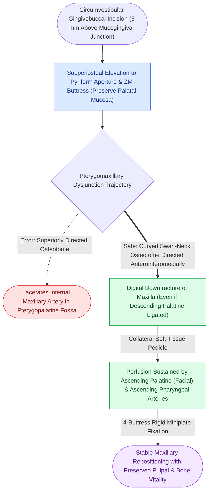

# Le Fort I downfracture osteotomy preserves collateral maxillary perfusion via the ascending palatine and ascending pharyngeal arteries

## Active Recall

> [!question]- What vascular vessels supply the mobilized downfractured maxilla after transection of the descending palatine arteries during a Le Fort I osteotomy?
> *Answer / Clinical Rationale*: Complete downfracture of the maxilla transects the maxillary artery branches supplying the maxillary sinus and often requires stretching or clipping of the descending palatine arteries. Dentoalveolar viability relies entirely on collateral mucosal perfusion from: (1) The **ascending palatine branch of the facial artery**; (2) The **ascending pharyngeal artery** (via the soft palate); and (3) Anastomoses from the anterior palatal mucosa. A robust palatal and buccal gingival soft-tissue pedicle is mandatory to prevent ischemic osteonecrosis.

> [!question]- What surgical maneuvers must be avoided to prevent avascular necrosis of the maxillary dentoalveolar segment?
> *Answer / Clinical Rationale*: (1) **Excessive subperiosteal dissection across the palatal vault** (the hard palate mucoperiosteum must never be stripped); (2) Unnecessary transection of the posterior palatal vascular pedicles; (3) Aggressive electrocautery near the greater palatine foramina; and (4) In multi-piece segmented maxillae, making interdental mucosal incisions that devascularize isolated dentoalveolar segments.

## Core Clinical & Mechanistic Principles

The biological safety of the Le Fort I downfracture osteotomy is rooted in the resilient [[Centripetal periosteal and centrifugal endosteal blood supplies preserve cortical bone viability|collateral soft-tissue microcirculation]] of the palate. Subperiosteal dissection must remain strictly buccal and nasal, keeping the oral palatal mucosa undisturbed.

Surgical craft pearls:
1. **Pterygoid Dysjunction**: Use a curved swan-neck osteotome directed anteriorly, inferiorly, and medially at the pterygomaxillary junction. Directing the osteotome superiorly risks lacerating the internal maxillary artery in the pterygopalatine fossa, causing catastrophic arterial hemorrhage.
2. **Nasal Septum and Lateral Nasal Wall**: Divide the cartilaginous and bony nasal septum with a guarded septal osteotome flush with the maxillary crest to prevent buckling of the septum and airway obstruction upon maxillary superior repositioning (impaction).
3. **Alar Base Cinch Suture**: Superior repositioning and advancement of the maxilla widens the alar base. A transverse cinch suture engaging the alar fibrocartilage controls nasal width and preserves aesthetics.

## Connected Concepts & Graph Traversal
- **Rapid Palatal Expansion**: [[Surgically assisted rapid palatal expansion combines subtotal Le Fort I osteotomies with midpalatal distraction for transverse maxillary deficiency|SARPE Transverse Distraction]]
- **Bimaxillary Splint Coordination**: [[Two-jaw bimaxillary orthognathic sequencing utilizes intermediate and final occlusal splints to coordinate three-dimensional repositioning|Two-Jaw Bimaxillary Sequencing]]
- **Facial Buttress Framework**: [[The facial skeleton absorbs impact forces through vertical and horizontal structural buttresses|Facial Buttress Architecture]]
- **Primary Bone Union**: [[Primary contact bone healing requires absolute stability with interfragmentary strain under two percent|Primary Bone Healing]]
- **Locking Plate Technology**: [[Locking internal fixator plates preserve periosteal microvascular perfusion without frictional bone compression|Locking Miniplates]]
