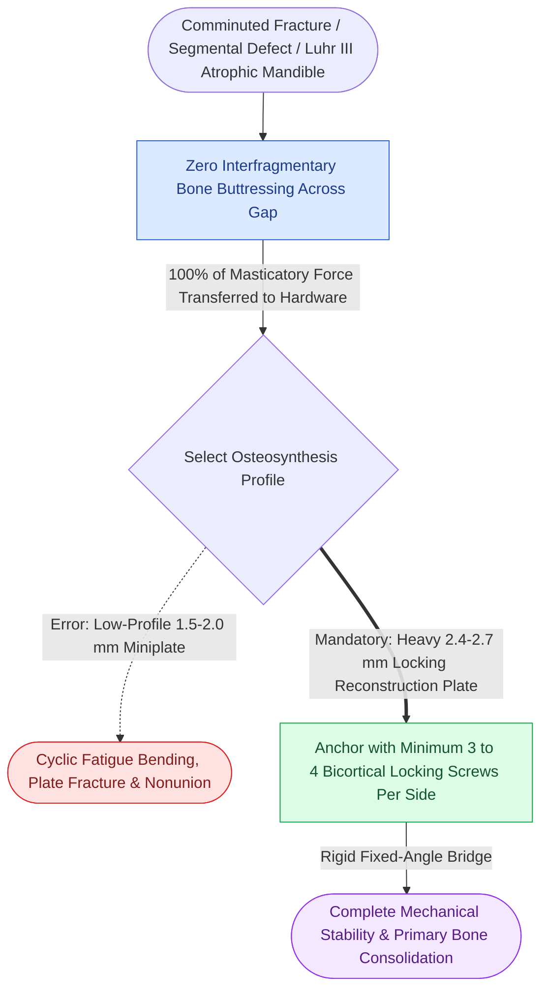

# Load-bearing fixation supports one hundred percent of functional loads in comminuted or atrophic bone

## Active Recall

> [!question]- Define load-bearing osteosynthesis and identify the four primary clinical indications in craniomaxillofacial trauma.
> *Answer / Clinical Rationale*: **Load-bearing osteosynthesis** is a biomechanical construct wherein the internal fixation hardware assumes **100% of all functional masticatory, bending, and torsional loads**, because the underlying bone fragments cannot share compressive force. The four primary indications are: (1) **Comminuted fractures** with loss of bone buttressing; (2) **Segmental bone defects** (e.g., ballistic injury or tumor resection); (3) **Severely atrophic edentulous mandibles** (Luhr Class II and III, height $\le 15	ext{ mm}$); and (4) **Infected nonunions or osteoradionecrosis** requiring radical debridement.

> [!question]- What are the minimum hardware specifications and screw purchase requirements for a mandibular load-bearing construct?
> *Answer / Clinical Rationale*: Mandibular load-bearing fixation mandates a heavy **$2.4	ext{ mm}$ or $2.7	ext{ mm}$ titanium reconstruction plate** (preferably locking). The plate must be secured with a minimum of **three to four bicortical locking screws in solid, uninjured bone on each side of the defect or comminution zone**, spanning the inferior basilar border to resist massive masseteric elevator torque without hardware fatigue failure.

## Core Clinical & Mechanistic Principles

The fundamental division in AO internal fixation is between load-bearing and load-sharing osteosynthesis. In load-bearing constructs, the hardware bridges a biomechanically compromised skeletal gap without relying on fragment interlock or bone-to-bone contact, providing absolute rigidity to achieve [[Primary contact bone healing requires absolute stability with interfragmentary strain under two percent|primary bone union]].

Key technical tenets:
1. **Section Modulus and Fatigue Life**: Because the plate bears all functional forces, low-profile miniplates ($1.0	ext{--}2.0	ext{ mm}$) will fail rapidly due to cyclic fatigue bending. Heavy reconstruction plates have a cross-sectional thickness ($2.0	ext{--}3.0	ext{ mm}$) engineered to survive millions of chewing cycles.
2. **Locking Screw Superiority**: Utilizing locking reconstruction plates creates a rigid fixed-angle frame that prevents screw toggle, stripping, and secondary plate pull-out in soft, osteopenic, or thin cortical bone.
3. **Plate Contouring**: The plate must be contoured meticulously to match the mandibular basilar arch or pre-bent using 3D stereolithographic models or intraoperative malleable templates to avoid fragment rotation during screw insertion.

## Connected Concepts & Graph Traversal
- **Load-Sharing Contrast**: [[Load-sharing fixation relies on anatomically interlocked bone fragments to share compressive masticatory forces|Load-Sharing Fixation Contrast]]
- **Atrophic Mandible Application**: [[Severely atrophic edentulous mandible fractures classified by Luhr mandate load-bearing reconstruction plate fixation|Atrophic Mandible Reconstruction Plating]]
- **Locking Fixator Mechanics**: [[Locking internal fixator plates preserve periosteal microvascular perfusion without frictional bone compression|Locking Internal Fixator Technology]]
- **🔗 Panfacial Skeletal Anchoring (FPRS)**: [[Panfacial fracture reconstruction proceeds from known stable peripheral buttresses to central occlusion|Panfacial Occlusal Anchoring]]
- **🔗 Condylar Position Protection (FPRS)**: [[Mandibular condyle fractures managed via open versus closed reduction depend on displacement and occlusion|Condylar Fracture Management]]
