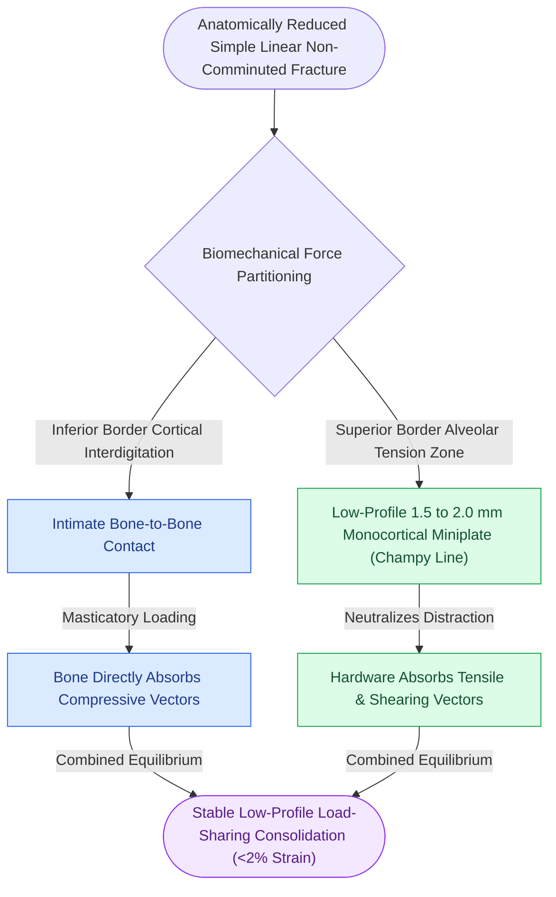

# Load-sharing fixation relies on anatomically interlocked bone fragments to share compressive masticatory forces

## Active Recall

> [!question]- Explain the biomechanical mechanism of load-sharing osteosynthesis and state its strict prerequisite.
> *Answer / Clinical Rationale*: In **load-sharing osteosynthesis**, the stability of the repaired bone is distributed between the internal fixation hardware and the bone fragments themselves. The strict prerequisite is **anatomical reduction with stable bony contact across the fracture interface**. When reduced, the interlocking cortical bone surfaces absorb functional compressive forces, while low-profile miniplates ($1.5	ext{--}2.0	ext{ mm}$) neutralize tensile, rotational, and bending vectors.

> [!question]- Why does applying load-sharing miniplate fixation to a fracture with a missing cortical gap result in hardware failure?
> *Answer / Clinical Rationale*: Miniplates are engineered with low profile and limited section modulus; they are not designed to carry 100% of functional masticatory forces. When a cortical gap exists, the bone cannot transmit compressive loads across the fracture. The entire bending moment is concentrated across the unsupported plate bridge, causing rapid cyclic metal fatigue, plate bending, or screw pull-out. A cortical defect mandates conversion to a **load-bearing reconstruction plate**.

## Core Clinical & Mechanistic Principles

**Load-sharing osteosynthesis** is the cornerstone of modern, minimally invasive craniomaxillofacial surgery. By taking advantage of the innate structural strength of the reduced skeleton, surgeons can utilize small, low-profile miniplates that minimize soft tissue dissection, prevent hardware palpability, and reduce devascularization while driving interfragmentary strain into the zone for [[Primary contact bone healing requires absolute stability with interfragmentary strain under two percent|primary contact bone healing]].

Key clinical applications:
1. **Champy Tension Band Miniplates**: In the mandible, placing a $2.0	ext{ mm}$ monocortical miniplate along the external oblique line neutralizes tensile distraction. Chewing forces drive the inferior border into compression, which is shared by the intact lower cortical buttress.
2. **Midfacial Buttress Miniplating**: In Le Fort fractures, $1.5	ext{ mm}$ or $2.0	ext{ mm}$ L-plates placed across the vertical pyriform and zygomaticomaxillary pillars stabilize vertical height, while the interdigitated bone interfaces absorb vertical occlusal loading.
3. **Lag Screw Fixation**: Lag screws represent the ultimate form of load sharing, converting functional loads into interfragmentary friction.

## Connected Concepts & Graph Traversal
- **Champy Tension Band System**: [[Mandible fractures require anatomical reduction and load-sharing miniplate fixation along Champy lines of ideal osteosynthesis|Mandibular Tension Band & Load-Sharing]]
- **Interfragmentary Compression**: [[The lag screw principle generates interfragmentary compression by engaging solely the distal cortex|The Lag Screw Principle]]
- **Locking Fixator Alternative**: [[Locking internal fixator plates preserve periosteal microvascular perfusion without frictional bone compression|Locking Internal Fixator Technology]]
- **Buttress Arch Alignment**: [[The facial skeleton absorbs impact forces through vertical and horizontal structural buttresses|Facial Buttress System Architecture]]
- **Maxillary Level I Fixation**: [[Le Fort I fractures separate the hard palate and require bilateral buttress plate fixation|Le Fort I Maxillary Buttress Fixation]]
