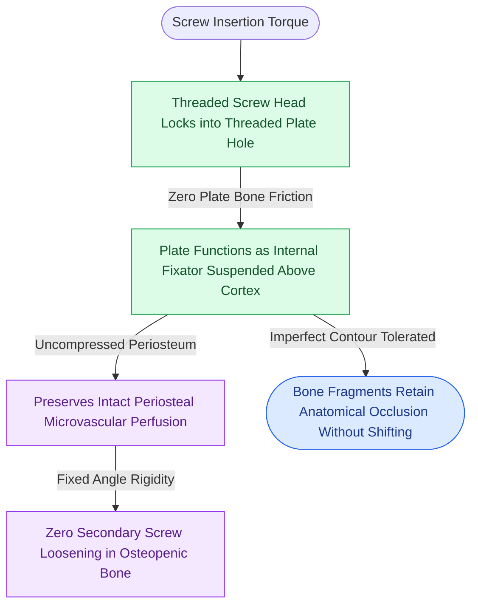

# Locking internal fixator plates preserve periosteal microvascular perfusion without frictional bone compression

## Active Recall

> [!question]- How does the biomechanical load-transfer mechanism of a locking plate differ fundamentally from a conventional non-locking plate?
> *Answer / Clinical Rationale*: Conventional non-locking plates rely on **frictional resistance** generated between the plate undersurface and cortical bone by tightening screws; this friction presses the plate firmly against periosteum, risking devascularization. In contrast, locking plates feature threaded screw heads that engage mating threads within the plate holes, converting the plate and screws into a rigid **fixed-angle internal fixator**. Functional loads are transmitted through the screw threads directly to the plate beam without requiring compressive contact against the bone.

> [!question]- Why does a minor pre-bending discrepancy in a locking plate avoid fragment displacement, whereas an identical discrepancy in a conventional plate causes malocclusion?
> *Answer / Clinical Rationale*: In a conventional system, driving the screw home draws the underlying bone toward the plate until full contact is reached; if the plate contour is imperfect, the bone conforms to the plate, causing angular rotation and occlusal shift. In a locking plate system, the screw head locks into the plate thread, arresting advancement at a fixed angle. The plate acts as an external fixator placed subcutaneously; no compressive pulling force is exerted on the cortex, locking fragments in their reduced spatial orientation regardless of a small plate-bone gap.

## Core Clinical & Mechanistic Principles

The development of **locking internal fixator technology** represents one of the major evolutionary leaps in craniomaxillofacial trauma surgery. In conventional osteosynthesis, stability is purely frictional: driving a screw into bone forces the plate against the underlying periosteum. In regions with delicate cortical architecture, such as the [[Mandible fractures require anatomical reduction and load-sharing miniplate fixation along Champy lines of ideal osteosynthesis|mandibular angle and body]], this compression occludes periosteal microvessels, creating localized cortical ischemia, bone resorption under the plate, and secondary screw loosening.

Locking systems decouple bone stability from plate-to-bone contact:
1. **Biological Preservation of Periosteal Blood Supply**: Because the plate does not compress the cortex, periosteal perfusion beneath the plate footprint remains completely patent. This markedly reduces infection rates and accelerates osteogenesis.
2. **Fixed-Angle Structural Rigidity**: Every screw functions as a rigid cantilever beam locked perpendicular (or at defined angles) to the plate. The system behaves mechanically like an external fixator placed beneath the soft tissue envelope.
3. **Prevention of Primary Stripping & Loosening**: In thin cortical bone or osteopenic fractures (e.g., the atrophic edentulous mandible), conventional screws frequently strip their thread tracks during final tightening. Locking screws cannot strip the bone because the mechanical stop is governed by the plate thread, not bone resistance.
4. **Forgiving Plate Contouring**: Exact anatomical adaptation of the plate to bone is no longer required. Even if a $1\text{--}2\text{ mm}$ gap exists between the plate and cortex, driving the locking screws home will **NOT** displace the bone fragments into malalignment.

## Connected Concepts & Graph Traversal
- **Biomechanical Strain Control**: [[Primary contact bone healing requires absolute stability with interfragmentary strain under two percent|Primary Contact Bone Healing Threshold]]
- **Midface Multi-Point Fixation**: [[Zygomaticomaxillary complex fractures disrupt four buttress articulations requiring multi-point reduction|ZMC Multi-Point Rigid Fixation]]
- **Maxillary Buttress Restoration**: [[Le Fort I fractures separate the hard palate and require bilateral buttress plate fixation|Le Fort I Maxillary Buttress Fixation]]
- **Panfacial Frame Realignment**: [[Panfacial fracture reconstruction proceeds from known stable peripheral buttresses to central occlusion|Panfacial Occlusal Anchoring]]
- **Condylar Mobility Preservation**: [[Mandibular condyle fractures managed via open versus closed reduction depend on displacement and occlusion|Condylar Fracture Management]]
