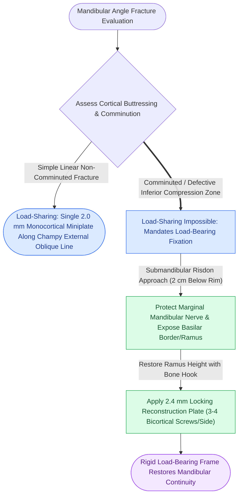

# Mandibular angle fractures with comminution or bone defects mandate load-bearing reconstruction plates

## Active Recall

> [!question]- Why is a transoral Champy single miniplate contraindicated in a comminuted mandibular angle fracture?
> *Answer / Clinical Rationale*: Champy's ideal osteosynthesis relies entirely on **load-sharing** across an intact, interdigitating inferior cortical border. In a comminuted angle fracture or one with an inferior border defect, the lower border cannot transmit compressive loads. Applying a single superior miniplate leaves the entire masticatory bending moment unsupported across the defect, causing immediate plate deformation, splaying of the angle, screw pull-out, and nonunion. Comminution mandates conversion to a **100% load-bearing reconstruction plate**.

> [!question]- What surgical approach and plate specifications are required to stabilize a comminuted mandibular angle fracture?
> *Answer / Clinical Rationale*: A comminuted angle fracture requires an **extraoral submandibular (Risdon) approach** (placed $\ge 2\text{ cm}$ below the mandibular margin to protect the marginal mandibular branch of CN VII). Fixation mandates a heavy **$2.4\text{ mm}$ locking reconstruction plate** contoured along the inferior border and ascending ramus, anchored with at least **3 to 4 bicortical locking screws in solid bone** on each side of the comminuted zone.

## Core Clinical & Mechanistic Principles

The mandibular angle is the biomechanical transition zone between the tooth-bearing horizontal body and the vertical ascending ramus. While simple linear fractures in dentate patients are classically managed with load-sharing miniplates along [[Mandible fractures require anatomical reduction and load-sharing miniplate fixation along Champy lines of ideal osteosynthesis|Champy's line of ideal osteosynthesis]], comminution shatters the inferior compression zone.

Operative pearls for comminuted angle repair:
1. **Third Molar Management**: If an impacted or partially erupted third molar is comminuted, mobile, or sits directly in the infected fracture gap, it must be extracted. If the tooth has an intact root and does not impede plate placement, it can be preserved to provide vertical occlusal stops during MMF.
2. **Transcervical Exposure**: Although transoral trocars exist for simple plates, heavy $2.4\text{ mm}$ reconstruction plates cannot be accurately contoured or secured with multi-screw bicortical purchase without open transcervical exposure.
3. **Restoring Ramus Height**: In comminuted angle fractures, the proximal ramus segment is pulled upward and medially by the temporalis and medial pterygoid muscles. The surgeon must apply inferior traction with a bone hook to restore vertical ramus height before locking screws into the ramus.

## Connected Concepts & Graph Traversal
- **Load-Bearing Doctrine**: [[Load-bearing fixation supports one hundred percent of functional loads in comminuted or atrophic bone|Load-Bearing Reconstruction Plating]]
- **Symphysis Dual-Plating**: [[Mandibular symphyseal and parasymphyseal fractures require dual-plate fixation to neutralize torsional rotational vectors|Mandibular Symphysis Dual-Plating]]
- **Condylar Subluxation Risks**: [[Mandibular condyle fractures managed via open versus closed reduction depend on displacement and occlusion|Condylar Fracture Management]]
- **Occlusal Registration**: [[Mandibulomaxillary fixation with arch bars or cortical screws establishes the central occlusal relationship|Mandibulomaxillary Fixation Principles]]
- **Locking Plate Technology**: [[Locking internal fixator plates preserve periosteal microvascular perfusion without frictional bone compression|Locking Internal Fixator Technology]]
