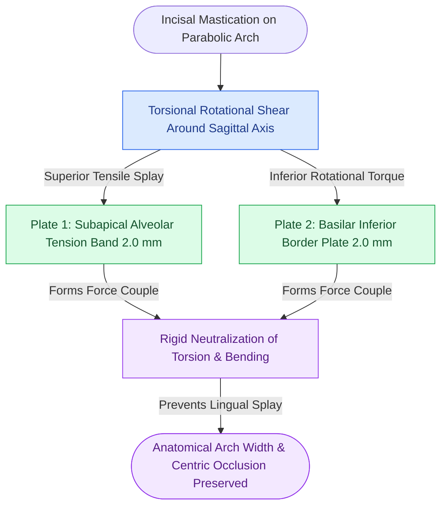

# Mandibular symphyseal and parasymphyseal fractures require dual-plate fixation to neutralize torsional rotational vectors

## Active Recall

> [!question]- Why does a single superior tension band miniplate fail in the mandibular symphysis despite being adequate at the mandibular angle?
> *Answer / Clinical Rationale*: At the angle, functional vectors are primarily planar tension along the superior border and compression along the inferior border. In the anterior horseshoe arch of the symphysis and parasymphysis, dynamic incisal biting and bilateral masseteric contraction generate powerful **torsional twisting moments around the sagittal axis** and lateral splaying vectors. A single plate neutralizes tension but cannot resist rotational torque around the long axis; an inferior basilar plate is mandatory to create a **force couple** that neutralizes torsion.

> [!question]- Where must the superior and inferior plates be positioned in the symphysis to avoid dental root and mental nerve injury?
> *Answer / Clinical Rationale*: 
> - **Superior Tension Band Plate**: Placed $\ge 5\text{ mm}$ apical to the canine and incisor root apices (monocortical screws, $2.0\text{ mm}$, length $6\text{--}8\text{ mm}$) to preserve periodontal pulp viability.
> - **Inferior Basilar Plate**: Placed $4\text{--}6\text{ mm}$ above the lower mandibular margin (bicortical or locking screws, $2.0\text{ mm}$) below the level of the mental nerve trunk as it emerges from the mental foramen.

## Core Clinical & Mechanistic Principles

The anterior mandible between the bilateral mental foramina encompasses the symphysis (between central incisors) and parasymphysis (canine to lateral incisor). The unique parabolic curvature of the chin subjects this region to intense rotational shear stresses during unilateral and bilateral mastication. Biomechanically, stable repair relies on [[Load-sharing fixation relies on anatomically interlocked bone fragments to share compressive masticatory forces|load-sharing dual-plate fixation]].

Key surgical tenets:
1. **The Dual-Plate Standard**: Two $2.0\text{ mm}$ miniplates spaced at least $4\text{--}5\text{ mm}$ apart vertically. The superior plate acts as an alveolar tension band; the inferior plate acts as a basilar neutralization strut.
2. **Alternative Lag Screw Technique**: In oblique fractures with adequate cross-sectional thickness, two $2.4\text{ mm}$ lag screws crossing the fracture line horizontally provide superior rigidity and interfragmentary compression with lower hardware profile.
3. **Lingual Cortical Splay**: Reduction forceps placed on the buccal cortex naturally squeeze the labial bone tight while flaring the lingual cortex open. The surgeon must inspect the lingual cortex manually or over-bend plates slightly to guarantee lingual cortical compression.
4. **Mentalis Muscle Resuspension**: Transoral degloving of the anterior mandible strips the origin of the **mentalis muscle** from the anterior symphyseal cortex. During layered wound closure, meticulous **resuspension of the mentalis muscle to the superior labial periosteal cuff** using heavy absorbable sutures (3-0 or 4-0 polyglactin) is mandatory. Failure to resuspend the mentalis causes downward descent of the soft-tissue chin pad, producing an intractable **chin ptosis ("witch's chin" deformity)**, excessive lower incisor show at rest, and oral incompetence with drooling.

## Connected Concepts & Graph Traversal
- **Tension Band Biomechanics**: [[Mandible fractures require anatomical reduction and load-sharing miniplate fixation along Champy lines of ideal osteosynthesis|Mandibular Tension Band & Load-Sharing]]
- **Lag Screw Fixation**: [[The lag screw principle generates interfragmentary compression by engaging solely the distal cortex|The Lag Screw Principle]]
- **Occlusal Anchoring**: [[Mandibulomaxillary fixation with arch bars or cortical screws establishes the central occlusal relationship|Mandibulomaxillary Fixation Principles]]
- **Locking Fixator Architecture**: [[Locking internal fixator plates preserve periosteal microvascular perfusion without frictional bone compression|Locking Internal Fixator Technology]]
- **Condylar Reciprocal Impact**: [[Mandibular condyle fractures managed via open versus closed reduction depend on displacement and occlusion|Condylar Fracture Management]]
