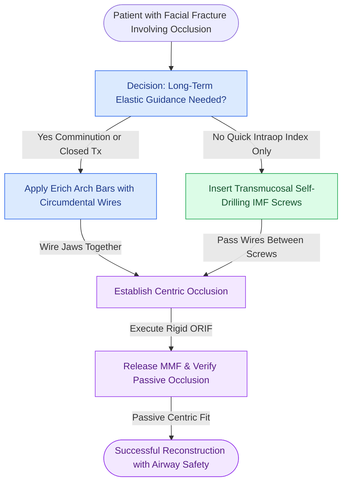

# Mandibulomaxillary fixation with arch bars or cortical screws establishes the central occlusal relationship

## Active Recall

> [!question]- Compare Erich arch bars with self-drilling IMF cortical screws regarding placement speed, tooth root safety, and postoperative elastic guidance.
> *Answer / Clinical Rationale*: 
> - **Placement Speed**: IMF screws are placed transmucosally in 10 to 15 minutes, whereas wiring Erich arch bars requires 45 to 60 minutes and carries significant sharps-injury risk.
> - **Tooth Root Safety**: Arch bars use circumdental wires around cervical crowns with zero risk of root injury. IMF screws carry a distinct risk of root transection and devitalization, requiring angled insertion into interradicular spaces apical to the mucogingival junction.
> - **Postoperative Guidance**: Arch bars allow multi-vector directional elastic traction for weeks postoperatively. IMF screws provide point-contact fixation, loosen within 2 to 3 weeks, and are indicated primarily for intraoperative occlusal indexing rather than prolonged traction.

> [!question]- What is the mandatory check performed immediately after completing rigid internal fixation before extubating the patient?
> *Answer / Clinical Rationale*: The surgeon must **release the MMF completely, manually mobilize the mandible, and inspect the occlusion**. The condyles must seat passively into the glenoid fossae, and the teeth must reproduce the patient's pre-traumatic centric occlusion with normal intercuspation and canine guidance without manual forcing. If premature dental contact, posterior open bite, or crossbite is present, hardware must be removed, occlusion re-registered in MMF, and plates re-applied.

## Core Clinical & Mechanistic Principles

In craniomaxillofacial surgery, the dental occlusion serves as the **foundational fiducial anchor** for facial skeletal reduction. Unlike other body regions where bone fragments are aligned by eye, facial fractures must be aligned so that the teeth intercuspate with microscopic precision. **Mandibulomaxillary Fixation (MMF)** temporarily locks the maxilla and mandible together into pre-morbid centric relation during operative reduction, enabling stable [[Primary contact bone healing requires absolute stability with interfragmentary strain under two percent|primary bone fixation]].

Techniques for establishing MMF:
1. **Erich Arch Bars**: The gold standard for stable, adaptable intermaxillary fixation. Secured with 24- or 26-gauge stainless steel wires looped around the cervical constriction of each tooth. Lug hooks allow multi-directional elastic guidance.
2. **IMF Cortical Bone Screws**: Rapid, minimally invasive system using $2.0	ext{ mm}$ self-drilling screws placed into maxillary and mandibular alveolar bone between tooth roots. Screws are connected with 24-gauge wire loops.
3. **Hybrid Arch Bars**: Pre-formed arch bar strips secured with self-drilling bone screws, combining the speed of IMF screws with the multi-tooth control of arch bars.
4. **Palatal Consideration**: If an unrecognized sagittal palatal fracture exists, applying MMF wedging the maxilla against the wider mandibular arch flares the hemipalates into a severe crossbite.

## Connected Concepts & Graph Traversal
- **Palatal Splay Prevention**: [[Sagittal palatal split fractures require transpalatal reduction prior to mandibulomaxillary fixation to prevent arch widening|Palatal Fracture Transverse Reduction]]
- **Panfacial Occlusal Step**: [[Panfacial fracture reconstruction proceeds from known stable peripheral buttresses to central occlusion|Panfacial Occlusal Anchoring]]
- **Mandibular Tension Banding**: [[Mandible fractures require anatomical reduction and load-sharing miniplate fixation along Champy lines of ideal osteosynthesis|Mandibular Tension Band & Load-Sharing]]
- **Maxillary Level I Fixation**: [[Le Fort I fractures separate the hard palate and require bilateral buttress plate fixation|Le Fort I Maxillary Buttress Fixation]]
- **Condylar Mobility Protection**: [[Mandibular condyle fractures managed via open versus closed reduction depend on displacement and occlusion|Condylar Fracture Management]]
