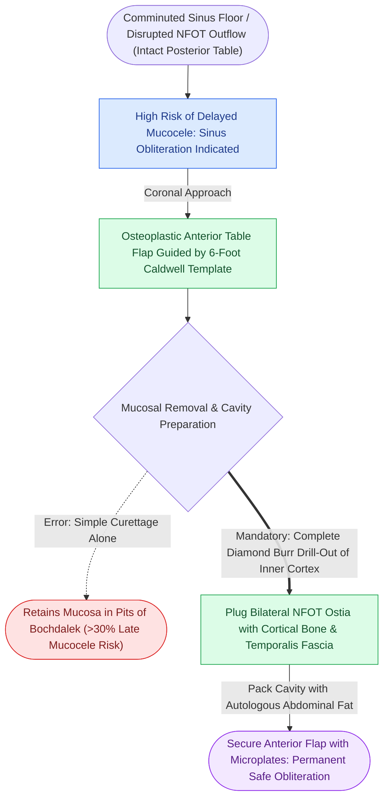

# Nasofrontal outflow tract injury with persistent obstruction mandates meticulous frontal sinus obliteration with autologous fat

## Active Recall

> [!question]- What clinical and radiological criteria indicate irreversible injury to the nasofrontal outflow tract (NFOT) necessitating sinus obliteration?
> *Answer / Clinical Rationale*: Irreversible NFOT injury is diagnosed when CT imaging demonstrates **fractures involving the medial floor of the frontal sinus**, comminution of the anterior ethmoid cells/frontal recess, or persistent non-clearing sinus fluid with endoscopic outflow blockage. Persistent obstruction leads invariably to **delayed frontal sinus mucocele or mucopyocele formation** (which can present 5 to 30 years post-injury with intracranial extension, orbital displacement, and bony erosion).

> [!question]- Detail the critical surgical steps required to successfully obliterate the frontal sinus and prevent late mucocele formation.
> *Answer / Clinical Rationale*: (1) Exposure via coronal flap and osteoplastic flap elevation under radiographic template guidance; (2) **Complete, meticulous exenteration of every scrap of sinus mucosa** using rotating diamond burs under continuous saline irrigation, drilling away the inner cortical surface into healthy bleeding bone to eradicate microscopic mucosal invaginations in the pits of Bochdalek; (3) Plugging the bilateral NFOT ostia with autologous cortical bone plugs, pericranium, or fascia; (4) Filling the entire sinus cavity with **autologous abdominal wall fat**; (5) Repositioning and rigid microplate fixation of the osteoplastic bone flap.

## Core Clinical & Mechanistic Principles

The frontal sinus is lined by ciliated pseudostratified columnar epithelium that continuously clears mucus through the narrow nasofrontal outflow tract into the frontal recess of the middle meatus. High-energy midface impact, particularly in conjunction with [[Type III nasoorbitoethmoidal fractures require transnasal canthopexy directed posterior and superior to the lacrimal crest|Type III NOE trauma]], shatters the delicate medial sinus floor.

Surgical tenets:
1. **Mucosal Invaginations**: Mucosa penetrates microscopic foramina in the anterior and posterior tables (the pits of Bochdalek). Simple curettage leaves mucosal remnants behind in $> 30\%$ of cases. Complete burring with diamond drills under magnification is mandatory.
2. **Packing Material**: Autologous subcutaneous abdominal fat is the standard filling material. Fat revascularizes rapidly, resists bacterial infection, and survives long-term without significant volume loss. Synthetic alloplastic materials (bone cement, hydroxyapatite, silastic) are contraindicated in post-traumatic obliteration due to catastrophic infection rates.
3. **Endoscopic Salvage**: In selected late outflow stenosis cases without acute comminution, modern endoscopic sinus techniques (such as Draf IIb or Draf III frontal sinusotomy) may provide an alternative to open obliteration.

## Connected Concepts & Graph Traversal
- **Anterior Table Restoration**: [[Isolated anterior table frontal sinus fractures require open reduction and microplate fixation for contour restoration|Anterior Table Fracture Fixation]]
- **Posterior Table Cranialization**: [[Comminuted posterior table frontal sinus fractures with dural lacerations mandate frontal sinus cranialization|Posterior Table Cranialization Doctrine]]
- **Endoscopic Outflow Rescue**: [[The frontal sinus rescue procedure utilizes a medially based middle turbinate mucosal flap to resurface denuded bone and prevent Draf IIb ostial restenosis|Frontal Sinus Rescue Procedure]]
- **Expanded Frontal Drainage**: [[Draf III modified Lothrop unites both frontal sinuses into a common cavity|Draf III Modified Lothrop]]
- **Bone Healing Doctrine**: [[Primary contact bone healing requires absolute stability with interfragmentary strain under two percent|Primary Bone Healing]]
