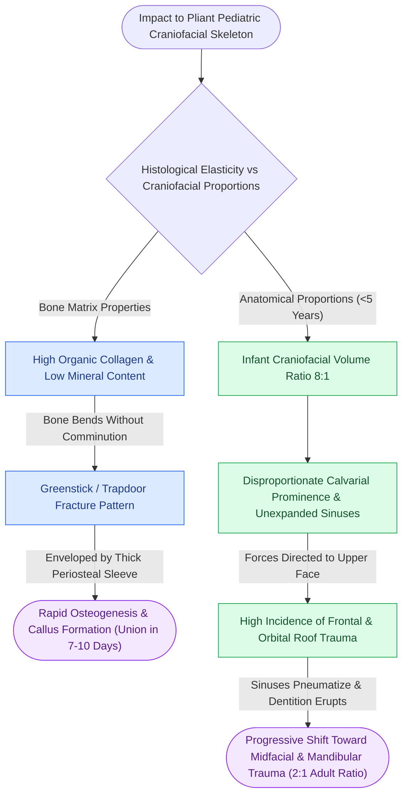

# Pediatric craniofacial fractures demonstrate high elasticity and greenstick patterns governed by thick osteogenic periosteum

## Active Recall

> [!question]- What histological and biomechanical properties distinguish pediatric facial bone from adult bone and account for greenstick fracture patterns?
> *Answer / Clinical Rationale*: Pediatric bone has **low mineral ash content, higher water and organic collagen matrix volume**, poorly pneumatized paranasal sinuses, open cranial sutures, and is enveloped by a **thick, highly vascular, active osteogenic periosteum**. These biomechanical characteristics make pediatric bone pliable and elastic. Under high-energy impact, pediatric bones bend and deform before failing, yielding incomplete cortical fractures (**greenstick fractures or trapdoor fractures**) rather than adult-style comminution.

> [!question]- How does the craniofacial volume ratio change from infancy to adulthood, and how does this shift fracture epidemiology in young children?
> *Answer / Clinical Rationale*: In infants and young children (< 5 years), the **cranium-to-face volume ratio is 8:1** (compared to 2:1 in adults). Because the cranium is disproportionately large and paranasal sinuses are unexpanded, traumatic forces impact the prominent frontal calvarium, orbital roofs, and skull base. As paranasal sinuses pneumatize and permanent dentition erupts, facial vertical height expands, shifting fracture patterns toward the midface and mandible in older children.

## Core Clinical & Mechanistic Principles

The growing skeleton possesses remarkable regenerative capacity governed by [[Secondary indirect bone healing proceeds through an enchondral cartilaginous callus under relative stability|osteogenic periosteal healing]]. The thick periosteal sleeve maintains fragment alignment and produces rapid callus formation within 7 to 10 days.

Clinical implications:
1. **Rapid Union Time**: Pediatric facial fractures heal at twice the rate of adult fractures. If open reduction is required, it must be performed within **4 to 7 days**, beyond which early bony consolidation occurs and necessitates osteotomy.
2. **Conservative Predilection**: Minimally displaced greenstick fractures of the mandible or midface without occlusal disturbance should be treated conservatively with a soft diet and close observation.
3. **Growth Disturbance Risk**: Trauma or aggressive surgical dissection directly involving craniofacial growth centers (e.g., condylar cartilage, nasal septal cartilage) can cause late facial asymmetry and retrognathia.

## Connected Concepts & Graph Traversal
- **Tooth Bud Preservation**: [[Fixation of pediatric mandibular fractures requires monocortical plates along the inferior basilar border to preserve developing tooth buds|Pediatric Mandibular Fixation]]
- **Condylar Remodeling**: [[Pediatric mandibular condyle fractures are managed with short-term functional mobilization to exploit biological remodeling and prevent ankylosis|Pediatric Condyle Remodeling]]
- **Trapdoor Trap Injury**: [[Pediatric white-eyed blowout fractures cause muscle entrapment requiring emergent surgical release|Pediatric White-Eyed Blowout]]
- **Resorbable Fixation**: [[Biodegradable copolymer osteosynthesis undergoes random hydrolytic scission eliminating hardware removal|Biodegradable Copolymer Osteosynthesis]]
- **Periosteal Perfusion**: [[Centripetal periosteal and centrifugal endosteal blood supplies preserve cortical bone viability|Periosteal Vascular Biology]]
