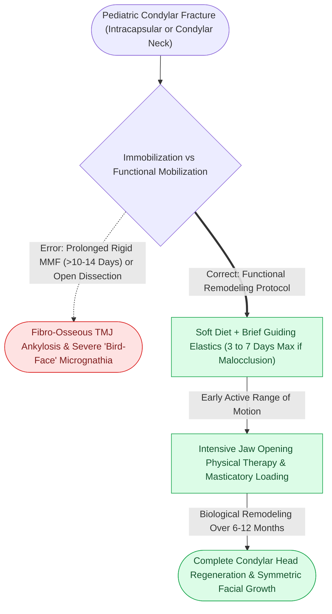

# Pediatric mandibular condyle fractures are managed with short-term functional mobilization to exploit biological remodeling and prevent ankylosis

## Active Recall

> [!question]- What biological mechanisms allow the pediatric mandibular condylar process to completely remodel following displaced fractures?
> *Answer / Clinical Rationale*: The pediatric condylar head houses a highly active **subarticular prechondroblastic proliferative cartilage layer** that functions as the primary regional growth center for mandibular vertical ramus height. In children younger than 12 years (especially < 6 years), fractured, displaced, or dislocated condylar heads possess extraordinary regenerative capacity: through functional joint stimulation, the displaced condylar stump undergoes gradual resorption while **neocartilage and bone regenerate a completely new, functional condylar process** that matches the opposite side.

> [!question]- Why is prolonged rigid mandibulomaxillary fixation (MMF) strictly avoided in pediatric condylar trauma, and what functional protocol is utilized?
> *Answer / Clinical Rationale*: Prolonged rigid MMF (> 7 to 10 days) leads to organizing hemarthrosis, articular cartilage degradation, fibrous ankylosis, and ultimately **devastating bony temporomandibular joint (TMJ) ankylosis** with severe retrognathia and facial asymmetry. Management centers on **functional mobilization**: a brief period (3 to 7 days) of soft diet or guiding elastics, followed immediately by active jaw exercises and physical therapy to stimulate vertical bone remodeling and maintain mouth opening.

## Core Clinical & Mechanistic Principles

The pediatric condyle responds to functional masticatory loading. Avoiding prolonged [[Mandibulomaxillary fixation with arch bars or cortical screws establishes the central occlusal relationship|mandibulomaxillary immobilization]] is the golden rule of pediatric temporomandibular trauma.

Key clinical principles:
1. **Rare Indications for ORIF in Children**: Open reduction of condylar fractures in young children is almost never indicated due to the risk of vascular disruption to the growth center and surgical scar contracture. ORIF is restricted to teenagers with mature adult-like condylar anatomy or severe mechanical mechanical blocking of opening.
2. **Post-Traumatic Chin Impact**: A classic pitfall is a laceration on the chin following a fall from a bicycle or playground: always evaluate the bilateral condylar processes for intracapsular crush injuries.
3. **Follow-Up Duration**: Pediatric condylar fractures require serial clinical and cephalometric follow-up until skeletal maturity to ensure symmetrical facial growth.

## Connected Concepts & Graph Traversal
- **Adult Condylar Approaches**: [[The preauricular and retromandibular approaches provide surgical access to condylar fractures while protecting the facial nerve|Adult Condylar Surgical Approaches]]
- **Endoscopic Condylar Repair**: [[Endoscopic-assisted transoral reduction of condylar neck fractures avoids external facial nerve dissection|Endoscopic Condylar Reduction]]
- **Pediatric Elasticity**: [[Pediatric craniofacial fractures demonstrate high elasticity and greenstick patterns governed by thick osteogenic periosteum|Pediatric Craniofacial Elasticity]]
- **Tooth Bud Preservation**: [[Fixation of pediatric mandibular fractures requires monocortical plates along the inferior basilar border to preserve developing tooth buds|Pediatric Mandibular Fixation]]
- **Callus Remodeling Biology**: [[Secondary indirect bone healing proceeds through an enchondral cartilaginous callus under relative stability|Secondary Indirect Bone Healing]]
