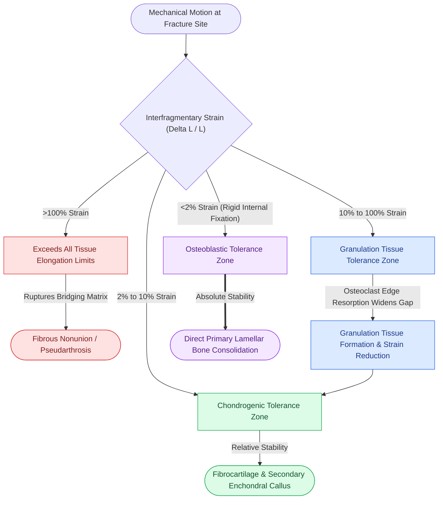

# Perren strain theory dictates tissue differentiation and mechanical thresholds for osteogenesis

## Active Recall

> [!question]- State the mathematical definition of interfragmentary strain and explain the biological tissue tolerance limits established by Perren.
> *Answer / Clinical Rationale*: Interfragmentary strain is defined as relative displacement under load divided by the initial gap width. Perren's strain theory states that **a specific tissue can only form within a fracture gap if the mechanical strain remains below that tissue's elongation-to-rupture threshold**:
> - **Granulation tissue**: Tolerates up to **100% strain**.
> - **Fibrocartilage (Soft Callus)**: Tolerates up to **10% to 15% strain**.
> - **Woven and Lamellar Bone**: Ruptures if strain exceeds **2%**.
> Therefore, rigid internal fixation must suppress motion so that strain is $< 2\%$, allowing direct osteoblastic bone formation.

> [!question]- Why does resorption of fracture fragment ends paradoxically reduce mechanical strain in an unstable fracture?
> *Answer / Clinical Rationale*: In an unstable fracture with micro-motion, if the initial gap width is tiny (e.g., $0.1	ext{ mm}$) and motion is $0.05	ext{ mm}$, the strain is an intolerable $50\%$. Osteoclasts resorb bone along the fracture edges, widening the gap from $0.1	ext{ mm}$ to $1.0	ext{ mm}$. If the motion remains $0.05	ext{ mm}$, the new strain drops to 5%. This biological resorption widens the denominator, dropping strain into the fibrocartilaginous tolerance zone ($< 10\%$) to enable soft callus bridging.

## Core Clinical & Mechanistic Principles

Stephan Perren's **interfragmentary strain hypothesis** revolutionized internal fixation by providing a mechanical foundation for tissue differentiation during fracture repair. The theory resolves the apparent paradox of why narrow fracture gaps can fail to heal if they are not rigidly immobilized: as the gap gets smaller, even minute absolute displacement produces catastrophic percentage strain. Clamping this motion requires [[Primary contact bone healing requires absolute stability with interfragmentary strain under two percent|absolute mechanical stability]].

In craniomaxillofacial trauma, Perren's strain theory dictates hardware selection:
- In linear non-comminuted fractures with interdigitating bone ends, lag screw compression or tension-band miniplates compress bone surfaces, driving displacement toward zero and keeping strain well under $2\%$.
- In comminuted fractures or bone defects, bone ends cannot contact each other. Without bone support, masticatory loads create large displacement; thus, high-profile **load-bearing reconstruction plates** are required to stiffen the construct and maintain strain $< 2\%$ across the gap.

## Connected Concepts & Graph Traversal
- **Interfragmentary Compression**: [[The lag screw principle generates interfragmentary compression by engaging solely the distal cortex|The Lag Screw Principle]]
- **Indirect Callus Dynamics**: [[Secondary indirect bone healing proceeds through an enchondral cartilaginous callus under relative stability|Secondary Indirect Bone Healing Cascade]]
- **Rigid Fixation Architecture**: [[Locking internal fixator plates preserve periosteal microvascular perfusion without frictional bone compression|Locking Internal Fixator Technology]]
- **Load-Sharing Osteosynthesis**: [[Load-sharing fixation relies on anatomically interlocked bone fragments to share compressive masticatory forces|Load-Sharing Osteosynthesis Mechanics]]
- **Atrophic Mandible Load-Bearing**: [[Severely atrophic edentulous mandible fractures classified by Luhr mandate load-bearing reconstruction plate fixation|Atrophic Mandible Reconstruction Plating]]
