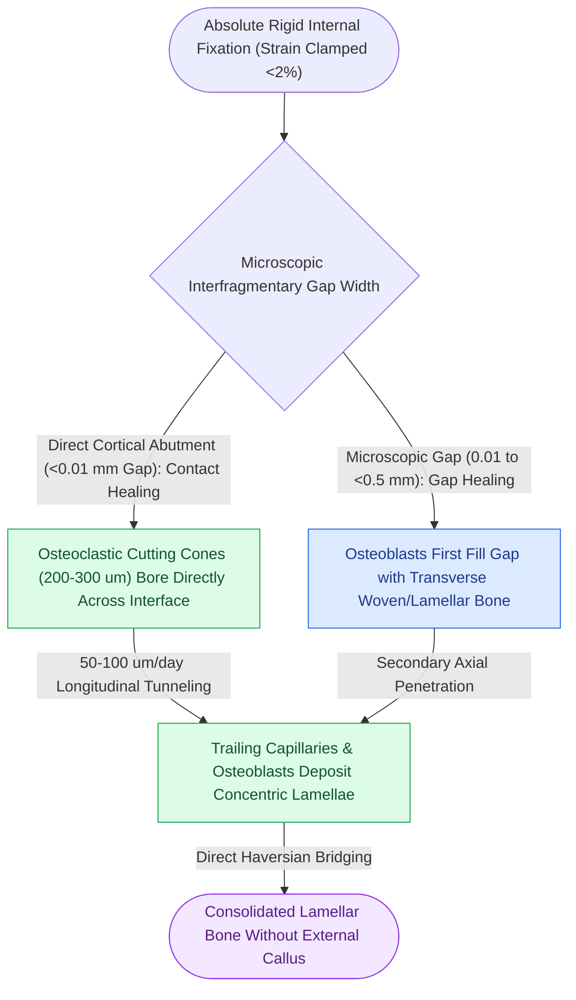

# Primary contact bone healing requires absolute stability with interfragmentary strain under two percent

## Active Recall

> [!question]- What mechanical and biological conditions are mandatory to achieve primary contact bone healing across a fracture gap?
> *Answer / Clinical Rationale*: Primary contact healing mandates **absolute stability** where interfragmentary strain is strictly below **2%** with zero macroscopic motion, combined with viable capillary perfusion. Under these conditions, osteoclasts form cutting cones that bore longitudinal channels across the fracture line, immediately followed by endothelial buds and osteoblasts laying down concentric lamellar Haversian systems without intermediate cartilaginous or periosteal callus.

> [!question]- Why does a microscopic movement of 0.1 mm in a 0.2 mm fracture gap prevent primary bone formation according to Perren strain theory?
> *Answer / Clinical Rationale*: Interfragmentary strain is defined as relative displacement divided by gap width ($\epsilon = \Delta L / L$). A $0.1\text{ mm}$ displacement across a narrow $0.2\text{ mm}$ gap generates **50% strain**. Because lamellar and woven bone rupture at strain exceeding $2\%$, bone tissue cannot survive in this mechanical environment; the gap fills with granulation tissue or fibrocartilage, precipitating fibrous nonunion unless absolute stability is established.

## Core Clinical & Mechanistic Principles

Bone healing in the craniomaxillofacial skeleton occurs along a biological spectrum determined by the mechanical stability of the **[[Mandible fractures require anatomical reduction and load-sharing miniplate fixation along Champy lines of ideal osteosynthesis|bone-implant construct]]**. While long bones frequently heal via secondary callus formation under relative stability, rigid internal fixation (RIF) in the facial skeleton aims to produce **primary bone healing** to ensure exact anatomical alignment, prevent occlusal shifts, and allow immediate masticatory mobilization.

Primary healing is bifurcated into two distinct microscopic modes depending on fragment intimacy:
1. **Contact Healing**: Where cortical surfaces are in direct microscopic abutment ($< 0.01\text{ mm}$ gap). Cylindrical osteoclastic cutting cones (diameter $200\text{--}300\ \mu\text{m}$) advance directly across the fracture interface at a rate of $50\text{--}100\ \mu\text{m}/\text{day}$, drilling longitudinal tunnels that span the fracture. Trailing capillary loops and perivascular osteoprogenitor cells follow immediately, depositing concentric osteoid lamellae to construct mature Haversian systems spanning both fragments.
2. **Gap Healing**: Where absolute stability is achieved across a microscopic gap ($< 0.5\text{ mm}$). Osteoblasts first fill the space with transversely oriented woven and lamellar bone. Once stabilized, longitudinal cutting cones penetrate and remodel this transverse bone into axially oriented Haversian osteons.

In contrast to secondary healing, primary bone healing produces **zero external periosteal or endochondral callus**. Rigid fixation prevents the cellular hypoxia and cyclic shearing forces that trigger chondrogenesis. Consequently, radiologic healing is characterized by the gradual disappearance of the radiolucent fracture line without prominent callus shadows.

## Connected Concepts & Graph Traversal
- **Perren Strain Thresholds**: [[Perren strain theory dictates tissue differentiation and mechanical thresholds for osteogenesis|Perren Strain Theory (<2% Strain)]]
- **Secondary Callus Contrast**: [[Secondary indirect bone healing proceeds through an enchondral cartilaginous callus under relative stability|Secondary Indirect Bone Healing]]
- **Interfragmentary Compression**: [[The lag screw principle generates interfragmentary compression by engaging solely the distal cortex|The Lag Screw Principle]]
- **🔗 Rigid Frame Architecture (FPRS)**: [[Zygomaticomaxillary complex fractures disrupt four buttress articulations requiring multi-point reduction|ZMC Multi-Point Rigid Fixation]]
- **Surgical Occlusion Alignment**: [[Le Fort I fractures separate the hard palate and require bilateral buttress plate fixation|Le Fort I Maxillary Buttress Fixation]]
